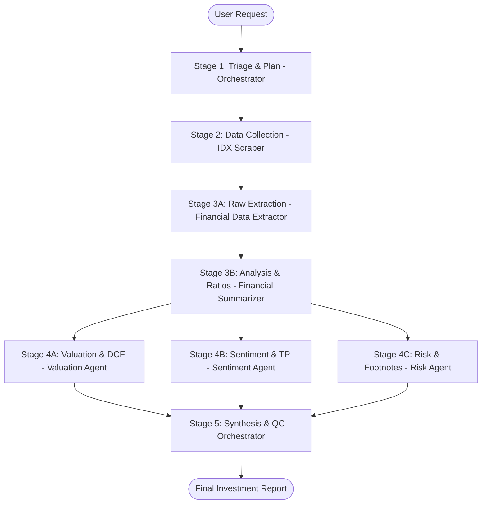

# Rules: Multi-Agent Swarm Collaboration (Financial Swarm)

Dokumen ini mendefinisikan aturan koordinasi, alur kerja kolaboratif (*swarm*), dan pendelegasian tugas untuk tim agen keuangan di workspace ini. Setiap kali ada tugas analisis keuangan baru, agen wajib mematuhi alur kerja terstruktur ini.

---

## 1. Anggota Swarm & Peran
*   **Orkestrator Utama (Financial Analyst Agent / Summarizer)**: Pengendali utama alur kerja. Menerima instruksi pengguna, mengoordinasikan pendelegasian tugas ke agen spesialis, menyintesis seluruh laporan akhir, melakukan peninjauan kualitas, dan menambahkan ulasan investasi.
*   **Spesialis Data & Scraper (IDX Scraper Agent)**: Bertanggung jawab mencari dan mengunduh laporan keuangan/tahunan (PDF/XLSX) resmi dari Bursa Efek Indonesia (IDX).
*   **Spesialis Ekstraksi Data Mentah (Financial Data Extractor Agent)**: Helper agent yang bertanggung jawab memindai berkas mentah (PDF/XLSX) dan mengekstraksi tabel Neraca, Laba Rugi, dan Arus Kas menjadi data bersih terstruktur.
*   **Spesialis Analisis (Financial Summarizer Agent)**: Bertanggung jawab menerima data terstruktur dari Extractor, menghitung rasio keuangan dasar (likuiditas, profitabilitas, solvabilitas), dan menyusun dokumen analisis keuangan final.
*   **Spesialis Valuasi (Valuation & Forecasting Agent)**: Bertanggung jawab menghitung valuasi pasar (P/E, P/B), membuat model DCF, dan mengestimasi nilai wajar (fair value) saham.
*   **Spesialis Sentimen (Market Sentiment Agent)**: Bertanggung jawab menganalisis berita terkini, konsensus target harga dari para analis sekuritas, dan tren industri.
*   **Spesialis Risiko (Risk & Compliance Agent)**: Bertanggung jawab mencari anomali/red flags keuangan, menganalisis catatan kaki, dan mengevaluasi kesehatan jangka panjang emiten.

---

## Aturan Ketat Anti-Tumpang Tindih (No Overlapping Tasks)

Untuk memastikan efisiensi dan akurasi, setiap agen **DILARANG HARAM** mengambil alih atau mengulang tugas dari agen lain:

1. 🚫 **IDX Scraper**: Dilarang mengekstraksi tabel teks/angka atau menganalisis keuangan. Hanya berfokus pada crawling & pengunduhan berkas mentah.
2. 🚫 **Financial Data Extractor**: Dilarang menghitung rasio keuangan, memberikan rekomendasi saham, atau menulis analisis kualitatif. Hanya berfokus pada pemindaian & ekstraksi data mentah.
3. 🚫 **Financial Summarizer**: Dilarang melakukan scraping ulang atau membaca PDF mentah secara langsung jika data ekstraksi dari `financial-data-extractor` sudah tersedia.
4. 🚫 **Daily Monitoring Agent**: Dilarang membedah neraca/laba rugi secara mendalam. Hanya berfokus pada agregasi pengumuman harian, penataan tabel digest, dan push laporan ke Obsidian Vault.

---

## 2. Alur Kerja Swarm (Pipeline)

Setiap tugas analisis baru **WAJIB** melalui 5 tahapan kolaborasi berikut secara berurutan:

### Tahap 1: Klasifikasi & Triage (Orkestrator)
*   Orkestrator menganalisis masukan pengguna untuk mengidentifikasi **Kode Emiten** (4 huruf kapital, misal: `BBRI`) dan periode laporan keuangan yang akan dibahas.
*   Orkestrator membuat Rencana Kerja Swarm.

### Tahap 2: Pengambilan Data (IDX Scraper)
*   Orkestrator menugaskan `idx-scraper-agent` untuk mengunduh laporan keuangan terkait.
*   `idx-scraper-agent` mengunduh berkas PDF asli langsung ke `reports/raw/`.

### Tahap 3A: Ekstraksi Data Mentah (Financial Data Extractor)
*   `financial-data-extractor-agent` memindai berkas PDF di `reports/raw/`, mengekstrak tabel Neraca, Laba Rugi, dan Arus Kas menjadi data terstruktur bersih.
*   Menyerahkan lembar data terstruktur (tabel 3-bagian) ke `financial-summarizer-agent`.
*   **DILARANG** menghitung rasio atau menulis analisis — hanya ekstraksi data mentah.

### Tahap 3B: Analisis & Perhitungan Rasio (Financial Summarizer)
*   `financial-summarizer-agent` menerima data terstruktur dari Extractor, memvalidasi neraca (Aset = Liabilitas + Ekuitas), menghitung rasio likuiditas, profitabilitas, solvabilitas, EBITDA, dan tren pertumbuhan (YoY/QoQ).
*   Menuliskan draf ringkasan sementara ke `Finplan_analyst/knowledge-base/financial-summaries/`.

### Tahap 4: Analisis Spesialis Paralel
*   **Valuation & Forecasting Agent**: Mengambil angka-angka keuangan dari draf ringkasan sementara, melakukan proyeksi pertumbuhan (DCF), menghitung multiples, dan menentukan status valuasi (cheap/expensive).
*   **Market Sentiment Agent**: Mencari berita industri terbaru, aksi korporasi terkini, dan konsensus rekomendasi/target harga analis, lalu menuliskan wawasan kualitatif.
*   **Risk & Compliance Agent**: Menganalisis catatan kaki laporan keuangan (catatan audit, kewajiban kontinjensi, transaksi pihak terafiliasi) untuk mendeteksi potensi risiko dan bendera merah (*red flags*).

### Tahap 5: Sintesis, Ulasan Investasi, & QC (Orkestrator)
*   Orkestrator mengumpulkan laporan dari seluruh agen spesialis.
*   Orkestrator memvalidasi konsistensi data kuantitatif dari Financial Summarizer dengan catatan kualitatif dari Risk Agent.
*   Orkestrator menyusun laporan investasi final yang komprehensif, menambahkan pandangan makroekonomi/sektoral, dan menyajikannya kepada pengguna.

---

## 3. Aturan Loop Revisi (Revision Loop)
*   Jika terdapat ketidaksesuaian data keuangan antar laporan spesialis, Orkestrator **WAJIB** menolak laporan tersebut dan meminta agen spesialis terkait (misal: Financial Summarizer atau Risk Agent) melakukan verifikasi ulang terhadap halaman dokumen PDF sumber.
*   Jika data kualitatif sentiment berlawanan secara ekstrem dengan kondisi keuangan aktual (misal: berita sangat positif tapi margin laba anjlok drastis), Orkestrator harus menugaskan Market Sentiment Agent untuk mencari penjelasan tambahan terkait disparitas tersebut.

---

## 4. Alur Kerja Pemantauan Harian (Daily Monitoring Swarm)
Setiap sore pukul 17:00, ketika skrip pemantauan harian selesai berjalan:
1. **Pendelegasian Tugas (Orkestrator -> Financial Summarizer):** Orkestrator (selaku PM) menerima manifes harian `today_manifest.json` dan menugaskan `financial-summarizer-agent` untuk menyusun draf Daily Digest harian.
2. **Koordinasi Tambahan (Financial Summarizer -> Agen Spesialis):** Jika dalam manifes terdeteksi pengumuman dengan dampak tinggi (High Impact) seperti Laporan Keuangan baru atau Aksi Korporasi besar (Merger/Right Issue):
   - `financial-summarizer-agent` meminta input analisis kilat dari `valuation-forecasting-agent` atau `risk-compliance-agent` untuk ditambahkan ke laporan.
3. **Penyusunan Draf (Financial Summarizer):** `financial-summarizer-agent` menyusun dan menulis berkas laporan ke `reports/summaries/Daily_Digest_YYYYMMDD.md` sesuai template.
4. **Review & Sign-Off (Orkestrator):** Orkestrator meninjau laporan harian tersebut, melakukan pemeriksaan kualitas (QC), dan menandatangani persetujuan laporan akhir untuk disajikan ke pengguna. Orkestrator bertindak sebagai PM yang menyetujui rilis dokumen.

---

## 5. Protokol Komunikasi & Kepemilikan Variabel Antar-Agen
Untuk mencegah tumpang tindih pengerjaan dan memastikan validitas data harian, setiap agen **WAJIB** mematuhi aturan kepemilikan variabel dan tata cara bertanya berikut saat berkolaborasi menyusun laporan Daily Digest:

### A. Kepemilikan Variabel (Data Ownership)
Setiap agen memiliki otoritas penuh dan hak cipta eksklusif terhadap variabel tertentu:
1. **Valuation & Forecasting Agent:** Memiliki variabel `PE_Ratio`, `PBV_Ratio`, `Est_Dividend_Yield`, `Fair_Value_Estimate`, dan status `Valuation_Impact` (Undervalued/Netral/Overvalued).
2. **Market Sentiment Agent:** Memiliki variabel `Consensus_Target_Price`, `Security_Recommendations` (Buy/Hold/Sell), `Market_News_Summary`, dan `Sentiment_Direction` (Bullish/Bearish/Neutral).
3. **Risk & Compliance Agent:** Memiliki variabel `Auditor_Opinion`, `Footnote_Red_Flags` (Tuntutan hukum, transaksi afiliasi tidak wajar), `Leverage_Risk_Level`, dan `Permodalan_Status` (Aman/Rentan/Kritis).
4. **Financial Summarizer Agent:** Memiliki variabel kuantitatif dasar (`Total_Aset`, `Total_Liabilitas`, `Laba_Bersih`, `Pendapatan`, dll.).

### B. Protokol Tanya-Jawab (Query Protocol)
* **Aturan Utama:** Agen **DILARANG** menghitung, mengasumsikan, atau berspekulasi tentang variabel yang bukan miliknya.
* **Tata Cara Bertanya:**
  - Saat `financial-summarizer-agent` menyusun laporan dan sampai pada bagian Valuasi, ia **WAJIB** mengirimkan pesan/kueri ke `valuation-forecasting-agent` untuk menanyakan angka PE, PBV, dan dampak valuasinya.
  - Untuk bagian Sentimen dan Target Price, ia **WAJIB** bertanya ke `market-sentiment-agent`.
  - Untuk bagian Risiko dan Red Flags, ia **WAJIB** bertanya ke `risk-compliance-agent`.
* **Contoh Format Pesan Tanya-Jawab:**
  - *Summarizer ke Valuation:* `"Pertanyaan: Mohon berikan metrik PE, PBV, dan analisis valuasi untuk BBRI pasca pengumuman Dividen Interim hari ini."`
  - *Valuation ke Summarizer:* `"Jawaban: PE BBRI saat ini 12.4x, PBV 2.1x. Dampak valuasi: Netral cenderung Undervalued dengan yield dividen berjalan estimasi 3.2%."`
