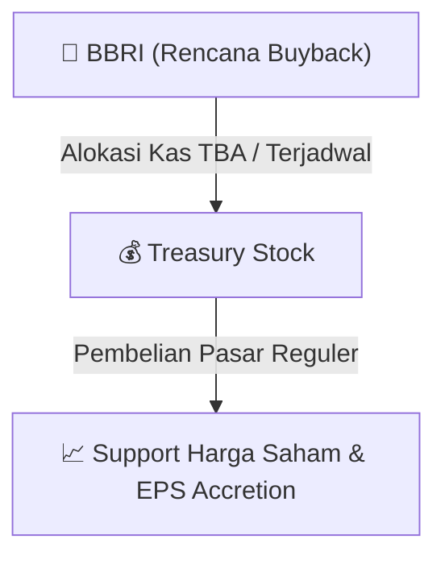

# ⚡ Laporan Intelijen Aksi Korporasi: [[BBRI]] - Buyback

⬅️ [[knowledge-base/daily-digests/Daily_Digest_20260915|Kembali ke Daily Digest]] | 📅 **2026-09-15** | 🎛️ [[Dashboard|Ke Dashboard Utama]]

> [!IMPORTANT]
> Laporan ini disusun secara otomatis oleh **Corporate Action Intelligence Agent** untuk memetakan implikasi strategis, rasio keuangan, alokasi dana, jadwal penting, dan panduan investor.

---

## 📌 1. Ringkasan Eksekutif & Katalis Strategis
- **Kode & Nama Emiten**: `[[BBRI]]`
- **Kategori Aksi Korporasi**: `Buyback`
- **Dokumen Resmi Bursa**: `Laporan Informasi dan Fakta Material`
- **Ringkasan Inti Aksi**: PT Bank Rakyat Indonesia (Persero) Tbk melaporkan pelaksanaan pembelian kembali saham (buyback) yang telah selesai pada periode yang berakhir, dengan tanggal kejadian 11 September 2026. Tidak ada dampak material negatif terhadap kegiatan operasional, hukum, kondisi keuangan, atau kelangsungan usaha perusahaan.

---

## 📊 2. Matriks Parameter Material & Angka Kunci
| Parameter Utama | Nilai / Keterangan Resmi |
| :--- | :--- |
| **Tanggal Kejadian** | `2026-09-11` |
| **Jenis Informasi** | `Pelaksanaan Pembelian Kembali Saham` |
| **Periode Buyback** | `Berakhir` |
| **Dampak Material Negatif** | `Tidak ada` |
| **Tanggal Pelaporan** | `2026-09-15` |

---

## 🛍️ 3. Parameter Utama Rencana Buyback Saham
- **Alokasi Dana Maksimum**: `TBA / Terjadwal`
- **Maksimum Saham yang Dibeli**: `TBA / Maksimum 10%`
- **Batas Harga Pelaksanaan**: `Harga Pasar Reguler`
- **Metode Pelaksanaan**: Melalui perdagangan saham di Pasar Reguler Bursa Efek Indonesia (BEI).

## 📈 4. Visualisasi Mekanisme Buyback

## 💡 5. Panduan Strategi Investor (Stock Support & Value Play)
- 🟢 **Sinyal Kepercayaan Manajemen**: Aksi *buyback* oleh [[BBRI]] menandakan manajemen menilai harga saham saat ini *undervalued*.
- 🛡️ **Penopang Harga (*Price Floor*)**: Dana *buyback* berfungsi menahan penurunan harga di pasar reguler, meningkatkan *Earnings Per Share* (EPS) pasca pencatatan *treasury stock*.

---

## 🔗 Hubungan Note Terkait (Knowledge Graph)
- [[knowledge-base/daily-digests/Daily_Digest_20260915|📄 Daily Digest 2026-09-15]]
- [[knowledge-base/trading-signals/Trading_Signals_20260915|🎯 Sinyal Cuan 2026-09-15]]
- [[Dashboard|🎛️ Kembali ke Dashboard]]