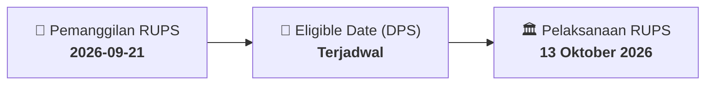

# ⚡ Laporan Intelijen Aksi Korporasi: [[BTPS]] - RUPS

⬅️ [[knowledge-base/daily-digests/Daily_Digest_20260921|Kembali ke Daily Digest]] | 📅 **2026-09-21** | 🎛️ [[Dashboard|Ke Dashboard Utama]]

> [!IMPORTANT]
> Laporan ini disusun secara otomatis oleh **Corporate Action Intelligence Agent** untuk memetakan implikasi strategis, rasio keuangan, alokasi dana, jadwal penting, dan panduan investor.

---

## 📌 1. Ringkasan Eksekutif & Katalis Strategis
- **Kode & Nama Emiten**: `[[BTPS]]`
- **Kategori Aksi Korporasi**: `RUPS`
- **Dokumen Resmi Bursa**: `Pemanggilan RUPS lamp8`
- **Ringkasan Inti Aksi**: PT Bank BTPN Syariah Tbk (BTPS) akan menyelenggarakan RUPS Luar Biasa pada 13 Oktober 2026. Agenda utama adalah persetujuan rencana pembelian kembali saham (buyback) dengan nilai nominal saham yang dibeli kembali tidak melebihi 10% dari modal ditempatkan dan biaya maksimum Rp1.000.000.000.000, serta pemberian kuasa kepada Direksi untuk melaksanakan buyback termasuk menentukan harga pembelian kembali.

---

## 📊 2. Matriks Parameter Material & Angka Kunci
| Parameter Utama | Nilai / Keterangan Resmi |
| :--- | :--- |
| **Agenda RUPS** | `Persetujuan atas Rencana Pembelian Kembali Saham (Buyback) Perseroan` |
| **Batas maksimum saham yang dibeli kembali** | `Tidak melebihi 10% dari jumlah modal yang ditempatkan dalam Perseroan` |
| **Batas biaya buyback** | `Sebanyak-banyaknya Rp1.000.000.000.000 (satu triliun rupiah), termasuk biaya perantara pedagang efek dan biaya lain terkait buyback` |
| **Pemberian kuasa kepada Direksi** | `Direksi berwenang melaksanakan tindakan yang diperlukan terkait buyback, termasuk menentukan harga pembelian kembali saham` |
| **Tanggal RUPS Luar Biasa** | `13 Oktober 2026` |
| **Jenis dokumen** | `Formulir Pertanyaan RUPS Luar Biasa` |

---

## 📌 3. Detail Pelaksanaan RUPS / RUPSLB
- **Hari, Tanggal Pelaksanaan**: `13 Oktober 2026`
- **Waktu Pelaksanaan**: `09.00 WIB s.d. selesai`
- **Lokasi / Tempat Pelaksanaan**: `Aplikasi eASY.KSEI / Kantor Perseroan`
- **Batas Hak Suara (Eligible Date / Recording Date)**: `Terjadwal`

## 📝 4. Matriks Agenda & Mata Acara Rapat
| No | Agenda / Mata Acara | Penjelasan & Sub-Acara |
| :-: | :--- | :--- |
| 1 | **Agenda RUPS** | Persetujuan atas Rencana Pembelian Kembali Saham (Buyback) Perseroan |

## 🗓️ 5. Timeline Investor & Ketentuan Kehadiran

## 💡 6. Panduan Investor & E-Voting
- 👥 **Hak Suara**: Pemegang saham yang berhak hadir/memberikan suara adalah yang terdaftar dalam DPS pada **Eligible Date (Terjadwal)**.
- 🗳️ **E-Voting eASY.KSEI**: Pemegang saham dapat memberikan kuasa/suara secara elektronik melalui sistem eASY.KSEI.

---

## 🔗 Hubungan Note Terkait (Knowledge Graph)
- [[knowledge-base/daily-digests/Daily_Digest_20260921|📄 Daily Digest 2026-09-21]]
- [[knowledge-base/trading-signals/Trading_Signals_20260921|🎯 Sinyal Cuan 2026-09-21]]
- [[Dashboard|🎛️ Kembali ke Dashboard]]