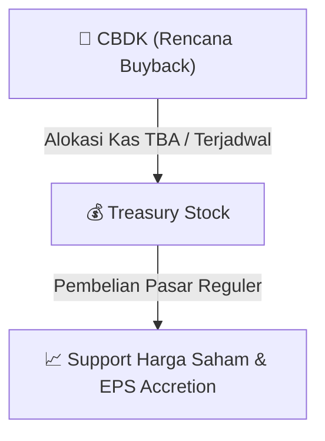

# ⚡ Laporan Intelijen Aksi Korporasi: [[CBDK]] - Buyback

⬅️ [[knowledge-base/daily-digests/Daily_Digest_20260819|Kembali ke Daily Digest]] | 📅 **2026-08-19** | 🎛️ [[Dashboard|Ke Dashboard Utama]]

> [!IMPORTANT]
> Laporan ini disusun secara otomatis oleh **Corporate Action Intelligence Agent** untuk memetakan implikasi strategis, rasio keuangan, alokasi dana, jadwal penting, dan panduan investor.

---

## 📌 1. Ringkasan Eksekutif & Katalis Strategis
- **Kode & Nama Emiten**: `[[CBDK]]`
- **Kategori Aksi Korporasi**: `Buyback`
- **Dokumen Resmi Bursa**: `Laporan Informasi dan Fakta Material`
- **Ringkasan Inti Aksi**: PT Bangun Kosambi Sukses Tbk menyampaikan laporan pelaksanaan pembelian kembali saham untuk periode 20 Mei 2026 sampai dengan 19 Agustus 2026, sesuai dengan rencana yang diumumkan sebelumnya melalui surat No 067/PIK2-CBDK/BEI/CORSEC/V/2026 tanggal 19 Mei 2026.

---

## 📊 2. Matriks Parameter Material & Angka Kunci
| Parameter Utama | Nilai / Keterangan Resmi |
| :--- | :--- |
| **Periode Pembelian Kembali Saham** | `20 Mei 2026 - 19 Agustus 2026` |
| **Tanggal Kejadian** | `19 Agustus 2026` |
| **Referensi Surat Rencana Buyback** | `No 067/PIK2-CBDK/BEI/CORSEC/V/2026 tanggal 19 Mei 2026` |
| **Nama Pengirim** | `Yohanes Edmond Budiman` |
| **Bidang Usaha** | `Real Estat dan Aktivitas Perusahaan Holding` |
| **Email Perusahaan** | `corporate.secretary@cbdpik2.com` |

---

## 🛍️ 3. Parameter Utama Rencana Buyback Saham
- **Alokasi Dana Maksimum**: `TBA / Terjadwal`
- **Maksimum Saham yang Dibeli**: `TBA / Maksimum 10%`
- **Batas Harga Pelaksanaan**: `Harga Pasar Reguler`
- **Metode Pelaksanaan**: Melalui perdagangan saham di Pasar Reguler Bursa Efek Indonesia (BEI).

## 📈 4. Visualisasi Mekanisme Buyback

## 💡 5. Panduan Strategi Investor (Stock Support & Value Play)
- 🟢 **Sinyal Kepercayaan Manajemen**: Aksi *buyback* oleh [[CBDK]] menandakan manajemen menilai harga saham saat ini *undervalued*.
- 🛡️ **Penopang Harga (*Price Floor*)**: Dana *buyback* berfungsi menahan penurunan harga di pasar reguler, meningkatkan *Earnings Per Share* (EPS) pasca pencatatan *treasury stock*.

---

## 🔗 Hubungan Note Terkait (Knowledge Graph)
- [[knowledge-base/daily-digests/Daily_Digest_20260819|📄 Daily Digest 2026-08-19]]
- [[knowledge-base/trading-signals/Trading_Signals_20260819|🎯 Sinyal Cuan 2026-08-19]]
- [[Dashboard|🎛️ Kembali ke Dashboard]]