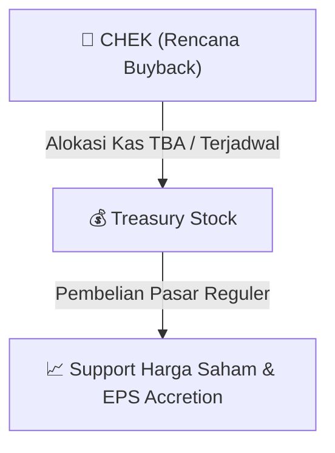

# ⚡ Laporan Intelijen Aksi Korporasi: [[CHEK]] - Buyback

⬅️ [[knowledge-base/daily-digests/Daily_Digest_20260918|Kembali ke Daily Digest]] | 📅 **2026-09-18** | 🎛️ [[Dashboard|Ke Dashboard Utama]]

> [!IMPORTANT]
> Laporan ini disusun secara otomatis oleh **Corporate Action Intelligence Agent** untuk memetakan implikasi strategis, rasio keuangan, alokasi dana, jadwal penting, dan panduan investor.

---

## 📌 1. Ringkasan Eksekutif & Katalis Strategis
- **Kode & Nama Emiten**: `[[CHEK]]`
- **Kategori Aksi Korporasi**: `Buyback`
- **Dokumen Resmi Bursa**: `Laporan Informasi dan Fakta Material`
- **Ringkasan Inti Aksi**: Informasi dan fakta material CHEK: 139/DIR/DB/IX/2026 PT Diastika Biotekindo Tbk CHEK 1 Laporan Informasi atau Fakta Material terkait Realisasi dan Penyelesaian Transaksi Pembelian Kembali Saham (Buyback) Tahun 2026 PT Diastika Biotekindo Tbk Dengan ini kami untuk dan atas menyampaikan Laporan Informasi atau Fakta Material sebagai berikut: Nama Emiten atau Perusahaan Publik PT Diastika Biotekindo Tbk Bidang Usaha Distributor Alat Kesehatan Telepon (021)38865038 Faksimili (021)4754707 Alamat Surat Elektronik (email) corpsec@diasti

---

## 📊 2. Matriks Parameter Material & Angka Kunci
| Parameter Utama | Nilai / Keterangan Resmi |
| :--- | :--- |
| **Uraian Kejadian** | `139/DIR/DB/IX/2026 PT Diastika Biotekindo Tbk CHEK 1 Laporan Informasi atau Fakta Material terkait Realisasi dan Penyelesaian Transaksi Pembelian Kembali Saham (Buyback) Tahun 2026 PT Diastika Biotekindo Tbk Dengan ini kami untuk dan atas menyampaikan Laporan Informasi atau Fakta Material sebagai berikut: Nama Emiten atau Perusahaan Publik PT Diastika Biotekindo Tbk Bidang Usaha Distributor Alat Kesehatan Telepon (021)38865038 Faksimili (021)4754707 Alamat Surat Elektronik (email) corpsec@diasti` |

---

## 🛍️ 3. Parameter Utama Rencana Buyback Saham
- **Alokasi Dana Maksimum**: `TBA / Terjadwal`
- **Maksimum Saham yang Dibeli**: `TBA / Maksimum 10%`
- **Batas Harga Pelaksanaan**: `Harga Pasar Reguler`
- **Metode Pelaksanaan**: Melalui perdagangan saham di Pasar Reguler Bursa Efek Indonesia (BEI).

## 📈 4. Visualisasi Mekanisme Buyback

## 💡 5. Panduan Strategi Investor (Stock Support & Value Play)
- 🟢 **Sinyal Kepercayaan Manajemen**: Aksi *buyback* oleh [[CHEK]] menandakan manajemen menilai harga saham saat ini *undervalued*.
- 🛡️ **Penopang Harga (*Price Floor*)**: Dana *buyback* berfungsi menahan penurunan harga di pasar reguler, meningkatkan *Earnings Per Share* (EPS) pasca pencatatan *treasury stock*.

---

## 🔗 Hubungan Note Terkait (Knowledge Graph)
- [[knowledge-base/daily-digests/Daily_Digest_20260918|📄 Daily Digest 2026-09-18]]
- [[knowledge-base/trading-signals/Trading_Signals_20260918|🎯 Sinyal Cuan 2026-09-18]]
- [[Dashboard|🎛️ Kembali ke Dashboard]]