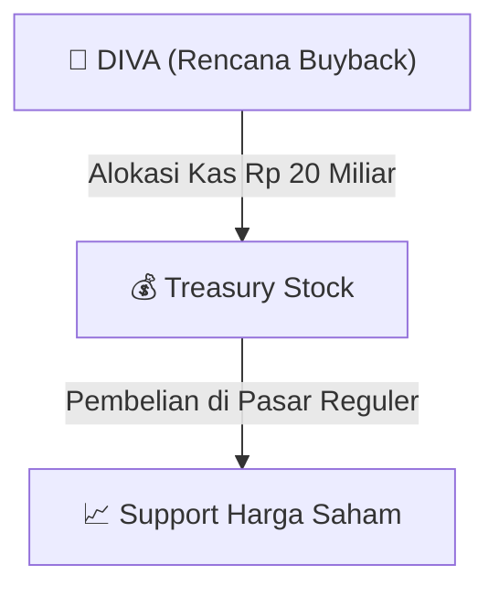

# ⚡ Laporan Intelijen Buyback Saham: [[DIVA]] (PT Digital Mediatama Maxima Tbk)

⬅️ [[knowledge-base/daily-digests/Daily_Digest_20260805|Kembali ke Daily Digest]] | 📅 **2026-08-05** | 🎛️ [[Dashboard|Ke Dashboard Utama]]

> [!IMPORTANT]
> PT Digital Mediatama Maxima Tbk (`[[DIVA]]`) mengumumkan Rencana Pembelian Kembali Saham (*Share Buyback*) di Pasar Reguler BEI.

---

## 📌 1. Executive Summary & Parameter Buyback

- **Kode & Nama Emiten**: `[[DIVA]]` (PT Digital Mediatama Maxima Tbk)
- **Kategori Aksi Korporasi**: `Buyback Saham`
- **Alokasi Dana Maksimum**: **Rp 20.000.000.000** (**Rp 20 Miliar**)
- **Target Pembelian Saham**: Maksimal **10% dari modal disetor**
- **Metode Pelaksanaan**: Melalui perdagangan saham di Pasar Reguler Bursa Efek Indonesia (BEI).

---

## 📈 2. Visualisasi Mekanisme Buyback

---

## 💡 3. Panduan Strategi Investor

- 🛡️ **Penopang Harga Saham (Price Floor)**: Manajemen DIVA mengalokasikan kas Rp 20 Miliar untuk menjaga kestabilan harga saham di pasar reguler.
- 🟢 **Sinyal Undervalued**: Pembelian kembali saham menandakan keyakinan tinggi manajemen terhadap nilai fundamental jangka panjang perseroan.

---

## 🔗 Hubungan Note Terkait (Knowledge Graph)
- [[knowledge-base/daily-digests/Daily_Digest_20260805|📄 Daily Digest 2026-08-05]]
- [[knowledge-base/trading-signals/Trading_Signals_20260805|🎯 Sinyal Cuan 2026-08-05]]
- [[Dashboard|🎛️ Kembali ke Dashboard Utama]]