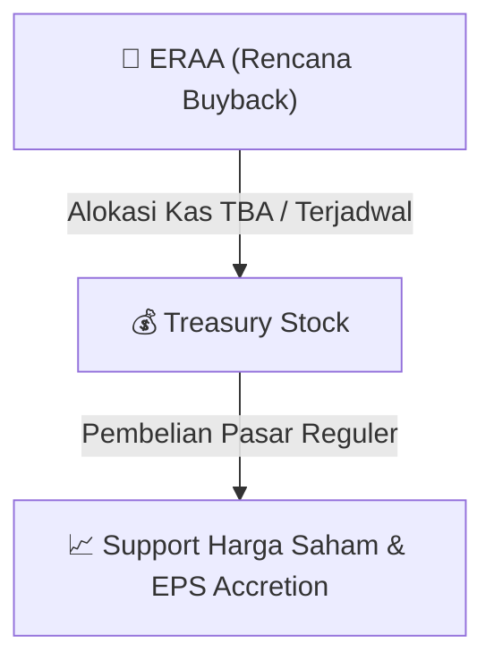

# ⚡ Laporan Intelijen Aksi Korporasi: [[ERAA]] - Buyback

⬅️ [[knowledge-base/daily-digests/Daily_Digest_20260903|Kembali ke Daily Digest]] | 📅 **2026-09-03** | 🎛️ [[Dashboard|Ke Dashboard Utama]]

> [!IMPORTANT]
> Laporan ini disusun secara otomatis oleh **Corporate Action Intelligence Agent** untuk memetakan implikasi strategis, rasio keuangan, alokasi dana, jadwal penting, dan panduan investor.

---

## 📌 1. Ringkasan Eksekutif & Katalis Strategis
- **Kode & Nama Emiten**: `[[ERAA]]`
- **Kategori Aksi Korporasi**: `Buyback`
- **Dokumen Resmi Bursa**: `Laporan Informasi dan Fakta Material lamp1`
- **Ringkasan Inti Aksi**: PT Erajaya Swasembada Tbk mengumumkan rencana pembelian kembali saham (buyback) dengan jumlah maksimum Rp500 miliar, dilaksanakan secara bertahap selama 3 bulan mulai 4 September 2026 hingga 4 Desember 2026 melalui Bursa Efek Indonesia, mengacu pada POJK No. 13 Tahun 2023 dan SEOJK No. S-10/D.04/2026.

---

## 📊 2. Matriks Parameter Material & Angka Kunci
| Parameter Utama | Nilai / Keterangan Resmi |
| :--- | :--- |
| **Dasar Hukum** | `POJK No. 13 Tahun 2023 dan SEOJK No. S-10/D.04/2026` |
| **Jumlah Maksimum Pembelian Kembali** | `Rp500.000.000.000` |
| **Periode Pembelian Kembali** | `4 September 2026 sampai dengan 4 Desember 2026` |
| **Durasi** | `3 bulan` |
| **Tempat Pelaksanaan** | `Bursa Efek Indonesia` |
| **Tanggal Keterbukaan Informasi** | `3 September 2026` |

---

## 🛍️ 3. Parameter Utama Rencana Buyback Saham
- **Alokasi Dana Maksimum**: `TBA / Terjadwal`
- **Maksimum Saham yang Dibeli**: `TBA / Maksimum 10%`
- **Batas Harga Pelaksanaan**: `Harga Pasar Reguler`
- **Metode Pelaksanaan**: Melalui perdagangan saham di Pasar Reguler Bursa Efek Indonesia (BEI).

## 📈 4. Visualisasi Mekanisme Buyback

## 💡 5. Panduan Strategi Investor (Stock Support & Value Play)
- 🟢 **Sinyal Kepercayaan Manajemen**: Aksi *buyback* oleh [[ERAA]] menandakan manajemen menilai harga saham saat ini *undervalued*.
- 🛡️ **Penopang Harga (*Price Floor*)**: Dana *buyback* berfungsi menahan penurunan harga di pasar reguler, meningkatkan *Earnings Per Share* (EPS) pasca pencatatan *treasury stock*.

---

## 🔗 Hubungan Note Terkait (Knowledge Graph)
- [[knowledge-base/daily-digests/Daily_Digest_20260903|📄 Daily Digest 2026-09-03]]
- [[knowledge-base/trading-signals/Trading_Signals_20260903|🎯 Sinyal Cuan 2026-09-03]]
- [[Dashboard|🎛️ Kembali ke Dashboard]]