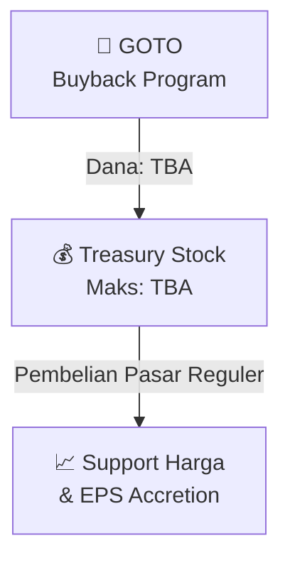

# 🛍️ Program Pembelian Kembali Saham (Buyback) — [[GOTO]]

⬅️ [[knowledge-base/daily-digests/Daily_Digest_20261002|Kembali ke Daily Digest]] | 📅 **2026-10-02** | 🎛️ [[Dashboard|Ke Dashboard Utama]]

> [!IMPORTANT]
> Laporan ini disusun secara otomatis oleh **Corporate Action Intelligence Agent** pada **2026-10-02**.
> Sumber dokumen: `20261001_GOTO_20261001_GOTO_Tanggapan atas Permintaan Penjelasan Bursa_32162486.pdf`

---

## 📌 1. Ringkasan Eksekutif & Tujuan Strategis

- **Kode & Nama Emiten**: `[[GOTO]]`
- **Kategori Aksi Korporasi**: `Buyback`
- **Dokumen Sumber**: `20261001_GOTO_20261001_GOTO_Tanggapan atas Permintaan Penjelasan Bursa_32162486.pdf`
- **Tanggal Laporan**: `2026-10-02`

[Analisis LLM tidak tersedia — isi manual]

---

## 📊 2. Fakta Material & Parameter Keuangan

| Parameter Utama | Nilai / Keterangan |
| :--- | :--- |
| **Nilai Program Buyback** | `TBA` |
| **Jumlah Saham Maksimum** | `TBA` |
| **Harga Maksimum** | `Harga Pasar Reguler` |
| **Periode Mulai** | `Terjadwal` |
| **Periode Selesai** | `Terjadwal` |

---

## 👥 3. Struktur Kepemilikan, Pengendali & Pembeli Siaga

- **Emiten**: `GOTO` | Informasi kepemilikan mengacu pada dokumen resmi sumber.

---

## 🎯 4. Alokasi & Rencana Penggunaan Dana

- **Nilai Program Buyback**: `TBA`
- **Tujuan**: Meningkatkan EPS, menopang harga saham, dan mengoptimalkan struktur modal.

---

## 📅 5. Timeline & Jadwal Pelaksanaan

| Tahapan / Event | Tanggal |
| :--- | :---: |
| **Periode Mulai Buyback** | `Terjadwal` |
| **Periode Selesai Buyback** | `Terjadwal` |

---

## 📈 6. Diagram Visual Flowchart (Mermaid)

---

## 💡 7. Rekomendasi Investor & Strategi Trading

[Analisis LLM tidak tersedia — isi manual]

---

## 🔗 8. Hubungan Note Terkait (Knowledge Graph)

- [[knowledge-base/daily-digests/Daily_Digest_20261002|📄 Daily Digest 2026-10-02]]
- [[knowledge-base/trading-signals/Trading_Signals_20261002|🎯 Sinyal Cuan 2026-10-02]]
- [[GOTO|🏬 Halaman Emiten GOTO]]
- [[Dashboard|🎛️ Kembali ke Dashboard Utama]]

---

*Laporan dibuat otomatis oleh Corporate Action Intelligence Agent · 2026-10-02*