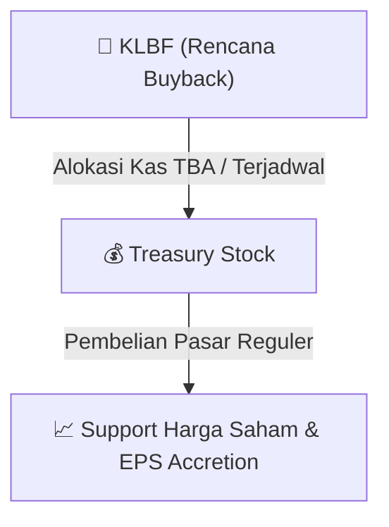

# ⚡ Laporan Intelijen Aksi Korporasi: [[KLBF]] - Buyback

⬅️ [[knowledge-base/daily-digests/Daily_Digest_20260915|Kembali ke Daily Digest]] | 📅 **2026-09-15** | 🎛️ [[Dashboard|Ke Dashboard Utama]]

> [!IMPORTANT]
> Laporan ini disusun secara otomatis oleh **Corporate Action Intelligence Agent** untuk memetakan implikasi strategis, rasio keuangan, alokasi dana, jadwal penting, dan panduan investor.

---

## 📌 1. Ringkasan Eksekutif & Katalis Strategis
- **Kode & Nama Emiten**: `[[KLBF]]`
- **Kategori Aksi Korporasi**: `Buyback`
- **Dokumen Resmi Bursa**: `Laporan Informasi dan Fakta Material`
- **Ringkasan Inti Aksi**: Kalbe Farma Tbk (KLBF) mengumumkan rencana pembelian kembali saham (buyback) dalam kondisi pasar yang berfluktuasi secara signifikan. Informasi ini disampaikan melalui laporan informasi dan fakta material pada tanggal 15 September 2026. Perusahaan menyatakan bahwa rencana buyback ini tidak memiliki dampak material terhadap kegiatan operasional, hukum, kondisi keuangan, atau kelangsungan usaha Perseroan.

---

## 📊 2. Matriks Parameter Material & Angka Kunci
| Parameter Utama | Nilai / Keterangan Resmi |
| :--- | :--- |
| **Nomor Surat** | `066/CSEC-KF/IX-2026` |
| **Tanggal Kejadian** | `15 September 2026` |
| **Jenis Informasi atau Fakta Material** | `Rencana Pembelian Kembali Saham dalam Kondisi Pasar yang Berfluktuasi secara Signifikan` |
| **Dampak terhadap Kegiatan Operasional, Hukum, Kondisi Keuangan, atau Kelangsungan Usaha** | `Tidak memiliki dampak material` |
| **Nama Pengirim** | `Maria Teresa Fabiola` |
| **Jabatan Pengirim** | `Tidak disebutkan secara eksplisit dalam dokumen` |
| **Lampiran** | `KLBF KI Buyback Phase 9.pdf` |
| **Bidang Usaha** | `Farmasi` |
| **Telepon** | `42873888` |
| **Faksimili** | `42873680` |
| **Alamat Surat Elektronik** | `info@kalbe.co.id` |

---

## 🛍️ 3. Parameter Utama Rencana Buyback Saham
- **Alokasi Dana Maksimum**: `TBA / Terjadwal`
- **Maksimum Saham yang Dibeli**: `TBA / Maksimum 10%`
- **Batas Harga Pelaksanaan**: `Harga Pasar Reguler`
- **Metode Pelaksanaan**: Melalui perdagangan saham di Pasar Reguler Bursa Efek Indonesia (BEI).

## 📈 4. Visualisasi Mekanisme Buyback

## 💡 5. Panduan Strategi Investor (Stock Support & Value Play)
- 🟢 **Sinyal Kepercayaan Manajemen**: Aksi *buyback* oleh [[KLBF]] menandakan manajemen menilai harga saham saat ini *undervalued*.
- 🛡️ **Penopang Harga (*Price Floor*)**: Dana *buyback* berfungsi menahan penurunan harga di pasar reguler, meningkatkan *Earnings Per Share* (EPS) pasca pencatatan *treasury stock*.

---

## 🔗 Hubungan Note Terkait (Knowledge Graph)
- [[knowledge-base/daily-digests/Daily_Digest_20260915|📄 Daily Digest 2026-09-15]]
- [[knowledge-base/trading-signals/Trading_Signals_20260915|🎯 Sinyal Cuan 2026-09-15]]
- [[Dashboard|🎛️ Kembali ke Dashboard]]