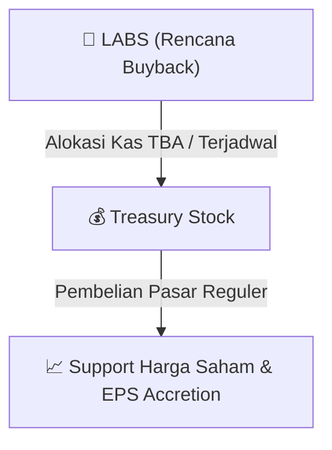

# ⚡ Laporan Intelijen Aksi Korporasi: [[LABS]] - Buyback

⬅️ [[knowledge-base/daily-digests/Daily_Digest_20260813|Kembali ke Daily Digest]] | 📅 **2026-08-13** | 🎛️ [[Dashboard|Ke Dashboard Utama]]

> [!IMPORTANT]
> Laporan ini disusun secara otomatis oleh **Corporate Action Intelligence Agent** untuk memetakan implikasi strategis, rasio keuangan, alokasi dana, jadwal penting, dan panduan investor.

---

## 📌 1. Ringkasan Eksekutif & Katalis Strategis
- **Kode & Nama Emiten**: `[[LABS]]`
- **Kategori Aksi Korporasi**: `Buyback`
- **Dokumen Resmi Bursa**: `Laporan Informasi dan Fakta Material lamp1`
- **Ringkasan Inti Aksi**: PT UBC Medical Indonesia Tbk (emiten dengan kode LABS) mengumumkan rencana pembelian kembali (buyback) saham perseroan dalam kondisi pasar yang berfluktuasi secara signifikan, sesuai dengan POJK No. 29/2023 dan POJK No. 13/2023, serta Surat OJK No. S-10/D.04/2026. Nilai agregat buyback diperkirakan maksimum sebesar IDR 12.600.000.000 (dua belas miliar enam ratus juta Rupiah). Pembelian kembali saham akan dilakukan melalui Bursa Efek Indonesia secara bertahap dalam jangka waktu 5 (lima) bulan, mulai dari 11 Agustus 2026 hingga 11 Januari 2027, tanpa memerlukan persetujuan RUPS karena kondisi pasar yang berfluktuasi signifikan.

---

## 📊 2. Matriks Parameter Material & Angka Kunci
| Parameter Utama | Nilai / Keterangan Resmi |
| :--- | :--- |
| **Nama Emiten** | `PT UBC Medical Indonesia Tbk` |
| **Kode Emiten** | `LABS` |
| **Kegiatan Usaha Utama** | `Perdagangan Besar Alat Laboratorium, Alat Farmasi dan Alat Kedokteran untuk Manusia` |
| **Dasar Hukum** | `POJK No. 29 Tahun 2023, POJK No. 13 Tahun 2023, Surat OJK No. S-10/D.04/2026, POJK No. 31/POJK.04/2015` |
| **Nilai Maksimum Buyback** | `IDR 12.600.000.000 (dua belas miliar enam ratus juta Rupiah)` |
| **Periode Pelaksanaan Buyback** | `11 Agustus 2026 hingga 11 Januari 2027 (5 bulan)` |
| **Mekanisme Pelaksanaan** | `Melalui Bursa Efek Indonesia secara bertahap` |
| **Persetujuan RUPS** | `Tidak diperlukan karena kondisi pasar berfluktuasi signifikan (Pasal 7 POJK 13/2023)` |
| **Tanggal Penerbitan Keterbukaan Informasi** | `10 Agustus 2026` |

---

## 🛍️ 3. Parameter Utama Rencana Buyback Saham
- **Alokasi Dana Maksimum**: `TBA / Terjadwal`
- **Maksimum Saham yang Dibeli**: `TBA / Maksimum 10%`
- **Batas Harga Pelaksanaan**: `Harga Pasar Reguler`
- **Metode Pelaksanaan**: Melalui perdagangan saham di Pasar Reguler Bursa Efek Indonesia (BEI).

## 📈 4. Visualisasi Mekanisme Buyback

## 💡 5. Panduan Strategi Investor (Stock Support & Value Play)
- 🟢 **Sinyal Kepercayaan Manajemen**: Aksi *buyback* oleh [[LABS]] menandakan manajemen menilai harga saham saat ini *undervalued*.
- 🛡️ **Penopang Harga (*Price Floor*)**: Dana *buyback* berfungsi menahan penurunan harga di pasar reguler, meningkatkan *Earnings Per Share* (EPS) pasca pencatatan *treasury stock*.

---

## 🔗 Hubungan Note Terkait (Knowledge Graph)
- [[knowledge-base/daily-digests/Daily_Digest_20260813|📄 Daily Digest 2026-08-13]]
- [[knowledge-base/trading-signals/Trading_Signals_20260813|🎯 Sinyal Cuan 2026-08-13]]
- [[Dashboard|🎛️ Kembali ke Dashboard]]