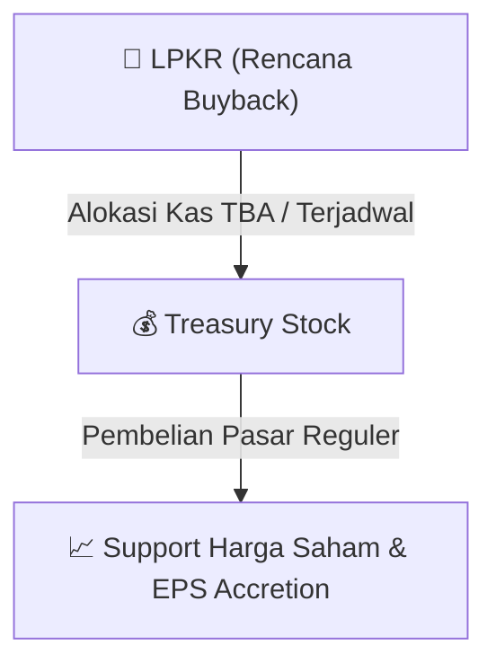

# ⚡ Laporan Intelijen Aksi Korporasi: [[LPKR]] - Buyback

⬅️ [[knowledge-base/daily-digests/Daily_Digest_20260915|Kembali ke Daily Digest]] | 📅 **2026-09-15** | 🎛️ [[Dashboard|Ke Dashboard Utama]]

> [!IMPORTANT]
> Laporan ini disusun secara otomatis oleh **Corporate Action Intelligence Agent** untuk memetakan implikasi strategis, rasio keuangan, alokasi dana, jadwal penting, dan panduan investor.

---

## 📌 1. Ringkasan Eksekutif & Katalis Strategis
- **Kode & Nama Emiten**: `[[LPKR]]`
- **Kategori Aksi Korporasi**: `Buyback`
- **Dokumen Resmi Bursa**: `Laporan Informasi dan Fakta Material lamp2`
- **Ringkasan Inti Aksi**: PT Lippo Karawaci Tbk mengumumkan penarikan kembali (treasury stock) sebanyak 20.700.600 saham hasil pembelian kembali, berdasarkan persetujuan RUPSLB tanggal 11 September 2026. Penarikan ini dilakukan sesuai Peraturan OJK No. 30/POJK.04/2017 yang telah digantikan dengan Peraturan OJK No. 29 Tahun 2023, dan mengubah Pasal 4 ayat (2) Anggaran Dasar Perseroan. Kreditur yang keberatan dapat mengajukan keberatan tertulis dalam 60 hari sejak pengumuman.

---

## 📊 2. Matriks Parameter Material & Angka Kunci
| Parameter Utama | Nilai / Keterangan Resmi |
| :--- | :--- |
| **Jumlah Saham Treasuri yang Ditarik Kembali** | `20.700.600 saham` |
| **Tanggal Persetujuan RUPSLB** | `11 September 2026` |
| **Dasar Hukum** | `Peraturan OJK No. 30/POJK.04/2017 (digantikan dengan Peraturan OJK No. 29 Tahun 2023)` |
| **Jangka Waktu Keberatan Kreditur** | `60 hari sejak tanggal pengumuman` |
| **Perubahan Anggaran Dasar** | `Pasal 4 ayat (2) Anggaran Dasar Perseroan` |
| **Alamat Pengajuan Keberatan** | `Menara Matahari Lt. 22, Jl. Boulevard Palem Raya No. 7, Lippo Karawaci Central, Tangerang, Banten 15810` |

---

## 🛍️ 3. Parameter Utama Rencana Buyback Saham
- **Alokasi Dana Maksimum**: `TBA / Terjadwal`
- **Maksimum Saham yang Dibeli**: `TBA / Maksimum 10%`
- **Batas Harga Pelaksanaan**: `Harga Pasar Reguler`
- **Metode Pelaksanaan**: Melalui perdagangan saham di Pasar Reguler Bursa Efek Indonesia (BEI).

## 📈 4. Visualisasi Mekanisme Buyback

## 💡 5. Panduan Strategi Investor (Stock Support & Value Play)
- 🟢 **Sinyal Kepercayaan Manajemen**: Aksi *buyback* oleh [[LPKR]] menandakan manajemen menilai harga saham saat ini *undervalued*.
- 🛡️ **Penopang Harga (*Price Floor*)**: Dana *buyback* berfungsi menahan penurunan harga di pasar reguler, meningkatkan *Earnings Per Share* (EPS) pasca pencatatan *treasury stock*.

---

## 🔗 Hubungan Note Terkait (Knowledge Graph)
- [[knowledge-base/daily-digests/Daily_Digest_20260915|📄 Daily Digest 2026-09-15]]
- [[knowledge-base/trading-signals/Trading_Signals_20260915|🎯 Sinyal Cuan 2026-09-15]]
- [[Dashboard|🎛️ Kembali ke Dashboard]]