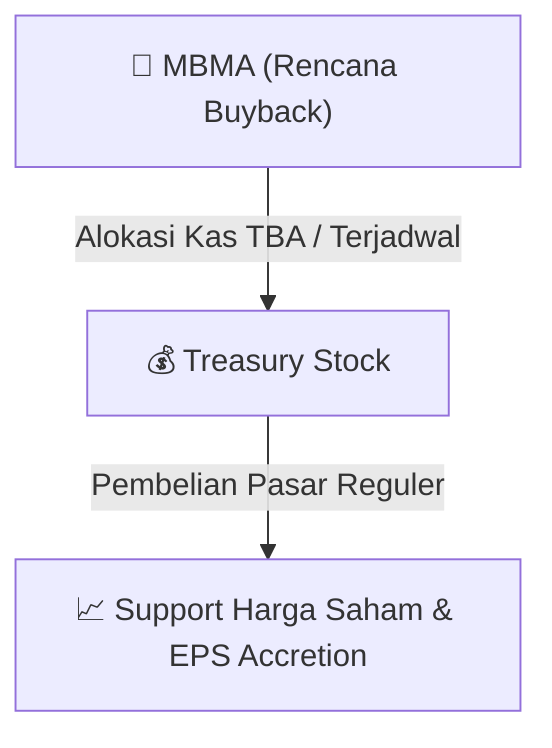

# ⚡ Laporan Intelijen Aksi Korporasi: [[MBMA]] - Buyback

⬅️ [[knowledge-base/daily-digests/Daily_Digest_20260916|Kembali ke Daily Digest]] | 📅 **2026-09-16** | 🎛️ [[Dashboard|Ke Dashboard Utama]]

> [!IMPORTANT]
> Laporan ini disusun secara otomatis oleh **Corporate Action Intelligence Agent** untuk memetakan implikasi strategis, rasio keuangan, alokasi dana, jadwal penting, dan panduan investor.

---

## 📌 1. Ringkasan Eksekutif & Katalis Strategis
- **Kode & Nama Emiten**: `[[MBMA]]`
- **Kategori Aksi Korporasi**: `Buyback`
- **Dokumen Resmi Bursa**: `Laporan Informasi dan Fakta Material lamp1`
- **Ringkasan Inti Aksi**: PT Merdeka Battery Materials Tbk (MBMA) mengumumkan rencana pembelian kembali saham (buyback) dalam kondisi pasar yang berfluktuasi secara signifikan. Rencana ini dilakukan untuk memenuhi Peraturan OJK No. 13 Tahun 2023 juncto POJK No. 29 Tahun 2023 dan Surat OJK No. S-112/D.04/2026. Keterbukaan Informasi ini diterbitkan pada 16 September 2026.

---

## 📊 2. Matriks Parameter Material & Angka Kunci
| Parameter Utama | Nilai / Keterangan Resmi |
| :--- | :--- |
| **Tanggal Penerbitan Keterbukaan Informasi** | `16 September 2026` |
| **Dasar Hukum** | `POJK No. 13 Tahun 2023, POJK No. 29 Tahun 2023, Surat OJK No. S-112/D.04/2026` |
| **Jenis Aksi Korporasi** | `Pembelian Kembali Saham (Buyback) dalam Kondisi Pasar Berfluktuasi Signifikan` |
| **Kegiatan Usaha** | `Perusahaan induk grup usaha pertambangan nikel dan mineral lainnya, pengolahan, dan kegiatan usaha terkait yang terintegrasi secara vertikal` |
| **Alamat Kantor Pusat** | `Treasury Tower, Lantai 69, District 8, SCBD Lot. 28` |

---

## 🛍️ 3. Parameter Utama Rencana Buyback Saham
- **Alokasi Dana Maksimum**: `TBA / Terjadwal`
- **Maksimum Saham yang Dibeli**: `TBA / Maksimum 10%`
- **Batas Harga Pelaksanaan**: `Harga Pasar Reguler`
- **Metode Pelaksanaan**: Melalui perdagangan saham di Pasar Reguler Bursa Efek Indonesia (BEI).

## 📈 4. Visualisasi Mekanisme Buyback

## 💡 5. Panduan Strategi Investor (Stock Support & Value Play)
- 🟢 **Sinyal Kepercayaan Manajemen**: Aksi *buyback* oleh [[MBMA]] menandakan manajemen menilai harga saham saat ini *undervalued*.
- 🛡️ **Penopang Harga (*Price Floor*)**: Dana *buyback* berfungsi menahan penurunan harga di pasar reguler, meningkatkan *Earnings Per Share* (EPS) pasca pencatatan *treasury stock*.

---

## 🔗 Hubungan Note Terkait (Knowledge Graph)
- [[knowledge-base/daily-digests/Daily_Digest_20260916|📄 Daily Digest 2026-09-16]]
- [[knowledge-base/trading-signals/Trading_Signals_20260916|🎯 Sinyal Cuan 2026-09-16]]
- [[Dashboard|🎛️ Kembali ke Dashboard]]