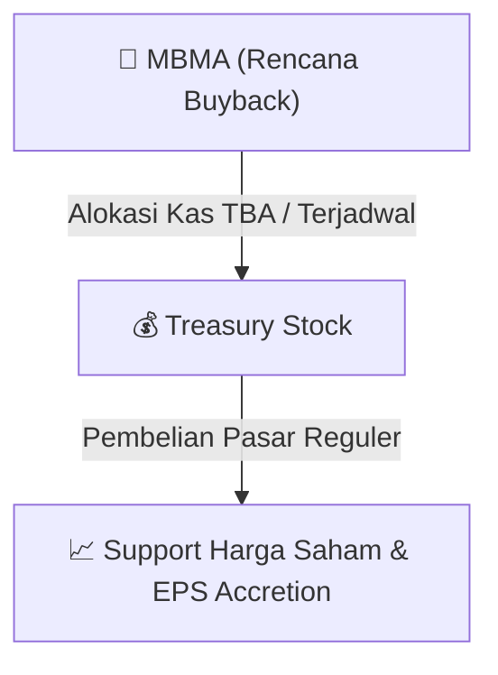

# ⚡ Laporan Intelijen Aksi Korporasi: [[MBMA]] - Buyback

⬅️ [[knowledge-base/daily-digests/Daily_Digest_20260917|Kembali ke Daily Digest]] | 📅 **2026-09-17** | 🎛️ [[Dashboard|Ke Dashboard Utama]]

> [!IMPORTANT]
> Laporan ini disusun secara otomatis oleh **Corporate Action Intelligence Agent** untuk memetakan implikasi strategis, rasio keuangan, alokasi dana, jadwal penting, dan panduan investor.

---

## 📌 1. Ringkasan Eksekutif & Katalis Strategis
- **Kode & Nama Emiten**: `[[MBMA]]`
- **Kategori Aksi Korporasi**: `Buyback`
- **Dokumen Resmi Bursa**: `Laporan Informasi dan Fakta Material lamp1`
- **Ringkasan Inti Aksi**: PT Merdeka Battery Materials Tbk (MBMA) menyampaikan keterbukaan informasi bahwa periode pelaksanaan pembelian kembali saham dalam kondisi pasar yang berfluktuasi secara signifikan telah berakhir dan pelaksanaan buyback dinyatakan selesai. Periode buyback berlangsung dari 17 Juni 2026 sampai dengan 16 September 2026, sesuai rencana yang diungkapkan pada 16 Juni 2026.

---

## 📊 2. Matriks Parameter Material & Angka Kunci
| Parameter Utama | Nilai / Keterangan Resmi |
| :--- | :--- |
| **Nomor Surat** | `156/MBM-JKT/CORSEC/IX/2026` |
| **Tanggal Surat** | `17 September 2026` |
| **Perihal** | `Keterbukaan Informasi atas Berakhirnya Periode Pelaksanaan Pembelian Kembali Saham dalam Kondisi Pasar yang Berfluktuasi Secara Signifikan` |
| **Jenis Aksi Korporasi** | `Pembelian Kembali Saham (Buyback)` |
| **Status Pelaksanaan** | `Selesai` |
| **Periode Pelaksanaan Pembelian Kembali Saham** | `17 Juni 2026 sampai dengan 16 September 2026` |
| **Tanggal Keterbukaan Informasi Rencana Pembelian Kembali Saham** | `16 Juni 2026` |
| **Dasar Hukum** | `POJK No. 13 Tahun 2023; POJK No. 29 Tahun 2023; Surat OJK No. S-10/D.04/2026` |
| **Pihak yang Dituju** | `Otoritas Jasa Keuangan Republik Indonesia dan PT Bursa Efek Indonesia` |

---

## 🛍️ 3. Parameter Utama Rencana Buyback Saham
- **Alokasi Dana Maksimum**: `TBA / Terjadwal`
- **Maksimum Saham yang Dibeli**: `TBA / Maksimum 10%`
- **Batas Harga Pelaksanaan**: `Harga Pasar Reguler`
- **Metode Pelaksanaan**: Melalui perdagangan saham di Pasar Reguler Bursa Efek Indonesia (BEI).

## 📈 4. Visualisasi Mekanisme Buyback

## 💡 5. Panduan Strategi Investor (Stock Support & Value Play)
- 🟢 **Sinyal Kepercayaan Manajemen**: Aksi *buyback* oleh [[MBMA]] menandakan manajemen menilai harga saham saat ini *undervalued*.
- 🛡️ **Penopang Harga (*Price Floor*)**: Dana *buyback* berfungsi menahan penurunan harga di pasar reguler, meningkatkan *Earnings Per Share* (EPS) pasca pencatatan *treasury stock*.

---

## 🔗 Hubungan Note Terkait (Knowledge Graph)
- [[knowledge-base/daily-digests/Daily_Digest_20260917|📄 Daily Digest 2026-09-17]]
- [[knowledge-base/trading-signals/Trading_Signals_20260917|🎯 Sinyal Cuan 2026-09-17]]
- [[Dashboard|🎛️ Kembali ke Dashboard]]