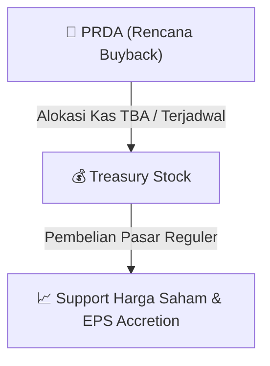

# ⚡ Laporan Intelijen Aksi Korporasi: [[PRDA]] - Buyback

⬅️ [[knowledge-base/daily-digests/Daily_Digest_20260828|Kembali ke Daily Digest]] | 📅 **2026-08-28** | 🎛️ [[Dashboard|Ke Dashboard Utama]]

> [!IMPORTANT]
> Laporan ini disusun secara otomatis oleh **Corporate Action Intelligence Agent** untuk memetakan implikasi strategis, rasio keuangan, alokasi dana, jadwal penting, dan panduan investor.

---

## 📌 1. Ringkasan Eksekutif & Katalis Strategis
- **Kode & Nama Emiten**: `[[PRDA]]`
- **Kategori Aksi Korporasi**: `Buyback`
- **Dokumen Resmi Bursa**: `Laporan Informasi dan Fakta Material lamp1`
- **Ringkasan Inti Aksi**: PT Prodia Widyahusada Tbk menyampaikan laporan pelaksanaan pembelian kembali saham per 28 Agustus 2026. Total saham yang dibeli kembali selama periode 20-28 Agustus 2026 adalah 3.300.000 lembar dengan sisa biaya buyback Rp141.556.154.904.

---

## 📊 2. Matriks Parameter Material & Angka Kunci
| Parameter Utama | Nilai / Keterangan Resmi |
| :--- | :--- |
| **Tanggal Laporan** | `28 Agustus 2026` |
| **Nomor Surat** | `105/CORSEC/EKS/VIII/2026` |
| **Dasar Regulasi** | `POJK No. 13 Tahun 2023 Pasal 12 ayat (1)` |
| **Tanggal Keterbukaan Informasi Rencana Buyback** | `19 Agustus 2026` |
| **Total Saham Dibeli Kembali (20-28 Agustus 2026)** | `3.300.000 lembar` |
| **Sisa Biaya Pembelian Kembali Saham per 28 Agustus 2026** | `Rp141.556.154.904` |
| **Persentase Kumulatif Saham Dibeli Kembali** | `0,34%` |
| **Harga Rata-rata Pembelian Kembali 28 Agustus 2026** | `Rp2.591` |
| **Rincian Transaksi 20 Agustus 2026** | `595.900 lembar @ Rp2.548, 0,06%` |
| **Rincian Transaksi 21 Agustus 2026** | `187.900 lembar @ Rp2.552, 0,02%` |
| **Rincian Transaksi 24 Agustus 2026** | `136.200 lembar @ Rp2.482, 0,01%` |
| **Rincian Transaksi 26 Agustus 2026** | `388.200 lembar @ Rp2.474, 0,04%` |
| **Rincian Transaksi 27 Agustus 2026** | `660.100 lembar @ Rp2.553, 0,07%` |
| **Rincian Transaksi 28 Agustus 2026** | `1.331.700 lembar @ Rp2.591, 0,14%` |

---

## 🛍️ 3. Parameter Utama Rencana Buyback Saham
- **Alokasi Dana Maksimum**: `TBA / Terjadwal`
- **Maksimum Saham yang Dibeli**: `TBA / Maksimum 10%`
- **Batas Harga Pelaksanaan**: `Harga Pasar Reguler`
- **Metode Pelaksanaan**: Melalui perdagangan saham di Pasar Reguler Bursa Efek Indonesia (BEI).

## 📈 4. Visualisasi Mekanisme Buyback

## 💡 5. Panduan Strategi Investor (Stock Support & Value Play)
- 🟢 **Sinyal Kepercayaan Manajemen**: Aksi *buyback* oleh [[PRDA]] menandakan manajemen menilai harga saham saat ini *undervalued*.
- 🛡️ **Penopang Harga (*Price Floor*)**: Dana *buyback* berfungsi menahan penurunan harga di pasar reguler, meningkatkan *Earnings Per Share* (EPS) pasca pencatatan *treasury stock*.

---

## 🔗 Hubungan Note Terkait (Knowledge Graph)
- [[knowledge-base/daily-digests/Daily_Digest_20260828|📄 Daily Digest 2026-08-28]]
- [[knowledge-base/trading-signals/Trading_Signals_20260828|🎯 Sinyal Cuan 2026-08-28]]
- [[Dashboard|🎛️ Kembali ke Dashboard]]