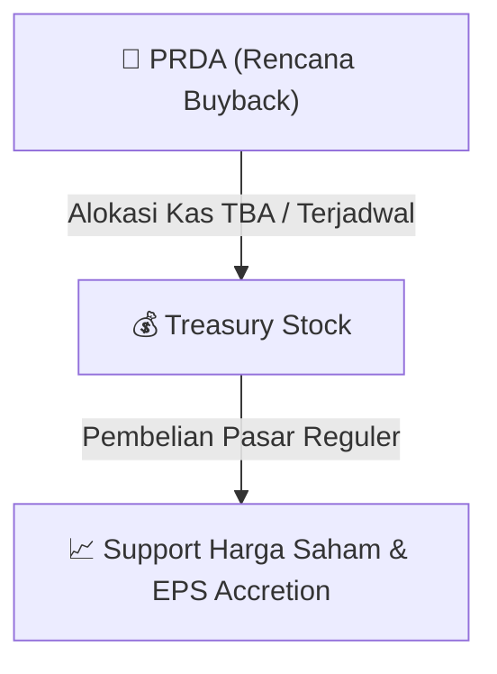

# ⚡ Laporan Intelijen Aksi Korporasi: [[PRDA]] - Buyback

⬅️ [[knowledge-base/daily-digests/Daily_Digest_20260918|Kembali ke Daily Digest]] | 📅 **2026-09-18** | 🎛️ [[Dashboard|Ke Dashboard Utama]]

> [!IMPORTANT]
> Laporan ini disusun secara otomatis oleh **Corporate Action Intelligence Agent** untuk memetakan implikasi strategis, rasio keuangan, alokasi dana, jadwal penting, dan panduan investor.

---

## 📌 1. Ringkasan Eksekutif & Katalis Strategis
- **Kode & Nama Emiten**: `[[PRDA]]`
- **Kategori Aksi Korporasi**: `Buyback`
- **Dokumen Resmi Bursa**: `Laporan Informasi dan Fakta Material lamp1`
- **Ringkasan Inti Aksi**: Informasi dan fakta material PRDA: ​ Nomor / Number: 122/CORSEC/EKS/IX/2026 18 September 2026​ Kepada Yth / To: 1.​ Kepala Eksekutif Pengawas Pasar Modal, Keuangan Derivatif dan Bursa Karbon / ​ Chief Executive of Capital Market, Financial Derivative, and Carbon Exchange Supervision of Financial Services Authority Departemen Keuangan RI Lantai 1 2.​ Direksi PT Bursa Efek Indonesia / Board of Directors of PT Bursa Efek Indonesia​ Jakarta 12190​ / Re : Laporan Hasil Pelaksanaan Pembelian Kembali Saham/​ Report on Shares Buyback Imp

---

## 📊 2. Matriks Parameter Material & Angka Kunci
| Parameter Utama | Nilai / Keterangan Resmi |
| :--- | :--- |
| **Uraian Kejadian** | `​ Nomor / Number: 122/CORSEC/EKS/IX/2026 18 September 2026​ Kepada Yth / To: 1.​ Kepala Eksekutif Pengawas Pasar Modal, Keuangan Derivatif dan Bursa Karbon / ​ Chief Executive of Capital Market, Financial Derivative, and Carbon Exchange Supervision of Financial Services Authority Departemen Keuangan RI Lantai 1 2.​ Direksi PT Bursa Efek Indonesia / Board of Directors of PT Bursa Efek Indonesia​ Jakarta 12190​ / Re : Laporan Hasil Pelaksanaan Pembelian Kembali Saham/​ Report on Shares Buyback Imp` |

---

## 🛍️ 3. Parameter Utama Rencana Buyback Saham
- **Alokasi Dana Maksimum**: `TBA / Terjadwal`
- **Maksimum Saham yang Dibeli**: `TBA / Maksimum 10%`
- **Batas Harga Pelaksanaan**: `Harga Pasar Reguler`
- **Metode Pelaksanaan**: Melalui perdagangan saham di Pasar Reguler Bursa Efek Indonesia (BEI).

## 📈 4. Visualisasi Mekanisme Buyback

## 💡 5. Panduan Strategi Investor (Stock Support & Value Play)
- 🟢 **Sinyal Kepercayaan Manajemen**: Aksi *buyback* oleh [[PRDA]] menandakan manajemen menilai harga saham saat ini *undervalued*.
- 🛡️ **Penopang Harga (*Price Floor*)**: Dana *buyback* berfungsi menahan penurunan harga di pasar reguler, meningkatkan *Earnings Per Share* (EPS) pasca pencatatan *treasury stock*.

---

## 🔗 Hubungan Note Terkait (Knowledge Graph)
- [[knowledge-base/daily-digests/Daily_Digest_20260918|📄 Daily Digest 2026-09-18]]
- [[knowledge-base/trading-signals/Trading_Signals_20260918|🎯 Sinyal Cuan 2026-09-18]]
- [[Dashboard|🎛️ Kembali ke Dashboard]]