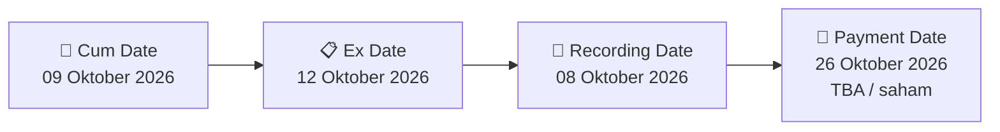

# 💰 Pengumuman Pembagian Dividen Tunai — [[AALI]]

⬅️ [[knowledge-base/daily-digests/Daily_Digest_20261001|Kembali ke Daily Digest]] | 📅 **2026-10-01** | 🎛️ [[Dashboard|Ke Dashboard Utama]]

> [!IMPORTANT]
> Laporan ini disusun secara otomatis oleh **Corporate Action Intelligence Agent** pada **2026-10-01**.
> Sumber dokumen: `20260930_AALI_20260930_AALI_Jadwal Aksi Korporasi (Khusus Penyampaian Dividen Interim)_32162157_lamp1.pdf`

---

## 📌 1. Ringkasan Eksekutif & Tujuan Strategis

- **Kode & Nama Emiten**: `[[AALI]]`
- **Kategori Aksi Korporasi**: `Dividen`
- **Dokumen Sumber**: `20260930_AALI_20260930_AALI_Jadwal Aksi Korporasi (Khusus Penyampaian Dividen Interim)_32162157_lamp1.pdf`
- **Tanggal Laporan**: `2026-10-01`

[Analisis LLM tidak tersedia — isi manual]

---

## 📊 2. Fakta Material & Parameter Keuangan

| Parameter Utama | Nilai / Keterangan |
| :--- | :--- |
| **Jenis Dividen** | `Final` |
| **Nominal per Saham** | `TBA` |
| **Total Nilai Dividen** | `TBA` |
| **Cum Date (Pasar Reguler)** | `09 Oktober 2026` |
| **Ex Date** | `12 Oktober 2026` |
| **Recording Date (DPS)** | `08 Oktober 2026` |
| **Payment Date** | `26 Oktober 2026` |

---

## 👥 3. Struktur Kepemilikan, Pengendali & Pembeli Siaga

- **Emiten**: `AALI` | Informasi kepemilikan mengacu pada dokumen resmi sumber.

---

## 🎯 4. Alokasi & Rencana Penggunaan Dana

- Informasi alokasi dana belum tersedia — lihat prospektus / dokumen resmi.

---

## 📅 5. Timeline & Jadwal Pelaksanaan

| Tahapan / Event | Tanggal |
| :--- | :---: |
| **Cum Date (Pasar Reguler & Negosiasi)** | `09 Oktober 2026` |
| **Ex Date** | `12 Oktober 2026` |
| **Recording Date (DPS)** | `08 Oktober 2026` |
| **Payment Date (Pembayaran ke RDN)** | `26 Oktober 2026` |

---

## 📈 6. Diagram Visual Flowchart (Mermaid)

---

## 💡 7. Rekomendasi Investor & Strategi Trading

[Analisis LLM tidak tersedia — isi manual]

---

## 🔗 8. Hubungan Note Terkait (Knowledge Graph)

- [[knowledge-base/daily-digests/Daily_Digest_20261001|📄 Daily Digest 2026-10-01]]
- [[knowledge-base/trading-signals/Trading_Signals_20261001|🎯 Sinyal Cuan 2026-10-01]]
- [[AALI|🏬 Halaman Emiten AALI]]
- [[Dashboard|🎛️ Kembali ke Dashboard Utama]]

---

*Laporan dibuat otomatis oleh Corporate Action Intelligence Agent · 2026-10-01*