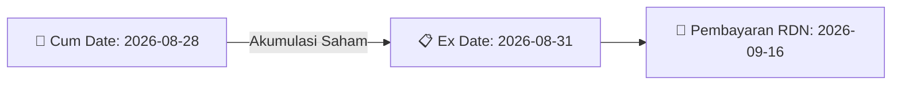

# ⚡ Laporan Intelijen Aksi Korporasi: [[BBCA]] - Dividen

⬅️ [[knowledge-base/daily-digests/Daily_Digest_20260819|Kembali ke Daily Digest]] | 📅 **2026-08-19** | 🎛️ [[Dashboard|Ke Dashboard Utama]]

> [!IMPORTANT]
> Laporan ini disusun secara otomatis oleh **Corporate Action Intelligence Agent** untuk memetakan implikasi strategis, rasio keuangan, alokasi dana, jadwal penting, dan panduan investor.

---

## 📌 1. Ringkasan Eksekutif & Katalis Strategis
- **Kode & Nama Emiten**: `[[BBCA]]`
- **Kategori Aksi Korporasi**: `Dividen`
- **Dokumen Resmi Bursa**: `Jadwal Aksi Korporasi (Khusus Penyampaian Dividen Interim)`
- **Ringkasan Inti Aksi**: PT Bank Central Asia Tbk (BBCA) mengumumkan rencana pembagian dividen tunai interim untuk tahun buku 2026 sebesar Rp25 per saham, dengan total nilai dividen minimum dan maksimum masing-masing Rp3.071.043.782.500. Jadwal dividen: cum dividen pasar reguler dan negosiasi 28 Agustus 2026, ex dividen pasar reguler dan negosiasi 31 Agustus 2026, recording date 1 September 2026, cum dividen pasar tunai 1 September 2026, ex dividen pasar tunai 2 September 2026, dan pembayaran dividen 16 September 2026.

---

## 📊 2. Matriks Parameter Material & Angka Kunci
| Parameter Utama | Nilai / Keterangan Resmi |
| :--- | :--- |
| **Nomor Surat** | `005/CSG-IVR/2026` |
| **Tanggal Keputusan Direksi disetujui Dewan Komisaris** | `2026-08-19` |
| **Periode Dividen** | `Tahun Buku 2026` |
| **Dividen per Saham** | `25 IDR` |
| **Total Nilai Dividen Minimum** | `3.071.043.782.500 IDR` |
| **Total Nilai Dividen Maksimum** | `3.071.043.782.500 IDR` |
| **Efek Bersifat Ekuitas yang Dapat Dikonversi** | `Tidak` |
| **Tanggal Cum Dividen Pasar Reguler dan Negosiasi** | `2026-08-28` |
| **Tanggal Ex Dividen Pasar Reguler dan Negosiasi** | `2026-08-31` |
| **Tanggal Cum Dividen Pasar Tunai** | `2026-09-01` |
| **Tanggal Ex Dividen Pasar Tunai** | `2026-09-02` |
| **Tanggal Daftar Pemegang Saham (Recording Date)** | `2026-09-01 16:00` |
| **Tanggal Pembayaran Dividen** | `2026-09-16` |
| **Laba Bersih Entitas Induk per 30 Juni 2026** | `29.534.445.918.301 IDR` |
| **Saldo Laba Ditahan Tidak Dibatasi Penggunaannya per 30 Juni 2026** | `251.487.039.179.909 IDR` |
| **Total Ekuitas per 30 Juni 2026** | `270.667.745.587.678 IDR` |
| **Catatan Realisasi Jumlah Saham** | `Realisasi jumlah saham yang berhak atas dividen interim kuartal III 2026 dapat lebih rendah sesuai akumulasi saham hasil buyback sampai tanggal pencatatan` |

---

## 🗓️ 3. Jadwal Penting Pembagian Dividen Tunai
| Tahapan Aksi | Tanggal | Keterangan & Panduan Investor |
| :--- | :---: | :--- |
| **Cum Date (Pasar Reguler & Negosiasi)** | `2026-08-28` | **Batas akhir akumulasi saham untuk mengunci hak dividen** |
| **Ex Date (Pasar Reguler & Negosiasi)** | `2026-08-31` | Perdagangan tanpa hak dividen (Waspada *Dividend Trap*) |
| **Recording Date (DPS)** | `2026-09-01 16:00` | Penentuan daftar resmi pemegang saham berhak |
| **Tanggal Pembayaran (Payment Date)** | `2026-09-16` | **Pencairan dana dividen tunai (25 IDR) langsung ke RDN** |

## 📈 4. Visualisasi Alur Distribusi Dividen

## 💡 5. Panduan Strategi Investor (Dividend Capture Play)
- 🎯 **Strategi Akumulasi**: Lakukan pembelian sebelum **Cum Date (2026-08-28)** jika mengincar *cash yield* dividen (25 IDR).
- ⚠️ **Manajemen Risiko Dividend Trap**: Evaluasi besaran *yield* dibanding penurunan harga pada Ex Date. Jika *yield* relatif kecil, pertimbangkan *sell on news* menjelang Cum Date.

---

## 🔗 Hubungan Note Terkait (Knowledge Graph)
- [[knowledge-base/daily-digests/Daily_Digest_20260819|📄 Daily Digest 2026-08-19]]
- [[knowledge-base/trading-signals/Trading_Signals_20260819|🎯 Sinyal Cuan 2026-08-19]]
- [[Dashboard|🎛️ Kembali ke Dashboard]]