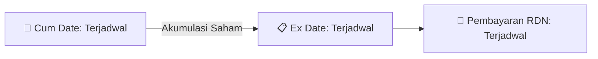

# ⚡ Laporan Intelijen Aksi Korporasi: [[CHIP]] - Dividen

⬅️ [[knowledge-base/daily-digests/Daily_Digest_20260828|Kembali ke Daily Digest]] | 📅 **2026-08-28** | 🎛️ [[Dashboard|Ke Dashboard Utama]]

> [!IMPORTANT]
> Laporan ini disusun secara otomatis oleh **Corporate Action Intelligence Agent** untuk memetakan implikasi strategis, rasio keuangan, alokasi dana, jadwal penting, dan panduan investor.

---

## 📌 1. Ringkasan Eksekutif & Katalis Strategis
- **Kode & Nama Emiten**: `[[CHIP]]`
- **Kategori Aksi Korporasi**: `Dividen`
- **Dokumen Resmi Bursa**: `AnnualReport2025-CHIP-att1`
- **Ringkasan Inti Aksi**: PT Pelita Teknologi Global Tbk menerbitkan Laporan Tahunan dan Laporan Keberlanjutan 2025 yang menyoroti penguatan ekosistem digital tepercaya, investasi mesin modern, serta penerapan manajemen risiko dan standar mutu/keamanan data untuk mendukung ekspansi pasar dan kemitraan strategis.

---

## 📊 2. Matriks Parameter Material & Angka Kunci
| Parameter Utama | Nilai / Keterangan Resmi |
| :--- | :--- |
| **Nama Perseroan** | `PT Pelita Teknologi Global Tbk` |
| **Bidang Usaha** | `Konsultasi dan perancangan Internet of Things (IoT) serta industri Kartu Cerdas (Smart Card)` |
| **Periode Laporan** | `2025` |
| **Dasar Penyusunan Laporan** | `POJK No. 29/POJK.04/2016, POJK No. 51/POJK.03/2017, SEOJK No. 16/SEOJK.04/2021` |
| **Fokus Strategis 2025** | `Penguatan kapasitas dan kualitas produksi melalui investasi mesin dan sistem pendukung modern, aman, dan efisien` |
| **Tema Laporan** | `Driving Trusted Digital Ecosystems for Sustainable Value` |

---

## 🗓️ 3. Jadwal Penting Pembagian Dividen Tunai
| Tahapan Aksi | Tanggal | Keterangan & Panduan Investor |
| :--- | :---: | :--- |
| **Cum Date (Pasar Reguler & Negosiasi)** | `Terjadwal` | **Batas akhir akumulasi saham untuk mengunci hak dividen** |
| **Ex Date (Pasar Reguler & Negosiasi)** | `Terjadwal` | Perdagangan tanpa hak dividen (Waspada *Dividend Trap*) |
| **Recording Date (DPS)** | `Terjadwal` | Penentuan daftar resmi pemegang saham berhak |
| **Tanggal Pembayaran (Payment Date)** | `Terjadwal` | **Pencairan dana dividen tunai (TBA / Terjadwal) langsung ke RDN** |

## 📈 4. Visualisasi Alur Distribusi Dividen

## 💡 5. Panduan Strategi Investor (Dividend Capture Play)
- 🎯 **Strategi Akumulasi**: Lakukan pembelian sebelum **Cum Date (Terjadwal)** jika mengincar *cash yield* dividen (TBA / Terjadwal).
- ⚠️ **Manajemen Risiko Dividend Trap**: Evaluasi besaran *yield* dibanding penurunan harga pada Ex Date. Jika *yield* relatif kecil, pertimbangkan *sell on news* menjelang Cum Date.

---

## 🔗 Hubungan Note Terkait (Knowledge Graph)
- [[knowledge-base/daily-digests/Daily_Digest_20260828|📄 Daily Digest 2026-08-28]]
- [[knowledge-base/trading-signals/Trading_Signals_20260828|🎯 Sinyal Cuan 2026-08-28]]
- [[Dashboard|🎛️ Kembali ke Dashboard]]