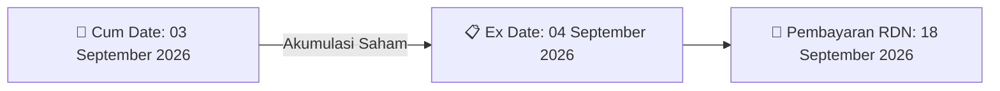

# ⚡ Laporan Intelijen Aksi Korporasi: [[CMRY]] - Dividen

⬅️ [[knowledge-base/daily-digests/Daily_Digest_20260827|Kembali ke Daily Digest]] | 📅 **2026-08-27** | 🎛️ [[Dashboard|Ke Dashboard Utama]]

> [!IMPORTANT]
> Laporan ini disusun secara otomatis oleh **Corporate Action Intelligence Agent** untuk memetakan implikasi strategis, rasio keuangan, alokasi dana, jadwal penting, dan panduan investor.

---

## 📌 1. Ringkasan Eksekutif & Katalis Strategis
- **Kode & Nama Emiten**: `[[CMRY]]`
- **Kategori Aksi Korporasi**: `Dividen`
- **Dokumen Resmi Bursa**: `Jadwal Aksi Korporasi (Khusus Penyampaian Dividen Interim)`
- **Ringkasan Inti Aksi**: PT Cisarua Mountain Dairy Tbk (CMRY) menyampaikan koreksi jadwal pembagian Dividen Tunai Interim untuk tahun buku 2026. Total nilai dividen sebesar IDR 793.468.300.000 dengan dividen per saham IDR 100. Cum dividen di pasar reguler dan negosiasi pada 3 September 2026, ex dividen pada 4 September 2026, recording date/DPS pada 7 September 2026, cum dividen pasar tunai pada 7 September 2026, ex dividen pasar tunai pada 8 September 2026, dan pembayaran dividen pada 18 September 2026. Data keuangan per 30 Juni 2026 meliputi laba bersih entitas induk dan total ekuitas masing-masing IDR 7.162.913.000.000 serta saldo laba ditahan tidak dibatasi penggunaannya IDR 3.339.927.000.000.

---

## 📊 2. Matriks Parameter Material & Angka Kunci
| Parameter Utama | Nilai / Keterangan Resmi |
| :--- | :--- |
| **Jenis Aksi Korporasi** | `Dividen Tunai Interim (Koreksi)` |
| **Nomor Surat** | `047/CORSEC/EKS/VIII/2026` |
| **Koreksi Atas Surat** | `Surat nomor 047/CORSEC/EKS/VIII/2026 tanggal 26 Agustus 2026` |
| **Tanggal Keputusan Direksi Disetujui Dewan Komisaris** | `26 Agustus 2026` |
| **Periode Tahun Buku** | `2026` |
| **Total Nilai Dividen** | `IDR 793.468.300.000` |
| **Dividen Per Saham** | `IDR 100` |
| **Tanggal Cum Dividen di Pasar Reguler dan Pasar Negosiasi** | `03 September 2026` |
| **Tanggal Ex Dividen di Pasar Reguler dan Pasar Negosiasi** | `04 September 2026` |
| **Tanggal Cum Dividen di Pasar Tunai** | `07 September 2026` |
| **Tanggal Ex Dividen di Pasar Tunai** | `08 September 2026` |
| **Tanggal Daftar Pemegang Saham (DPS) yang Berhak** | `07 September 2026` |
| **Waktu Pencatatan DPS** | `16:00` |
| **Tanggal Pembayaran Dividen** | `18 September 2026` |
| **Laba Bersih Entitas Induk per 30 Juni 2026** | `IDR 7.162.913.000.000` |
| **Saldo Laba Ditahan yang Tidak Dibatasi Penggunaannya per 30 Juni 2026** | `IDR 3.339.927.000.000` |
| **Total Ekuitas per 30 Juni 2026** | `IDR 7.162.913.000.000` |
| **Nama Pengirim** | `Martua Sihaloho` |
| **Jabatan Pengirim** | `Direktur` |
| **Waktu Penyampaian** | `27-08-2026 11:37` |

---

## 🗓️ 3. Jadwal Penting Pembagian Dividen Tunai
| Tahapan Aksi | Tanggal | Keterangan & Panduan Investor |
| :--- | :---: | :--- |
| **Cum Date (Pasar Reguler & Negosiasi)** | `03 September 2026` | **Batas akhir akumulasi saham untuk mengunci hak dividen** |
| **Ex Date (Pasar Reguler & Negosiasi)** | `04 September 2026` | Perdagangan tanpa hak dividen (Waspada *Dividend Trap*) |
| **Recording Date (DPS)** | `07 September 2026` | Penentuan daftar resmi pemegang saham berhak |
| **Tanggal Pembayaran (Payment Date)** | `18 September 2026` | **Pencairan dana dividen tunai (IDR 100) langsung ke RDN** |

## 📈 4. Visualisasi Alur Distribusi Dividen

## 💡 5. Panduan Strategi Investor (Dividend Capture Play)
- 🎯 **Strategi Akumulasi**: Lakukan pembelian sebelum **Cum Date (03 September 2026)** jika mengincar *cash yield* dividen (IDR 100).
- ⚠️ **Manajemen Risiko Dividend Trap**: Evaluasi besaran *yield* dibanding penurunan harga pada Ex Date. Jika *yield* relatif kecil, pertimbangkan *sell on news* menjelang Cum Date.

---

## 🔗 Hubungan Note Terkait (Knowledge Graph)
- [[knowledge-base/daily-digests/Daily_Digest_20260827|📄 Daily Digest 2026-08-27]]
- [[knowledge-base/trading-signals/Trading_Signals_20260827|🎯 Sinyal Cuan 2026-08-27]]
- [[Dashboard|🎛️ Kembali ke Dashboard]]