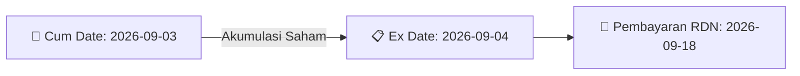

# ⚡ Laporan Intelijen Aksi Korporasi: [[DR]] - Dividen

⬅️ [[knowledge-base/daily-digests/Daily_Digest_20260828|Kembali ke Daily Digest]] | 📅 **2026-08-28** | 🎛️ [[Dashboard|Ke Dashboard Utama]]

> [!IMPORTANT]
> Laporan ini disusun secara otomatis oleh **Corporate Action Intelligence Agent** untuk memetakan implikasi strategis, rasio keuangan, alokasi dana, jadwal penting, dan panduan investor.

---

## 📌 1. Ringkasan Eksekutif & Katalis Strategis
- **Kode & Nama Emiten**: `[[DR]]`
- **Kategori Aksi Korporasi**: `Dividen`
- **Dokumen Resmi Bursa**: `DR DR Keterbukaan Informasi lamp1`
- **Ringkasan Inti Aksi**: Pengumuman penyesuaian syarat dan ketentuan Waran Terstruktur dengan underlying CMRY sehubungan rencana dividen tunai CMRY untuk tahun buku 2026. Total dividen Rp793.468.300.000, dividen per saham Rp100, dengan jadwal cum/ex dividen dan pembayaran pada 18 September 2026. Rasio pelaksanaan dan harga pelaksanaan Waran Terstruktur CMRY akan disesuaikan berdasarkan formula yang ditetapkan.

---

## 📊 2. Matriks Parameter Material & Angka Kunci
| Parameter Utama | Nilai / Keterangan Resmi |
| :--- | :--- |
| **Underlying Waran Terstruktur** | `CMRY (PT Cisarua Mountain Dairy Tbk)` |
| **Penerbit Waran Terstruktur** | `PT RHB Sekuritas Indonesia` |
| **Periode Tahun Buku Dividen** | `2026` |
| **Total Nilai Dividen** | `IDR 793.468.300.000` |
| **Dividen Per Saham** | `IDR 100` |
| **Efek Bersifat Ekuitas Selain Saham yang Dapat Dikonversi Menjadi Saham** | `Tidak` |
| **Tanggal Efektif** | `2026-08-26` |
| **Tanggal Cum Dividen Pasar Reguler dan Pasar Negosiasi** | `2026-09-03` |
| **Tanggal Ex Dividen Pasar Reguler dan Pasar Negosiasi** | `2026-09-04` |
| **Tanggal Cum Dividen Pasar Tunai** | `2026-09-07` |
| **Tanggal Ex Dividen Pasar Tunai** | `2026-09-08` |
| **Tanggal Daftar Pemegang Saham (Recording Date)** | `2026-09-07 16:00` |
| **Tanggal Pembayaran Dividen** | `2026-09-18` |
| **Formula Penyesuaian Rasio Pelaksanaan** | `E x (P - D) / P` |
| **Formula Penyesuaian Harga Pelaksanaan** | `X x (P - D) / P` |

---

## 🗓️ 3. Jadwal Penting Pembagian Dividen Tunai
| Tahapan Aksi | Tanggal | Keterangan & Panduan Investor |
| :--- | :---: | :--- |
| **Cum Date (Pasar Reguler & Negosiasi)** | `2026-09-03` | **Batas akhir akumulasi saham untuk mengunci hak dividen** |
| **Ex Date (Pasar Reguler & Negosiasi)** | `2026-09-04` | Perdagangan tanpa hak dividen (Waspada *Dividend Trap*) |
| **Recording Date (DPS)** | `2026-09-07 16:00` | Penentuan daftar resmi pemegang saham berhak |
| **Tanggal Pembayaran (Payment Date)** | `2026-09-18` | **Pencairan dana dividen tunai (IDR 100) langsung ke RDN** |

## 📈 4. Visualisasi Alur Distribusi Dividen

## 💡 5. Panduan Strategi Investor (Dividend Capture Play)
- 🎯 **Strategi Akumulasi**: Lakukan pembelian sebelum **Cum Date (2026-09-03)** jika mengincar *cash yield* dividen (IDR 100).
- ⚠️ **Manajemen Risiko Dividend Trap**: Evaluasi besaran *yield* dibanding penurunan harga pada Ex Date. Jika *yield* relatif kecil, pertimbangkan *sell on news* menjelang Cum Date.

---

## 🔗 Hubungan Note Terkait (Knowledge Graph)
- [[knowledge-base/daily-digests/Daily_Digest_20260828|📄 Daily Digest 2026-08-28]]
- [[knowledge-base/trading-signals/Trading_Signals_20260828|🎯 Sinyal Cuan 2026-08-28]]
- [[Dashboard|🎛️ Kembali ke Dashboard]]