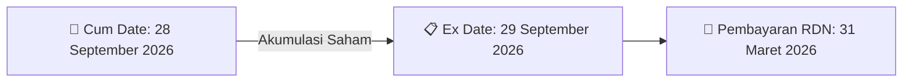

# ⚡ Laporan Intelijen Aksi Korporasi: [[HEXA]] - Dividen

⬅️ [[knowledge-base/daily-digests/Daily_Digest_20260921|Kembali ke Daily Digest]] | 📅 **2026-09-21** | 🎛️ [[Dashboard|Ke Dashboard Utama]]

> [!IMPORTANT]
> Laporan ini disusun secara otomatis oleh **Corporate Action Intelligence Agent** untuk memetakan implikasi strategis, rasio keuangan, alokasi dana, jadwal penting, dan panduan investor.

---

## 📌 1. Ringkasan Eksekutif & Katalis Strategis
- **Kode & Nama Emiten**: `[[HEXA]]`
- **Kategori Aksi Korporasi**: `Dividen`
- **Dokumen Resmi Bursa**: `Keterbukaan Informasi terkait Aksi Korporasi`
- **Ringkasan Inti Aksi**: Pembagian dividen tunai HEXA.

---

## 📊 2. Matriks Parameter Material & Angka Kunci
| Parameter Utama | Nilai / Keterangan Resmi |
| :--- | :--- |
| **Nominal Dividen** | `Rp0,013319 per saham` |
| **Total Dividen** | `Rp11.187.960` |
| **Cum Date** | `28 September 2026` |
| **Ex Date** | `29 September 2026` |
| **Recording Date** | `25 September 2026` |
| **Tanggal Pembayaran** | `31 Maret 2026` |

---

## 🗓️ 3. Jadwal Penting Pembagian Dividen Tunai
| Tahapan Aksi | Tanggal | Keterangan & Panduan Investor |
| :--- | :---: | :--- |
| **Cum Date (Pasar Reguler & Negosiasi)** | `28 September 2026` | **Batas akhir akumulasi saham untuk mengunci hak dividen** |
| **Ex Date (Pasar Reguler & Negosiasi)** | `29 September 2026` | Perdagangan tanpa hak dividen (Waspada *Dividend Trap*) |
| **Recording Date (DPS)** | `25 September 2026` | Penentuan daftar resmi pemegang saham berhak |
| **Tanggal Pembayaran (Payment Date)** | `31 Maret 2026` | **Pencairan dana dividen tunai (Rp0,013319 per saham) langsung ke RDN** |

## 📈 4. Visualisasi Alur Distribusi Dividen

## 💡 5. Panduan Strategi Investor (Dividend Capture Play)
- 🎯 **Strategi Akumulasi**: Lakukan pembelian sebelum **Cum Date (28 September 2026)** jika mengincar *cash yield* dividen (Rp0,013319 per saham).
- ⚠️ **Manajemen Risiko Dividend Trap**: Evaluasi besaran *yield* dibanding penurunan harga pada Ex Date. Jika *yield* relatif kecil, pertimbangkan *sell on news* menjelang Cum Date.

---

## 🔗 Hubungan Note Terkait (Knowledge Graph)
- [[knowledge-base/daily-digests/Daily_Digest_20260921|📄 Daily Digest 2026-09-21]]
- [[knowledge-base/trading-signals/Trading_Signals_20260921|🎯 Sinyal Cuan 2026-09-21]]
- [[Dashboard|🎛️ Kembali ke Dashboard]]