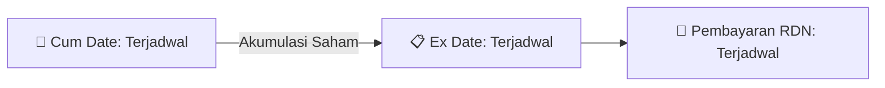

# ⚡ Laporan Intelijen Aksi Korporasi: [[HUMI]] - Dividen

⬅️ [[knowledge-base/daily-digests/Daily_Digest_20260813|Kembali ke Daily Digest]] | 📅 **2026-08-13** | 🎛️ [[Dashboard|Ke Dashboard Utama]]

> [!IMPORTANT]
> Laporan ini disusun secara otomatis oleh **Corporate Action Intelligence Agent** untuk memetakan implikasi strategis, rasio keuangan, alokasi dana, jadwal penting, dan panduan investor.

---

## 📌 1. Ringkasan Eksekutif & Katalis Strategis
- **Kode & Nama Emiten**: `[[HUMI]]`
- **Kategori Aksi Korporasi**: `Dividen`
- **Dokumen Resmi Bursa**: `Keterbukaan Informasi terkait Aksi Korporasi`
- **Ringkasan Inti Aksi**: PT Humpuss Maritim Internasional Tbk (HUMI) mengumumkan koreksi atas keterbukaan informasi sebelumnya terkait pembagian dividen tunai untuk tahun buku 2025. Dividen tunai akan dibagikan berdasarkan hasil RUPS Tahunan tanggal 29 Juli 2026, dengan total nilai dividen sebesar IDR 3.000.000.000 dan dividen per saham sebesar IDR 0,166. Jadwal pembagian dividen mencakup cum dividen di pasar reguler dan negosiasi pada 6 Agustus 2026, ex dividen pada 7 Agustus 2026, cum dividen di pasar tunai pada 10 Agustus 2026, ex dividen pada 11 Agustus 2026, recording date pada 10 Agustus 2026, dan pembayaran dividen pada 28 Agustus 2026. Data keuangan yang mendasari pembagian dividen per 31 Desember 2025 meliputi laba bersih USD 3.066.484, saldo laba ditahan USD 75.474.461, dan total ekuitas USD 172.874.357.

---

## 📊 2. Matriks Parameter Material & Angka Kunci
| Parameter Utama | Nilai / Keterangan Resmi |
| :--- | :--- |
| **Total Nilai Dividen** | `IDR 3.000.000.000` |
| **Dividen Per Saham** | `IDR 0,166` |
| **Tanggal Cum Dividen di Pasar Reguler dan Pasar Negosiasi** | `06 Agustus 2026` |
| **Tanggal Ex Dividen di Pasar Reguler dan Pasar Negosiasi** | `07 Agustus 2026` |
| **Tanggal Cum Dividen di Pasar Tunai** | `10 Agustus 2026` |
| **Tanggal Ex Dividen di Pasar Tunai** | `11 Agustus 2026` |
| **Tanggal Daftar Pemegang Saham (DPS) yang berhak atas dividen tunai** | `10 Agustus 2026` |
| **Tanggal Pembayaran Dividen** | `28 Agustus 2026` |
| **Laba Bersih yang diatribusikan kepada entitas induk** | `USD 3.066.484` |
| **Saldo Laba Ditahan yang Tidak Dibatasi Penggunaannya** | `USD 75.474.461` |
| **Total Ekuitas** | `USD 172.874.357` |
| **Tanggal Efektif** | `29 Juli 2026` |

---

## 🗓️ 3. Jadwal Penting Pembagian Dividen Tunai
| Tahapan Aksi | Tanggal | Keterangan & Panduan Investor |
| :--- | :---: | :--- |
| **Cum Date (Pasar Reguler & Negosiasi)** | `Terjadwal` | **Batas akhir akumulasi saham untuk mengunci hak dividen** |
| **Ex Date (Pasar Reguler & Negosiasi)** | `Terjadwal` | Perdagangan tanpa hak dividen (Waspada *Dividend Trap*) |
| **Recording Date (DPS)** | `Terjadwal` | Penentuan daftar resmi pemegang saham berhak |
| **Tanggal Pembayaran (Payment Date)** | `Terjadwal` | **Pencairan dana dividen tunai (TBA / Terjadwal) langsung ke RDN** |

## 📈 4. Visualisasi Alur Distribusi Dividen

## 💡 5. Panduan Strategi Investor (Dividend Capture Play)
- 🎯 **Strategi Akumulasi**: Lakukan pembelian sebelum **Cum Date (Terjadwal)** jika mengincar *cash yield* dividen (TBA / Terjadwal).
- ⚠️ **Manajemen Risiko Dividend Trap**: Evaluasi besaran *yield* dibanding penurunan harga pada Ex Date. Jika *yield* relatif kecil, pertimbangkan *sell on news* menjelang Cum Date.

---

## 🔗 Hubungan Note Terkait (Knowledge Graph)
- [[knowledge-base/daily-digests/Daily_Digest_20260813|📄 Daily Digest 2026-08-13]]
- [[knowledge-base/trading-signals/Trading_Signals_20260813|🎯 Sinyal Cuan 2026-08-13]]
- [[Dashboard|🎛️ Kembali ke Dashboard]]