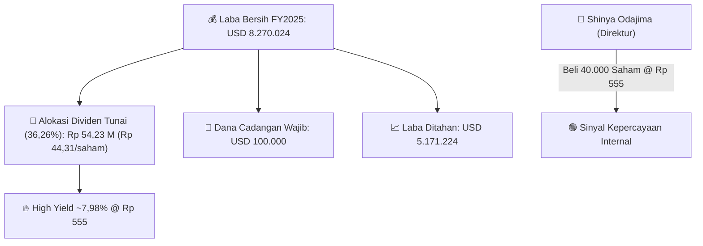
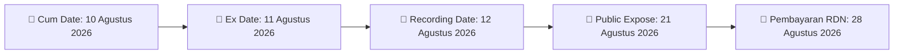

# ⚡ Laporan Intelijen Khusus: [[IKBI]] - Dividen Tunai & Sinyal Insider

⬅️ [[knowledge-base/daily-digests/Daily_Digest_20260804|Kembali ke Daily Digest]] | 📅 **2026-08-04** | 🎛️ [[Dashboard|Ke Dashboard Utama]]

> [!IMPORTANT]
> Dokumen ini adalah **Laporan Intelijen Master Aksi Korporasi** yang merangkum persetujuan RUPST, parameter pembagian dividen tunai **Rp 44,31 per saham** (**Yield ~7,98%**), sinyal transaksi pembelian saham oleh Direksi, serta jadwal pelaksanaan resmi.

---

## 📌 1. Executive Summary & Katalis Ganda

- **Emiten**: `[[IKBI]]` (PT Sumi Indo Kabel Tbk)
- **Kategori Aksi**: `Dividen Tunai RUPST & Insider Buying`
- **Nominal Dividen per Saham**: **Rp 44,31 per saham** (`USD 0,00245 / saham`)
- **Total Nilai Dividen Tunai**: **Rp 54,23 Miliar** (`USD 2.998.800` / **36,26% Payout Ratio** dari Laba Bersih FY2025 `USD 8.270.024`).
- **Sinyal Insider Buying**: **Shinya Odajima (Direktur IKBI)** melakukan pembelian saham pribadi sebanyak **40.000 lembar saham @ Rp 555/saham** pada 4 Agustus 2026.
- **Katalis Public Expose**: Paparan Publik Tahunan dijadwalkan pada **Jumat, 21 Agustus 2026 (09.00 WIB)** di Tangerang.

---

## 📊 2. Fakta Material & Matriks Parametrik

| Parameter Aksi Korporasi | Nilai Resmi | Analisis & Implikasi Investor |
| :--- | :---: | :--- |
| **Nominal Dividen per Saham** | `Rp 44,31 / saham` | Equivalent `USD 0,00245 / saham` |
| **Total Pembayaran Dividen** | `Rp 54.235.440.000` | Equivalent `USD 2.998.800` |
| **Harga Acuan Transaksi Insider** | `Rp 555 / saham` | Pembelian Pribadi Direktur 4 Agt 2026 |
| **Estimasi Dividend Yield** | **~7,98%** | **Sangat Tinggi / High-Conviction Yield** |
| **Dana Cadangan Wajib & Laba Ditahan** | `USD 100.000` | Sisa Laba Ditahan Kuat: `USD 5.171.224` |

---

## 🗓️ 3. Jadwal Pelaksanaan Pembagian Dividen Tunai (T+1 Presisi)

| Tahapan Perdagangan | Tanggal Pelaksanaan | Status & Panduan Investor |
| :--- | :---: | :--- |
| 📅 **Cum Dividen (Pasar Reguler & Negosiasi)** | **10 Agustus 2026** | Batas akhir akumulasi saham berhak dividen |
| 🚨 **Ex Dividen (Pasar Reguler & Negosiasi)** | **11 Agustus 2026** | Perdagangan tanpa hak dividen (Ex Date) |
| 📝 **Recording Date (DPS)** | **12 Agustus 2026** | Batas pendaftaran resmi daftar pemegang saham |
| 💸 **Tanggal Pembayaran Dividen** | **28 Agustus 2026** | Pencairan kas dividen tunai ke RDN |
| 🎤 **Public Expose Tahunan** | **21 Agustus 2026** | Sesi paparan kinerja & Q&A manajemen |

---

## 📈 4. Visualisasi Alokasi Laba & Timeline Pembayaran

---

## 💡 5. Panduan Strategi & Rekomendasi Investor

- 🎯 **Strategi Akumulasi**: Manfaatkan sinyal *insider buying* Direksi @ Rp 555 dan potensi *yield* **~7,98%**.
- ⚠️ **Waspada Ex Date**: Setelah Ex Date (11 Agustus 2026), perhatikan potensi penyesuaian harga pasar.

---

## 🔗 Hubungan Note Terkait (Knowledge Graph)
- [[knowledge-base/daily-digests/Daily_Digest_20260804|📄 Daily Digest 2026-08-04]]
- [[knowledge-base/trading-signals/Trading_Signals_20260814|🎯 Sinyal Cuan 2026-08-14]]
- [[Dashboard|🎛️ Kembali ke Dashboard]]
