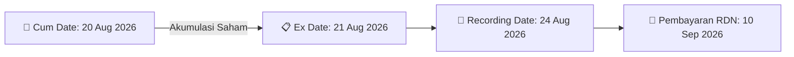

# ⚡ Laporan Intelijen Aksi Korporasi: [[INPP]] - Dividen Interim

⬅️ [[knowledge-base/daily-digests/Daily_Digest_20260811|Kembali ke Daily Digest]] | 📅 **2026-08-11** | 🎛️ [[Dashboard|Ke Dashboard Utama]]

> [!IMPORTANT]
> Laporan ini disusun secara otomatis oleh **Corporate Action Intelligence Agent** untuk memetakan implikasi strategis, rasio keuangan, alokasi dana, jadwal penting, dan panduan investor.

---

## 📌 1. Ringkasan Eksekutif & Katalis Strategis
- **Kode & Nama Emiten**: `[[INPP]]` (PT Indonesian Paradise Property Tbk)
- **Kategori Aksi Korporasi**: `Dividen Interim`
- **Nominal Dividen**: `Rp 4,50 per saham`
- **Total Nilai Dividen**: `Rp 50.318.872.794` (Rp 50,32 Miliar)
- **Dokumen Resmi Bursa**: `Jadwal Dividen Tunai Interim PT Indonesian Paradise Property Tbk`
- **Ringkasan Inti Aksi**: PT Indonesian Paradise Property Tbk (INPP) mengumumkan pembagian Dividen Interim Tunai tahun buku 2026 sebesar **Rp 4,50 per saham** dengan total dana sebesar **Rp 50,32 Miliar**, berdasarkan keputusan Direksi yang disetujui Dewan Komisaris pada tanggal 7 Agustus 2026.

---

## 📊 2. Matriks Parameter Material & Angka Kunci
| Parameter Utama | Nilai / Keterangan Resmi |
| :--- | :--- |
| **Nilai Dividen per Saham** | `Rp 4,50` per lembar saham |
| **Total Dana Dividen** | `Rp 50.318.872.794` (Rp 50,32 Miliar) |
| **Nomor Surat Keterangan** | `039/INPP-CS/VIII/2026` |
| **Tanggal Keputusan Direksi & Komisaris** | `07 Agustus 2026` |
| **Tanggal Pembayaran Dividen Tunai** | `10 September 2026` |

---

## 🗓️ 3. Jadwal Penting Pembagian Dividen Tunai
| Tahapan Aksi | Tanggal Resmi | Keterangan & Panduan Investor |
| :--- | :---: | :--- |
| **Cum Dividen (Pasar Reguler & Negosiasi)** | `20 Agustus 2026` | **Batas akhir akumulasi saham untuk mengunci hak dividen Rp 4,50/saham** |
| **Ex Dividen (Pasar Reguler & Negosiasi)** | `21 Agustus 2026` | Perdagangan tanpa hak dividen (Waspada *Dividend Trap*) |
| **Cum Dividen (Pasar Tunai)** | `24 Agustus 2026` | Batas akhir transaksi pasar tunai |
| **Ex Dividen (Pasar Tunai)** | `26 Agustus 2026` | Perdagangan pasar tunai tanpa hak dividen |
| **Recording Date (DPS)** | `24 Agustus 2026` | Penentuan daftar resmi pemegang saham berhak pukul 16:00 WIB |
| **Tanggal Pembayaran (Payment Date)** | `10 September 2026` | **Pencairan dana dividen tunai langsung ke RDN investor** |

---

## 📈 4. Visualisasi Alur Distribusi Dividen

## 💡 5. Panduan Strategi Investor (Dividend Capture Play)
- 🎯 **Strategi Akumulasi**: Lakukan akumulasi sebelum **20 Agustus 2026 (Cum Date)** untuk mengunci hak dividen tunai Rp 4,50/saham.
- ⚠️ **Manajemen Risiko Dividend Trap**: Evaluasi besaran *dividend yield* dibanding potensi penurunan harga pada Ex Date (21 Agustus 2026).

---

## 🔗 Hubungan Note Terkait (Knowledge Graph)
- [[knowledge-base/daily-digests/Daily_Digest_20260811|📄 Daily Digest 2026-08-11]]
- [[knowledge-base/trading-signals/Trading_Signals_20260814|🎯 Sinyal Cuan 2026-08-14]]
- [[Dashboard|🎛️ Kembali ke Dashboard]]
