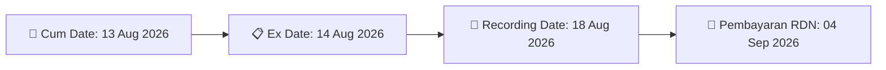

# ⚡ Laporan Aksi Korporasi Khusus: [[MARK]] - Dividen

⬅️ [[knowledge-base/daily-digests/Daily_Digest_20260805|Kembali ke Daily Digest]] | 📅 **2026-08-05** | 🎛️ [[Dashboard|Ke Dashboard Utama]]

> [!IMPORTANT]
> Dokumen ini disatukan secara otomatis oleh **Corporate Action Intelligence Agent** untuk memetakan implikasi strategis, rasio keuangan, alokasi dana, dan panduan investor.

---

## 📌 1. Ringkasan Eksekutif & Tujuan Strategis
- **Emiten**: `[[MARK]]`
- **Kategori Aksi**: `Dividen`
- **Judul Dokumen Resmi**: `Jadwal Aksi Korporasi (Khusus Penyampaian Dividen Interim)`
- **Ringkasan Utama**: Pembagian dividen tunai MARK.

---

## 📊 2. Fakta Material & Parameter Utama
- **Nominal Dividen**: `Rp20 per saham`
- **Total Dividen**: `Rp76.00 Miliar`
- **Cum Date**: `13 Agustus 2026`
- **Ex Date**: `14 Agustus 2026`
- **Recording Date**: `18 Agustus 2026`
- **Tanggal Pembayaran**: `04 September 2026`

---

## 📈 3. Visualisasi Timeline Pembayaran Dividen

## 💡 6. Panduan Strategi Investor & Arbitrase
- 📈 **Strategi Aksi**: Akumulasi saham sebelum **Cum Date** untuk mengunci dividen tunai.

---

## 🔗 Hubungan Note Terkait (Knowledge Graph)
- [[knowledge-base/daily-digests/Daily_Digest_20260805|📄 Daily Digest 2026-08-05]]
- [[knowledge-base/trading-signals/Trading_Signals_20260805|🎯 Sinyal Cuan 2026-08-05]]
- [[Dashboard|🎛️ Kembali ke Dashboard]]