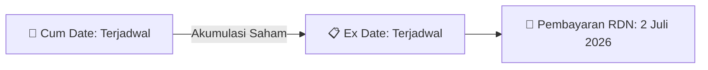

# ⚡ Laporan Intelijen Aksi Korporasi: [[SCNP]] - Dividen

⬅️ [[knowledge-base/daily-digests/Daily_Digest_20260910|Kembali ke Daily Digest]] | 📅 **2026-09-10** | 🎛️ [[Dashboard|Ke Dashboard Utama]]

> [!IMPORTANT]
> Laporan ini disusun secara otomatis oleh **Corporate Action Intelligence Agent** untuk memetakan implikasi strategis, rasio keuangan, alokasi dana, jadwal penting, dan panduan investor.

---

## 📌 1. Ringkasan Eksekutif & Katalis Strategis
- **Kode & Nama Emiten**: `[[SCNP]]`
- **Kategori Aksi Korporasi**: `Dividen`
- **Dokumen Resmi Bursa**: `Laporan Informasi dan Fakta Material lamp1`
- **Ringkasan Inti Aksi**: PT Selaras Citra Nusantara Perkasa Tbk (SCNP) melaporkan kinerja keuangan yang signifikan untuk semester pertama tahun 2026. Pendapatan usaha melonjak 41,7% menjadi Rp 156,58 miliar, dan perseroan berhasil membukukan laba usaha positif sebesar Rp 6,74 miliar, berbalik dari rugi usaha pada periode yang sama tahun sebelumnya. Laba tahun berjalan juga meningkat menjadi Rp 12,55 miliar. Perseroan juga membagikan dividen tunai sebesar Rp 10 miliar yang telah dibayarkan pada 2 Juli 2026.

---

## 📊 2. Matriks Parameter Material & Angka Kunci
| Parameter Utama | Nilai / Keterangan Resmi |
| :--- | :--- |
| **Pendapatan Usaha S1-2026** | `Rp 156,58 Miliar` |
| **Pertumbuhan Pendapatan Usaha** | `Naik 41,7%` |
| **Laba Usaha S1-2026** | `Rp 6,74 Miliar` |
| **Laba Usaha S1-2025** | `Rp (1,15) Miliar` |
| **Laba Kotor S1-2026** | `Rp 22,60 Miliar` |
| **Laba Tahun Berjalan S1-2026** | `Rp 12,55 Miliar` |
| **Marjin Laba Kotor (GPM) S1-2026** | `14,44%` |
| **Marjin Laba Usaha (OPM) S1-2026** | `4,31%` |
| **Rasio Utang terhadap Modal (DER)** | `36,84%` |
| **Tingkat Penyelesaian Bangunan Pabrik** | `Lebih dari 83%` |
| **Serapan Investasi Aset Tetap Dalam Penyelesaian** | `Rp 33,96 Miliar` |
| **Target Volume Ekspansi Produksi** | `1.594.062 unit` |
| **Peningkatan Volume Produksi** | `Lebih dari 49% dibandingkan capaian 2025` |
| **Dividen Tunai** | `Rp 10 Miliar` |
| **Tanggal Pembayaran Dividen** | `2 Juli 2026` |

---

## 🗓️ 3. Jadwal Penting Pembagian Dividen Tunai
| Tahapan Aksi | Tanggal | Keterangan & Panduan Investor |
| :--- | :---: | :--- |
| **Cum Date (Pasar Reguler & Negosiasi)** | `Terjadwal` | **Batas akhir akumulasi saham untuk mengunci hak dividen** |
| **Ex Date (Pasar Reguler & Negosiasi)** | `Terjadwal` | Perdagangan tanpa hak dividen (Waspada *Dividend Trap*) |
| **Recording Date (DPS)** | `Terjadwal` | Penentuan daftar resmi pemegang saham berhak |
| **Tanggal Pembayaran (Payment Date)** | `2 Juli 2026` | **Pencairan dana dividen tunai (TBA / Terjadwal) langsung ke RDN** |

## 📈 4. Visualisasi Alur Distribusi Dividen

## 💡 5. Panduan Strategi Investor (Dividend Capture Play)
- 🎯 **Strategi Akumulasi**: Lakukan pembelian sebelum **Cum Date (Terjadwal)** jika mengincar *cash yield* dividen (TBA / Terjadwal).
- ⚠️ **Manajemen Risiko Dividend Trap**: Evaluasi besaran *yield* dibanding penurunan harga pada Ex Date. Jika *yield* relatif kecil, pertimbangkan *sell on news* menjelang Cum Date.

---

## 🔗 Hubungan Note Terkait (Knowledge Graph)
- [[knowledge-base/daily-digests/Daily_Digest_20260910|📄 Daily Digest 2026-09-10]]
- [[knowledge-base/trading-signals/Trading_Signals_20260910|🎯 Sinyal Cuan 2026-09-10]]
- [[Dashboard|🎛️ Kembali ke Dashboard]]