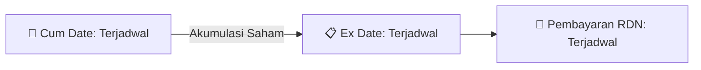

# ⚡ Laporan Intelijen Aksi Korporasi: [[TAPG]] - Dividen

⬅️ [[knowledge-base/daily-digests/Daily_Digest_20260824|Kembali ke Daily Digest]] | 📅 **2026-08-24** | 🎛️ [[Dashboard|Ke Dashboard Utama]]

> [!IMPORTANT]
> Laporan ini disusun secara otomatis oleh **Corporate Action Intelligence Agent** untuk memetakan implikasi strategis, rasio keuangan, alokasi dana, jadwal penting, dan panduan investor.

---

## 📌 1. Ringkasan Eksekutif & Katalis Strategis
- **Kode & Nama Emiten**: `[[TAPG]]`
- **Kategori Aksi Korporasi**: `Dividen`
- **Dokumen Resmi Bursa**: `Informasi Transaksi Afiliasi`
- **Ringkasan Inti Aksi**: Pembagian dividen tunai TAPG.

---

## 📊 2. Matriks Parameter Material & Angka Kunci
- **Detail Dokumen**: Rincian angka terlampir pada dokumen resmi `20260824_TAPG_20260824_TAPG_Informasi Transaksi Afiliasi_32132316.pdf`.

---

## 🗓️ 3. Jadwal Penting Pembagian Dividen Tunai
| Tahapan Aksi | Tanggal | Keterangan & Panduan Investor |
| :--- | :---: | :--- |
| **Cum Date (Pasar Reguler & Negosiasi)** | `Terjadwal` | **Batas akhir akumulasi saham untuk mengunci hak dividen** |
| **Ex Date (Pasar Reguler & Negosiasi)** | `Terjadwal` | Perdagangan tanpa hak dividen (Waspada *Dividend Trap*) |
| **Recording Date (DPS)** | `Terjadwal` | Penentuan daftar resmi pemegang saham berhak |
| **Tanggal Pembayaran (Payment Date)** | `Terjadwal` | **Pencairan dana dividen tunai (TBA / Terjadwal) langsung ke RDN** |

## 📈 4. Visualisasi Alur Distribusi Dividen

## 💡 5. Panduan Strategi Investor (Dividend Capture Play)
- 🎯 **Strategi Akumulasi**: Lakukan pembelian sebelum **Cum Date (Terjadwal)** jika mengincar *cash yield* dividen (TBA / Terjadwal).
- ⚠️ **Manajemen Risiko Dividend Trap**: Evaluasi besaran *yield* dibanding penurunan harga pada Ex Date. Jika *yield* relatif kecil, pertimbangkan *sell on news* menjelang Cum Date.

---

## 🔗 Hubungan Note Terkait (Knowledge Graph)
- [[knowledge-base/daily-digests/Daily_Digest_20260824|📄 Daily Digest 2026-08-24]]
- [[knowledge-base/trading-signals/Trading_Signals_20260824|🎯 Sinyal Cuan 2026-08-24]]
- [[Dashboard|🎛️ Kembali ke Dashboard]]