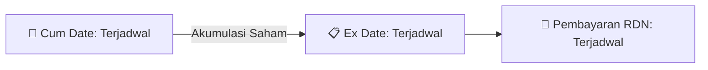

# ⚡ Laporan Intelijen Aksi Korporasi: [[TAXI]] - Dividen

⬅️ [[knowledge-base/daily-digests/Daily_Digest_20260911|Kembali ke Daily Digest]] | 📅 **2026-09-11** | 🎛️ [[Dashboard|Ke Dashboard Utama]]

> [!IMPORTANT]
> Laporan ini disusun secara otomatis oleh **Corporate Action Intelligence Agent** untuk memetakan implikasi strategis, rasio keuangan, alokasi dana, jadwal penting, dan panduan investor.

---

## 📌 1. Ringkasan Eksekutif & Katalis Strategis
- **Kode & Nama Emiten**: `[[TAXI]]`
- **Kategori Aksi Korporasi**: `Dividen`
- **Dokumen Resmi Bursa**: `Ringkasan RisalahRisalah RUPS`
- **Ringkasan Inti Aksi**: Rapat Umum Pemegang Saham Tahunan (RUPST) PT Express Transindo Utama Tbk (TAXI) diselenggarakan pada 9 September 2026 dengan kuorum kehadiran 21,14% dari total saham dengan hak suara sah. Rapat menyetujui seluruh agenda, termasuk persetujuan laporan tahunan dan laporan keuangan tahun buku 2025, penetapan penggunaan laba bersih tanpa pembagian dividen tunai, pemberian wewenang kepada Dewan Komisaris untuk menunjuk akuntan publik untuk audit tahun buku 2026, serta penetapan remunerasi Dewan Komisaris dan Direksi untuk tahun buku 2026. Susunan Direksi dan Dewan Komisaris periode 2022-2027 tetap dipertahankan.

---

## 📊 2. Matriks Parameter Material & Angka Kunci
| Parameter Utama | Nilai / Keterangan Resmi |
| :--- | :--- |
| **Tanggal RUPS** | `2026-09-09` |
| **Kuorum Kehadiran** | `21,14% (2.161.370.539 saham)` |
| **Agenda 1 - Persetujuan Laporan Tahunan dan Laporan Keuangan** | `Disetujui dengan 99,954% suara setuju` |
| **Agenda 2 - Penggunaan Laba Bersih** | `Disetujui, tidak ada pembagian dividen tunai` |
| **Agenda 3 - Penunjukan Akuntan Publik** | `Disetujui, wewenang diberikan kepada Dewan Komisaris` |
| **Agenda 4 - Remunerasi Dewan Komisaris dan Direksi** | `Disetujui, honorarium Dewan Komisaris maksimal Rp120.000.000 per tahun` |
| **Laporan Keuangan Tahun Buku 2025** | `Opini Wajar Tanpa Pengecualian oleh KAP Heroe Pramono dan Rekan` |
| **Susunan Direksi** | `Johannes B.E. Triatmojo (Direktur Utama), Jannes Philipus Chuang (Direktur), Shafruhan Sinungan (Direktur)` |
| **Susunan Dewan Komisaris** | `Ari Daryata Singgih (Komisaris Utama), M. Alfan Baharudin (Komisaris)` |

---

## 🗓️ 3. Jadwal Penting Pembagian Dividen Tunai
| Tahapan Aksi | Tanggal | Keterangan & Panduan Investor |
| :--- | :---: | :--- |
| **Cum Date (Pasar Reguler & Negosiasi)** | `Terjadwal` | **Batas akhir akumulasi saham untuk mengunci hak dividen** |
| **Ex Date (Pasar Reguler & Negosiasi)** | `Terjadwal` | Perdagangan tanpa hak dividen (Waspada *Dividend Trap*) |
| **Recording Date (DPS)** | `Terjadwal` | Penentuan daftar resmi pemegang saham berhak |
| **Tanggal Pembayaran (Payment Date)** | `Terjadwal` | **Pencairan dana dividen tunai (TBA / Terjadwal) langsung ke RDN** |

## 📈 4. Visualisasi Alur Distribusi Dividen

## 💡 5. Panduan Strategi Investor (Dividend Capture Play)
- 🎯 **Strategi Akumulasi**: Lakukan pembelian sebelum **Cum Date (Terjadwal)** jika mengincar *cash yield* dividen (TBA / Terjadwal).
- ⚠️ **Manajemen Risiko Dividend Trap**: Evaluasi besaran *yield* dibanding penurunan harga pada Ex Date. Jika *yield* relatif kecil, pertimbangkan *sell on news* menjelang Cum Date.

---

## 🔗 Hubungan Note Terkait (Knowledge Graph)
- [[knowledge-base/daily-digests/Daily_Digest_20260911|📄 Daily Digest 2026-09-11]]
- [[knowledge-base/trading-signals/Trading_Signals_20260911|🎯 Sinyal Cuan 2026-09-11]]
- [[Dashboard|🎛️ Kembali ke Dashboard]]