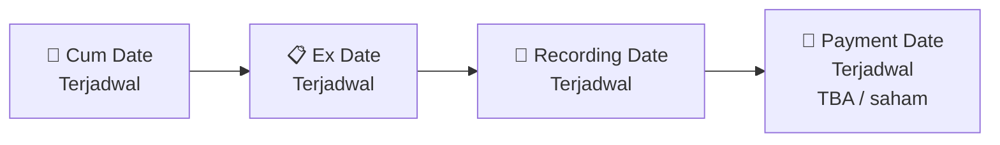

# 💰 Pengumuman Pembagian Dividen Tunai — [[TEBE]]

⬅️ [[knowledge-base/daily-digests/Daily_Digest_20261007|Kembali ke Daily Digest]] | 📅 **2026-10-07** | 🎛️ [[Dashboard|Ke Dashboard Utama]]

> [!IMPORTANT]
> Laporan ini disusun secara otomatis oleh **Corporate Action Intelligence Agent** pada **2026-10-07**.
> Sumber dokumen: `20261006_TEBE_20261005_TEBE_Public Expose_32163383_lamp1.pdf`

---

## 📌 1. Ringkasan Eksekutif & Tujuan Strategis

- **Kode & Nama Emiten**: `[[TEBE]]`
- **Kategori Aksi Korporasi**: `Dividen`
- **Dokumen Sumber**: `20261006_TEBE_20261005_TEBE_Public Expose_32163383_lamp1.pdf`
- **Tanggal Laporan**: `2026-10-07`

[Analisis LLM tidak tersedia — isi manual]

---

## 📊 2. Fakta Material & Parameter Keuangan

| Parameter Utama | Nilai / Keterangan |
| :--- | :--- |
| **Jenis Dividen** | `Final` |
| **Nominal per Saham** | `TBA` |
| **Total Nilai Dividen** | `TBA` |
| **Cum Date (Pasar Reguler)** | `Terjadwal` |
| **Ex Date** | `Terjadwal` |
| **Recording Date (DPS)** | `Terjadwal` |
| **Payment Date** | `Terjadwal` |

---

## 👥 3. Struktur Kepemilikan, Pengendali & Pembeli Siaga

- **Emiten**: `TEBE` | Informasi kepemilikan mengacu pada dokumen resmi sumber.

---

## 🎯 4. Alokasi & Rencana Penggunaan Dana

- Informasi alokasi dana belum tersedia — lihat prospektus / dokumen resmi.

---

## 📅 5. Timeline & Jadwal Pelaksanaan

| Tahapan / Event | Tanggal |
| :--- | :---: |
| **Cum Date (Pasar Reguler & Negosiasi)** | `Terjadwal` |
| **Ex Date** | `Terjadwal` |
| **Recording Date (DPS)** | `Terjadwal` |
| **Payment Date (Pembayaran ke RDN)** | `Terjadwal` |

---

## 📈 6. Diagram Visual Flowchart (Mermaid)

---

## 💡 7. Rekomendasi Investor & Strategi Trading

[Analisis LLM tidak tersedia — isi manual]

---

## 🔗 8. Hubungan Note Terkait (Knowledge Graph)

- [[knowledge-base/daily-digests/Daily_Digest_20261007|📄 Daily Digest 2026-10-07]]
- [[knowledge-base/trading-signals/Trading_Signals_20261007|🎯 Sinyal Cuan 2026-10-07]]
- [[TEBE|🏬 Halaman Emiten TEBE]]
- [[Dashboard|🎛️ Kembali ke Dashboard Utama]]

---

*Laporan dibuat otomatis oleh Corporate Action Intelligence Agent · 2026-10-07*