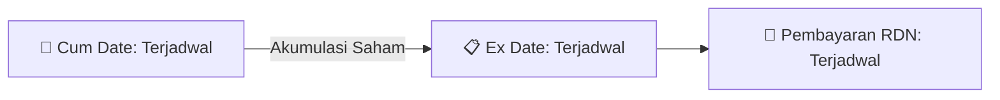

# ⚡ Laporan Intelijen Aksi Korporasi: [[VICO]] - Dividen

⬅️ [[knowledge-base/daily-digests/Daily_Digest_20260827|Kembali ke Daily Digest]] | 📅 **2026-08-27** | 🎛️ [[Dashboard|Ke Dashboard Utama]]

> [!IMPORTANT]
> Laporan ini disusun secara otomatis oleh **Corporate Action Intelligence Agent** untuk memetakan implikasi strategis, rasio keuangan, alokasi dana, jadwal penting, dan panduan investor.

---

## 📌 1. Ringkasan Eksekutif & Katalis Strategis
- **Kode & Nama Emiten**: `[[VICO]]`
- **Kategori Aksi Korporasi**: `Dividen`
- **Dokumen Resmi Bursa**: `Pemanggilan RUPS lamp2`
- **Ringkasan Inti Aksi**: Perseroan mengumumkan pemanggilan Rapat Umum Pemegang Saham Luar Biasa yang akan diselenggarakan pada Jumat, 18 September 2026 untuk meminta persetujuan penggunaan sebagian laba ditahan per 31 Desember 2025 sebagai dividen tunai.

---

## 📊 2. Matriks Parameter Material & Angka Kunci
| Parameter Utama | Nilai / Keterangan Resmi |
| :--- | :--- |
| **Hari/Tanggal RUPSLB** | `Jumat, 18 September 2026` |
| **Waktu RUPSLB** | `14.00 WIB - Selesai` |
| **Tempat RUPSLB** | `Graha BIP, Lantai 3A, South Jakarta 12930` |
| **Mekanisme Rapat** | `Fisik dan elektronik dengan aplikasi Electronic Meeting System` |
| **Mata Acara** | `Persetujuan penggunaan sebagian laba ditahan untuk dividen tunai` |
| **Laba Ditahan yang Digunakan** | `Saldo Laba Ditahan per 31 Desember 2025` |
| **Auditor** | `Heliantono dan Rekan Parker Russell International` |
| **Nomor Laporan Auditor** | `00400/2.0459/AU.1/09/0916-4/1/III/2026` |
| **Tanggal Laporan Auditor** | `27 Maret 2026` |
| **Tanggal Pemanggilan** | `27 Agustus 2026` |
| **Tanggal Penyelenggaraan Rapat** | `18 September 2026` |
| **Recording Date** | `26 Agustus 2026 pukul 16:00 WIB` |
| **Periode Unduh Materi** | `27 Agustus 2026 sampai 18 September 2026` |

---

## 🗓️ 3. Jadwal Penting Pembagian Dividen Tunai
| Tahapan Aksi | Tanggal | Keterangan & Panduan Investor |
| :--- | :---: | :--- |
| **Cum Date (Pasar Reguler & Negosiasi)** | `Terjadwal` | **Batas akhir akumulasi saham untuk mengunci hak dividen** |
| **Ex Date (Pasar Reguler & Negosiasi)** | `Terjadwal` | Perdagangan tanpa hak dividen (Waspada *Dividend Trap*) |
| **Recording Date (DPS)** | `26 Agustus 2026 pukul 16:00 WIB` | Penentuan daftar resmi pemegang saham berhak |
| **Tanggal Pembayaran (Payment Date)** | `Terjadwal` | **Pencairan dana dividen tunai (TBA / Terjadwal) langsung ke RDN** |

## 📈 4. Visualisasi Alur Distribusi Dividen

## 💡 5. Panduan Strategi Investor (Dividend Capture Play)
- 🎯 **Strategi Akumulasi**: Lakukan pembelian sebelum **Cum Date (Terjadwal)** jika mengincar *cash yield* dividen (TBA / Terjadwal).
- ⚠️ **Manajemen Risiko Dividend Trap**: Evaluasi besaran *yield* dibanding penurunan harga pada Ex Date. Jika *yield* relatif kecil, pertimbangkan *sell on news* menjelang Cum Date.

---

## 🔗 Hubungan Note Terkait (Knowledge Graph)
- [[knowledge-base/daily-digests/Daily_Digest_20260827|📄 Daily Digest 2026-08-27]]
- [[knowledge-base/trading-signals/Trading_Signals_20260827|🎯 Sinyal Cuan 2026-08-27]]
- [[Dashboard|🎛️ Kembali ke Dashboard]]