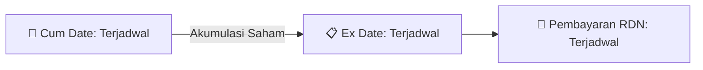

# ⚡ Laporan Intelijen Aksi Korporasi: [[ZP]] - Dividen

⬅️ [[knowledge-base/daily-digests/Daily_Digest_20260828|Kembali ke Daily Digest]] | 📅 **2026-08-28** | 🎛️ [[Dashboard|Ke Dashboard Utama]]

> [!IMPORTANT]
> Laporan ini disusun secara otomatis oleh **Corporate Action Intelligence Agent** untuk memetakan implikasi strategis, rasio keuangan, alokasi dana, jadwal penting, dan panduan investor.

---

## 📌 1. Ringkasan Eksekutif & Katalis Strategis
- **Kode & Nama Emiten**: `[[ZP]]`
- **Kategori Aksi Korporasi**: `Dividen`
- **Dokumen Resmi Bursa**: `ZP ZP Keterbukaan Informasi lamp1`
- **Ringkasan Inti Aksi**: PT Maybank Sekuritas Indonesia mengumumkan bahwa tidak ada penyesuaian syarat dan ketentuan untuk Waran Terstruktur BBCAZPCZ6A dan BBCAZPCH7A sehubungan dengan Dividen Tunai PT Bank Central Asia Tbk (BBCA) yang diumumkan pada 19 Agustus 2026, sesuai Bagian 3.8 Prospektus tertanggal 11 April 2025.

---

## 📊 2. Matriks Parameter Material & Angka Kunci
| Parameter Utama | Nilai / Keterangan Resmi |
| :--- | :--- |
| **Emiten Underlying** | `PT Bank Central Asia Tbk (BBCA)` |
| **Penerbit Waran** | `PT Maybank Sekuritas Indonesia` |
| **Kode Waran Terstruktur** | `BBCAZPCZ6A dan BBCAZPCH7A` |
| **Tanggal Pengumuman Dividen BBCA** | `19 Agustus 2026` |
| **Tanggal Pengumuman Penerbit** | `21 Agustus 2026` |
| **Tanggal Prospektus** | `11 April 2025` |
| **Keputusan Penyesuaian** | `Tidak ada penyesuaian terhadap BBCAZPCZ6A dan BBCAZPCH7A sehubungan dengan Dividen Tunai` |
| **Referensi Syarat** | `Bagian 3.8 Prospektus tertanggal 11 April 2025 dan Term Sheet` |

---

## 🗓️ 3. Jadwal Penting Pembagian Dividen Tunai
| Tahapan Aksi | Tanggal | Keterangan & Panduan Investor |
| :--- | :---: | :--- |
| **Cum Date (Pasar Reguler & Negosiasi)** | `Terjadwal` | **Batas akhir akumulasi saham untuk mengunci hak dividen** |
| **Ex Date (Pasar Reguler & Negosiasi)** | `Terjadwal` | Perdagangan tanpa hak dividen (Waspada *Dividend Trap*) |
| **Recording Date (DPS)** | `Terjadwal` | Penentuan daftar resmi pemegang saham berhak |
| **Tanggal Pembayaran (Payment Date)** | `Terjadwal` | **Pencairan dana dividen tunai (TBA / Terjadwal) langsung ke RDN** |

## 📈 4. Visualisasi Alur Distribusi Dividen

## 💡 5. Panduan Strategi Investor (Dividend Capture Play)
- 🎯 **Strategi Akumulasi**: Lakukan pembelian sebelum **Cum Date (Terjadwal)** jika mengincar *cash yield* dividen (TBA / Terjadwal).
- ⚠️ **Manajemen Risiko Dividend Trap**: Evaluasi besaran *yield* dibanding penurunan harga pada Ex Date. Jika *yield* relatif kecil, pertimbangkan *sell on news* menjelang Cum Date.

---

## 🔗 Hubungan Note Terkait (Knowledge Graph)
- [[knowledge-base/daily-digests/Daily_Digest_20260828|📄 Daily Digest 2026-08-28]]
- [[knowledge-base/trading-signals/Trading_Signals_20260828|🎯 Sinyal Cuan 2026-08-28]]
- [[Dashboard|🎛️ Kembali ke Dashboard]]