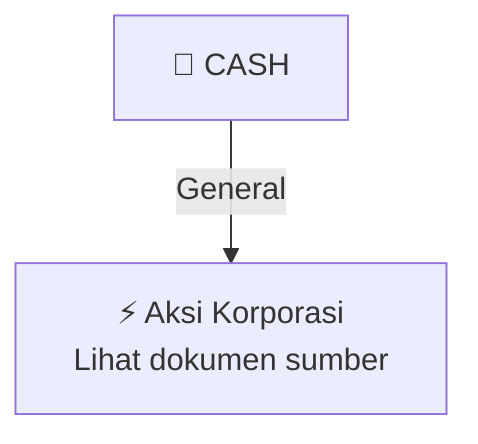

# ⚡ Keterbukaan Informasi Aksi Korporasi — [[CASH]]

⬅️ [[knowledge-base/daily-digests/Daily_Digest_20261006|Kembali ke Daily Digest]] | 📅 **2026-10-06** | 🎛️ [[Dashboard|Ke Dashboard Utama]]

> [!IMPORTANT]
> Laporan ini disusun secara otomatis oleh **Corporate Action Intelligence Agent** pada **2026-10-06**.
> Sumber dokumen: `20261005_CASH_20261005_CASH_Laporan Informasi dan Fakta Material_32163210_lamp3.pdf`

---

## 📌 1. Ringkasan Eksekutif & Tujuan Strategis

- **Kode & Nama Emiten**: `[[CASH]]`
- **Kategori Aksi Korporasi**: `General`
- **Dokumen Sumber**: `20261005_CASH_20261005_CASH_Laporan Informasi dan Fakta Material_32163210_lamp3.pdf`
- **Tanggal Laporan**: `2026-10-06`

[Analisis LLM tidak tersedia — isi manual]

---

## 📊 2. Fakta Material & Parameter Keuangan

| Parameter Utama | Nilai / Keterangan |
| :--- | :--- |
| **Nomor surat Perseroan** | `425/SK/CSC-CWI/X/2026` |
| **Tanggal jawaban ke-3 Perseroan kepada OJK** | `5 Oktober 2026` |
| **Tanggal respon ke-3 OJK** | `4 Oktober 2026` |
| **Keberatan pihak tertentu atas rencana penambahan kegiatan usaha** | `Tidak terdapat keberatan dari pihak-pihak tertentu` |
| **Pemegang saham Perseroan yang disebut** | `PT Fortuna Wijaya Global merupakan pemegang saham Perseroan` |
| **Keterbukaan ultimate beneficial owner PT Fortuna Wijaya Global** | `Belum dapat diungkapkan karena PT Fortuna Wijaya Global adalah perseroan terbatas tertutup dan informasi pemegang saham individu tidak tercatat pada Biro Administrasi Efek` |
| **Dasar penetapan Pemegang Saham Pengendali** | `RUPST Perseroan tanggal 28 Mei 2025 menyetujui perubahan dan penetapan pemegang saham pengendali` |
| **Perubahan Pemegang Saham Pengendali** | `Dari Sdr. Tee Tedy Setiawan dan Sdr. Andri Wijono Sutiono menjadi Sdr. Andri Wijono Sutiono` |
| **Persentase kepemilikan Sdr. Andri Wijono Sutiono** | `33,80%` |
| **Persentase kepemilikan Sdr. Hasim** | `33,64%` |
| **Kepemilikan Sdr. Andri Wijono Sutiono pada PT Bara Utama** | `Tidak memiliki saham secara langsung; memiliki kepemilikan tidak langsung melalui PT Citra Mustika Abadi dan PT Bukit Besi Raya` |
| **Referensi prospektus kepemilikan saham per 31 Mei 2026** | `Prospektus Perseroan halaman 59 yang diterbitkan 1 Juni 2026 melalui website Bursa` |

---

## 👥 3. Struktur Kepemilikan, Pengendali & Pembeli Siaga

- **Emiten**: `CASH` | Informasi kepemilikan mengacu pada dokumen resmi sumber.

---

## 🎯 4. Alokasi & Rencana Penggunaan Dana

- Informasi alokasi dana belum tersedia — lihat prospektus / dokumen resmi.

---

## 📅 5. Timeline & Jadwal Pelaksanaan

| Tahapan / Event | Tanggal |
| :--- | :---: |
| **Jadwal** | Lihat dokumen sumber. |

---

## 📈 6. Diagram Visual Flowchart (Mermaid)

---

## 💡 7. Rekomendasi Investor & Strategi Trading

[Analisis LLM tidak tersedia — isi manual]

---

## 🔗 8. Hubungan Note Terkait (Knowledge Graph)

- [[knowledge-base/daily-digests/Daily_Digest_20261006|📄 Daily Digest 2026-10-06]]
- [[knowledge-base/trading-signals/Trading_Signals_20261006|🎯 Sinyal Cuan 2026-10-06]]
- [[CASH|🏬 Halaman Emiten CASH]]
- [[Dashboard|🎛️ Kembali ke Dashboard Utama]]

---

*Laporan dibuat otomatis oleh Corporate Action Intelligence Agent · 2026-10-06*