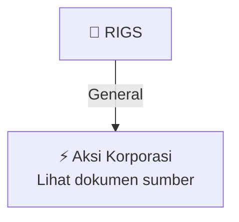

# ⚡ Keterbukaan Informasi Aksi Korporasi — [[RIGS]]

⬅️ [[knowledge-base/daily-digests/Daily_Digest_20260929|Kembali ke Daily Digest]] | 📅 **2026-09-29** | 🎛️ [[Dashboard|Ke Dashboard Utama]]

> [!IMPORTANT]
> Laporan ini disusun secara otomatis oleh **Corporate Action Intelligence Agent** pada **2026-09-29**.
> Sumber dokumen: `20260928_RIGS_AnnualReport2026-RIGS-att1.pdf`

---

## 📌 1. Ringkasan Eksekutif & Tujuan Strategis

- **Kode & Nama Emiten**: `[[RIGS]]`
- **Kategori Aksi Korporasi**: `General`
- **Dokumen Sumber**: `20260928_RIGS_AnnualReport2026-RIGS-att1.pdf`
- **Tanggal Laporan**: `2026-09-29`

[Analisis LLM tidak tersedia — isi manual]

---

## 📊 2. Fakta Material & Parameter Keuangan

| Parameter Utama | Nilai / Keterangan |
| :--- | :--- |
| **Uraian Kejadian** | `LAPORAN TAHUNAN DAN LAPORAN KEBERLANJUTAN 2026 2026 ANNUAL REPORT AND SUSTAINABILITY REPORT Ketangguhan Operasional Pertumbuhan Berkelanjutan OperaƟ onal Resilience, Sustainable Growth 2026 Annual and Sustainability Report | Laporan Tahunan dan Laporan Keberlanjutan 2026 2 TENTANG LAPORAN TAHUNAN DAN LAPORAN KEBERLANJUTAN 2026 About the 2026 Annual Report and Sustainability Report PT Rig Tenders Indonesia Tbk (“Perseroan”) menyajikan Laporan Tahunan dan Laporan Keberlanjutan 2026 dengan tema “Op` |

---

## 👥 3. Struktur Kepemilikan, Pengendali & Pembeli Siaga

- **Emiten**: `RIGS` | Informasi kepemilikan mengacu pada dokumen resmi sumber.

---

## 🎯 4. Alokasi & Rencana Penggunaan Dana

- Informasi alokasi dana belum tersedia — lihat prospektus / dokumen resmi.

---

## 📅 5. Timeline & Jadwal Pelaksanaan

| Tahapan / Event | Tanggal |
| :--- | :---: |
| **Jadwal** | Lihat dokumen sumber. |

---

## 📈 6. Diagram Visual Flowchart (Mermaid)

---

## 💡 7. Rekomendasi Investor & Strategi Trading

[Analisis LLM tidak tersedia — isi manual]

---

## 🔗 8. Hubungan Note Terkait (Knowledge Graph)

- [[knowledge-base/daily-digests/Daily_Digest_20260929|📄 Daily Digest 2026-09-29]]
- [[knowledge-base/trading-signals/Trading_Signals_20260929|🎯 Sinyal Cuan 2026-09-29]]
- [[RIGS|🏬 Halaman Emiten RIGS]]
- [[Dashboard|🎛️ Kembali ke Dashboard Utama]]

---

*Laporan dibuat otomatis oleh Corporate Action Intelligence Agent · 2026-09-29*