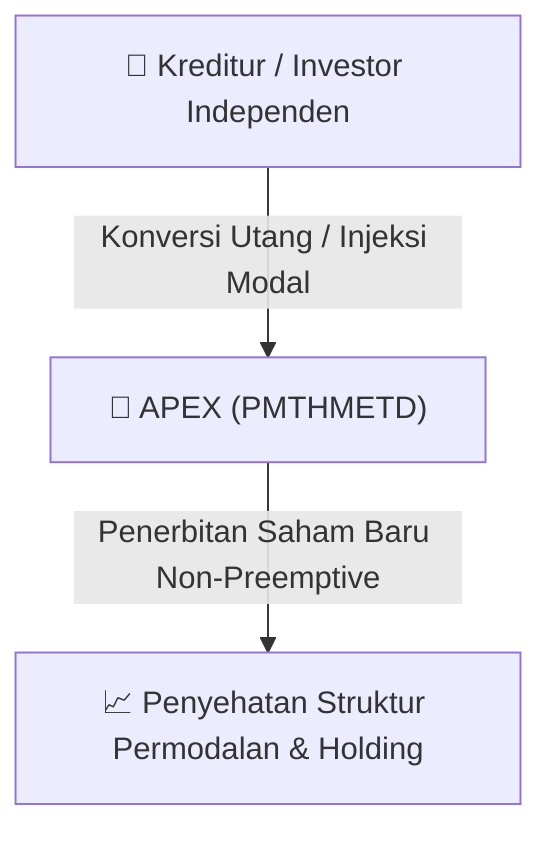

# ⚡ Laporan Intelijen Aksi Korporasi: [[APEX]] - RUPS

⬅️ [[knowledge-base/daily-digests/Daily_Digest_20260831|Kembali ke Daily Digest]] | 📅 **2026-08-31** | 🎛️ [[Dashboard|Ke Dashboard Utama]]

> [!IMPORTANT]
> Laporan ini disusun secara otomatis oleh **Corporate Action Intelligence Agent** untuk memetakan implikasi strategis, rasio keuangan, alokasi dana, jadwal penting, dan panduan investor.

---

## 📌 1. Ringkasan Eksekutif & Katalis Strategis
- **Kode & Nama Emiten**: `[[APEX]]`
- **Kategori Aksi Korporasi**: `RUPS`
- **Dokumen Resmi Bursa**: `Pengumuman RUPS lamp4`
- **Ringkasan Inti Aksi**: PT Apexindo Pratama Duta Tbk berencana menerbitkan saham baru melalui Penambahan Modal Tanpa Hak Memesan Efek Terlebih Dahulu (PMTHMETD) untuk memperbaiki posisi keuangan, dengan persetujuan RUPS Luar Biasa pada 7 Oktober 2026. Penerbitan saham baru sebanyak 218.090.317 saham Seri B dengan nilai nominal Rp325 per saham dan harga pelaksanaan Rp325 per saham, mewakili 5,79% dari modal ditempatkan dan disetor penuh setelah PMTHMETD, yang akan menyebabkan dilusi kepemilikan pemegang saham sebesar 5,79%.

---

## 📊 2. Matriks Parameter Material & Angka Kunci
| Parameter Utama | Nilai / Keterangan Resmi |
| :--- | :--- |
| **Jumlah Saham Baru** | `218.090.317 saham Seri B` |
| **Nilai Nominal per Saham** | `Rp325,00` |
| **Harga Pelaksanaan per Saham** | `Rp325,00` |
| **Persentase Dilusi** | `5,79%` |
| **Tanggal RUPS Luar Biasa** | `7 Oktober 2026` |
| **Tanggal Penerbitan Informasi** | `31 Agustus 2026` |
| **Kegiatan Usaha Utama** | `Operasi pengeboran minyak, gas, dan panas bumi di darat dan lepas pantai, termasuk penyemenan, logging, pengeboran, dan wireline` |
| **Alamat Kantor Pusat** | `Office 8 Building, Floor 20-21, SCBD Lot. 28, Jakarta Selatan` |
| **Biro Administrasi Efek** | `PT Adimitra Jasa Korpora` |
| **Kreditur Sindikasi Asing** | `HSBC Bank PLC dan The Hongkong and Shanghai Banking Corporation Limited` |

---

## 🏢 3. Detail Rencana PMTHMETD / Private Placement [[APEX]]
- **Jenis Aksi Korporasi**: `Penambahan Modal Tanpa Hak Memesan Efek Terlebih Dahulu (PMTHMETD / Private Placement)`
- **Tujuan Utama**: `PT Apexindo Pratama Duta Tbk berencana menerbitkan saham baru melalui Penambahan Modal Tanpa Hak Memesan Efek Terlebih Dahulu (PMTHMETD) untuk memperbaiki posisi keuangan, dengan persetujuan RUPS Luar Biasa pada 7 Oktober 2026. Penerbitan saham baru sebanyak 218.090.317 saham Seri B dengan nilai nominal Rp325 per saham dan harga pelaksanaan Rp325 per saham, mewakili 5,79% dari modal ditempatkan dan disetor penuh setelah PMTHMETD, yang akan menyebabkan dilusi kepemilikan pemegang saham sebesar 5,79%.`
- **Mekanisme**: Konversi Utang Menjadi Saham (*Debt-to-Equity Swap*) & Penerbitan Saham Baru kepada Investor Standby / Independen.

## 📈 4. Visualisasi Alur Private Placement (PMTHMETD)

## 💡 5. Panduan Strategi Investor & Analisis Dampak
- 🟢 **Penyehatan Struktur Permodalan**: Konversi utang menjadi saham mengurangi beban bunga (*interest expense*) dan memperbaiki ekuitas [[APEX]].
- ⚠️ **Dampak Dilusi Tanpa HMETD**: Karena dilakukan tanpa HMETD, pemegang saham publik tidak mendapatkan hak membeli saham baru, sehingga terjadi dilusi persentase kepemilikan.

---

## 🔗 Hubungan Note Terkait (Knowledge Graph)
- [[knowledge-base/daily-digests/Daily_Digest_20260831|📄 Daily Digest 2026-08-31]]
- [[knowledge-base/trading-signals/Trading_Signals_20260831|🎯 Sinyal Cuan 2026-08-31]]
- [[Dashboard|🎛️ Kembali ke Dashboard]]