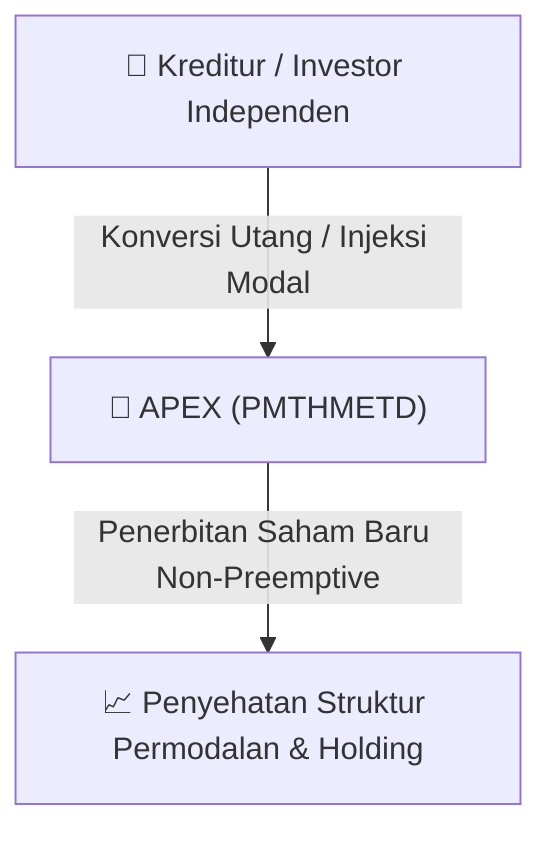

# ⚡ Laporan Intelijen Aksi Korporasi: [[APEX]] - RUPS

⬅️ [[knowledge-base/daily-digests/Daily_Digest_20260915|Kembali ke Daily Digest]] | 📅 **2026-09-15** | 🎛️ [[Dashboard|Ke Dashboard Utama]]

> [!IMPORTANT]
> Laporan ini disusun secara otomatis oleh **Corporate Action Intelligence Agent** untuk memetakan implikasi strategis, rasio keuangan, alokasi dana, jadwal penting, dan panduan investor.

---

## 📌 1. Ringkasan Eksekutif & Katalis Strategis
- **Kode & Nama Emiten**: `[[APEX]]`
- **Kategori Aksi Korporasi**: `RUPS`
- **Dokumen Resmi Bursa**: `Pemanggilan RUPS lamp3`
- **Ringkasan Inti Aksi**: Pemanggilan Rapat Umum Pemegang Saham Luar Biasa (RUPSLB) PT Apexindo Pratama Duta Tbk yang akan diselenggarakan pada 7 Oktober 2026. Agenda utama meliputi persetujuan perubahan Anggaran Dasar terkait reklasifikasi saham menjadi Seri A (Rp500) dan Seri B (Rp325), serta persetujuan Penambahan Modal Tanpa Hak Memesan Efek Terlebih Dahulu (PMTHMETD) dengan menerbitkan 218.090.317 saham Seri B baru melalui mekanisme kompensasi utang.

---

## 📊 2. Matriks Parameter Material & Angka Kunci
| Parameter Utama | Nilai / Keterangan Resmi |
| :--- | :--- |
| **Tanggal RUPS** | `2026-10-07` |
| **Waktu RUPS** | `10.00 WIB - selesai` |
| **Tempat RUPS** | `Function Room Residence 8, Lantai 7, Kebayoran Baru, Jakarta Selatan 12190` |
| **Tanggal Daftar Pemegang Saham Berhak Hadir** | `2026-09-14 pukul 16.00 WIB` |
| **Nilai Nominal Saham Seri A** | `Rp500,00 per saham` |
| **Nilai Nominal Saham Seri B** | `Rp325,00 per saham` |
| **Modal Dasar Perusahaan Saat Ini** | `6.000.000.000 saham dengan nilai nominal Rp500,00` |
| **Jumlah Saham Baru Seri B yang Diterbitkan (PMTHMETD)** | `218.090.317 saham` |
| **Mekanisme Pembayaran PMTHMETD** | `Kompensasi utang (offsetting tagihan pihak ketiga)` |
| **Dasar Hukum PMTHMETD** | `POJK No. 32/POJK.04/2015 jo. POJK No. 14/POJK.04/2019` |
| **Batas Maksimal Kehadiran Fisik** | `30 orang` |
| **Batas Akhir Penyerahan Kuasa Asli** | `2026-10-06 pukul 16.00 WIB` |

---

## 🏢 3. Detail Rencana PMTHMETD / Private Placement [[APEX]]
- **Jenis Aksi Korporasi**: `Penambahan Modal Tanpa Hak Memesan Efek Terlebih Dahulu (PMTHMETD / Private Placement)`
- **Tujuan Utama**: `Pemanggilan Rapat Umum Pemegang Saham Luar Biasa (RUPSLB) PT Apexindo Pratama Duta Tbk yang akan diselenggarakan pada 7 Oktober 2026. Agenda utama meliputi persetujuan perubahan Anggaran Dasar terkait reklasifikasi saham menjadi Seri A (Rp500) dan Seri B (Rp325), serta persetujuan Penambahan Modal Tanpa Hak Memesan Efek Terlebih Dahulu (PMTHMETD) dengan menerbitkan 218.090.317 saham Seri B baru melalui mekanisme kompensasi utang.`
- **Mekanisme**: Konversi Utang Menjadi Saham (*Debt-to-Equity Swap*) & Penerbitan Saham Baru kepada Investor Standby / Independen.

## 📈 4. Visualisasi Alur Private Placement (PMTHMETD)

## 💡 5. Panduan Strategi Investor & Analisis Dampak
- 🟢 **Penyehatan Struktur Permodalan**: Konversi utang menjadi saham mengurangi beban bunga (*interest expense*) dan memperbaiki ekuitas [[APEX]].
- ⚠️ **Dampak Dilusi Tanpa HMETD**: Karena dilakukan tanpa HMETD, pemegang saham publik tidak mendapatkan hak membeli saham baru, sehingga terjadi dilusi persentase kepemilikan.

---

## 🔗 Hubungan Note Terkait (Knowledge Graph)
- [[knowledge-base/daily-digests/Daily_Digest_20260915|📄 Daily Digest 2026-09-15]]
- [[knowledge-base/trading-signals/Trading_Signals_20260915|🎯 Sinyal Cuan 2026-09-15]]
- [[Dashboard|🎛️ Kembali ke Dashboard]]