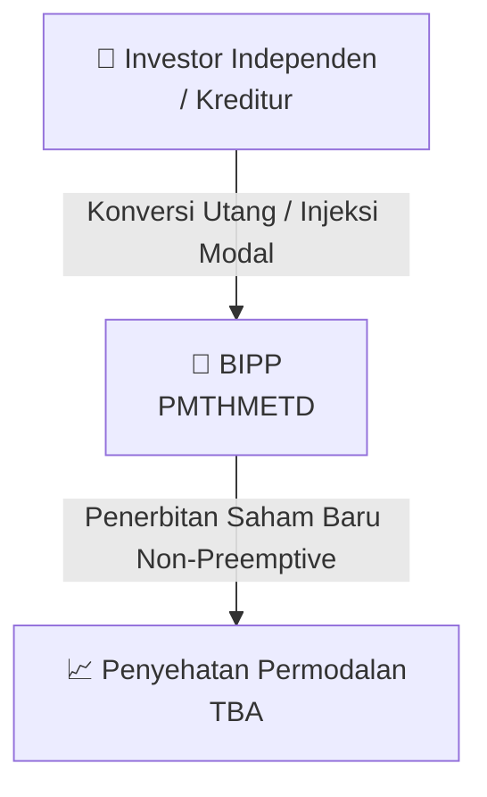

# 🏢 Penambahan Modal Tanpa HMETD (Private Placement) — [[BIPP]]

⬅️ [[knowledge-base/daily-digests/Daily_Digest_20260924|Kembali ke Daily Digest]] | 📅 **2026-09-24** | 🎛️ [[Dashboard|Ke Dashboard Utama]]

> [!IMPORTANT]
> Laporan ini disusun secara otomatis oleh **Corporate Action Intelligence Agent** pada **2026-09-24**.
> Sumber dokumen: `20260923_BIPP_20260923_BIPP_Penambahan Modal Tanpa HMETD_32150643_lamp2.pdf`

---

## 📌 1. Ringkasan Eksekutif & Tujuan Strategis

- **Kode & Nama Emiten**: `[[BIPP]]`
- **Kategori Aksi Korporasi**: `Private_Placement`
- **Dokumen Sumber**: `20260923_BIPP_20260923_BIPP_Penambahan Modal Tanpa HMETD_32150643_lamp2.pdf`
- **Tanggal Laporan**: `2026-09-24`

[Analisis LLM tidak tersedia — isi manual]

---

## 📊 2. Fakta Material & Parameter Keuangan

| Parameter Utama | Nilai / Keterangan |
| :--- | :--- |
| **Jenis Aksi** | `PMTHMETD / Private Placement` |
| **Jumlah Saham Baru** | `502.866.937 saham` |
| **Rasio HMETD** | `TBA` |
| **Harga Pelaksanaan** | `TBA` |
| **Target Dana** | `TBA` |
| **Pembeli Siaga** | `TBA` |
| **Komitmen Pembeli Siaga** | `TBA` |
| **Dilusi Maksimum** | `9,09%` |
| **Pengendali Utama** | `TBA` |

---

## 👥 3. Struktur Kepemilikan, Pengendali & Pembeli Siaga

- **Pemegang Saham Pengendali**: `TBA`
- **Pembeli Siaga (Standby Buyer)**: `TBA`
- **Komitmen Pembeli Siaga**: `TBA`
- **Dilusi Maksimum** (jika tidak exercise HMETD): `9,09%`

---

## 🎯 4. Alokasi & Rencana Penggunaan Dana

| Peruntukan Dana | Alokasi (%) |
| :--- | :---: |
| per saham atau sebanyak-banyaknya | `10,00%` |
| pemegang saham Perseroan akan terkena dilusi kepemilikannya 
sebanyak-banyaknya | `9,09%` |
| Jumlah aset diproyeksikan meningkat paling banyak | `2,74%` |
| , sedangkan ekuitas meningkat | `5,27%` |
| an I-A Bursa Efek Indonesia, 
yang mensyaratkan harga pelaksanaan paling sedikit | `90%` |
| te Ltd merupakan pemegang saham pengendali langsung Perseroan dengan kepemilikan | `61,62%` |

- **Total Target Dana**: `TBA`

---

## 📅 5. Timeline & Jadwal Pelaksanaan

| Tahapan / Event | Tanggal |
| :--- | :---: |
| **Harga Pelaksanaan HMETD** | `TBA` |
| **Periode Pelaksanaan HMETD** | `Terjadwal — lihat prospektus` |

---

## 📈 6. Diagram Visual Flowchart (Mermaid)

---

## 💡 7. Rekomendasi Investor & Strategi Trading

[Analisis LLM tidak tersedia — isi manual]

---

## 🔗 8. Hubungan Note Terkait (Knowledge Graph)

- [[knowledge-base/daily-digests/Daily_Digest_20260924|📄 Daily Digest 2026-09-24]]
- [[knowledge-base/trading-signals/Trading_Signals_20260924|🎯 Sinyal Cuan 2026-09-24]]
- [[BIPP|🏬 Halaman Emiten BIPP]]
- [[Dashboard|🎛️ Kembali ke Dashboard Utama]]

---

*Laporan dibuat otomatis oleh Corporate Action Intelligence Agent · 2026-09-24*