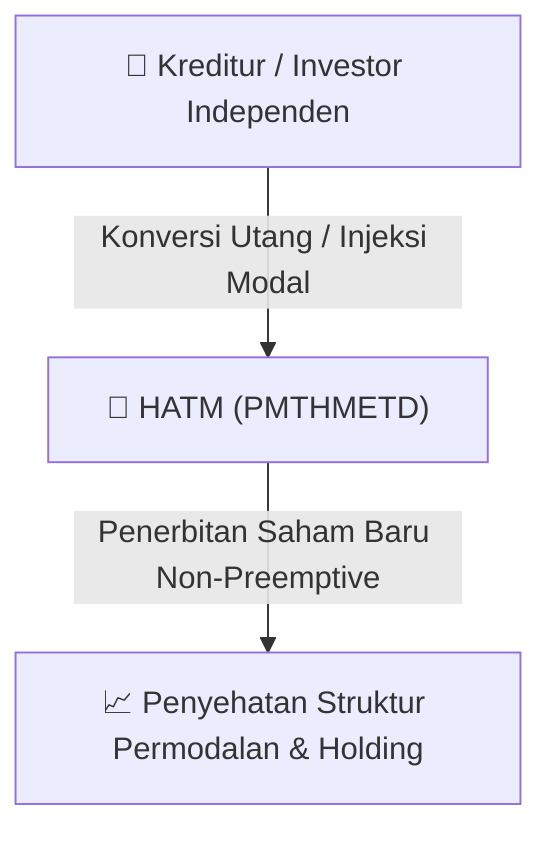

# ⚡ Laporan Intelijen Aksi Korporasi: [[HATM]] - Aksi Korporasi

⬅️ [[knowledge-base/daily-digests/Daily_Digest_20260828|Kembali ke Daily Digest]] | 📅 **2026-08-28** | 🎛️ [[Dashboard|Ke Dashboard Utama]]

> [!IMPORTANT]
> Laporan ini disusun secara otomatis oleh **Corporate Action Intelligence Agent** untuk memetakan implikasi strategis, rasio keuangan, alokasi dana, jadwal penting, dan panduan investor.

---

## 📌 1. Ringkasan Eksekutif & Katalis Strategis
- **Kode & Nama Emiten**: `[[HATM]]`
- **Kategori Aksi Korporasi**: `Aksi Korporasi`
- **Dokumen Resmi Bursa**: `Laporan Informasi dan Fakta Material`
- **Ringkasan Inti Aksi**: PT Habco Trans Maritima Tbk berencana melakukan Penambahan Modal Tanpa Hak Memesan Efek Terlebih Dahulu (PMTHMETD) untuk memperkuat struktur permodalan dan memperoleh tambahan dana.

---

## 📊 2. Matriks Parameter Material & Angka Kunci
| Parameter Utama | Nilai / Keterangan Resmi |
| :--- | :--- |
| **Jumlah saham PMTHMETD** | `640.000.000 saham` |
| **Persentase terhadap jumlah saham ditempatkan dan disetor penuh** | `7,37%` |
| **Harga pelaksanaan saham PMTHMETD** | `Rp500` |
| **Dampak terhadap keuangan** | `Meningkatkan aset lancar berupa kas dan setara kas, total aset, dan total ekuitas` |

---

## 🏢 3. Detail Rencana PMTHMETD / Private Placement [[HATM]]
- **Jenis Aksi Korporasi**: `Penambahan Modal Tanpa Hak Memesan Efek Terlebih Dahulu (PMTHMETD / Private Placement)`
- **Tujuan Utama**: `PT Habco Trans Maritima Tbk berencana melakukan Penambahan Modal Tanpa Hak Memesan Efek Terlebih Dahulu (PMTHMETD) untuk memperkuat struktur permodalan dan memperoleh tambahan dana.`
- **Mekanisme**: Konversi Utang Menjadi Saham (*Debt-to-Equity Swap*) & Penerbitan Saham Baru kepada Investor Standby / Independen.

## 📈 4. Visualisasi Alur Private Placement (PMTHMETD)

## 💡 5. Panduan Strategi Investor & Analisis Dampak
- 🟢 **Penyehatan Struktur Permodalan**: Konversi utang menjadi saham mengurangi beban bunga (*interest expense*) dan memperbaiki ekuitas [[HATM]].
- ⚠️ **Dampak Dilusi Tanpa HMETD**: Karena dilakukan tanpa HMETD, pemegang saham publik tidak mendapatkan hak membeli saham baru, sehingga terjadi dilusi persentase kepemilikan.

---

## 🔗 Hubungan Note Terkait (Knowledge Graph)
- [[knowledge-base/daily-digests/Daily_Digest_20260828|📄 Daily Digest 2026-08-28]]
- [[knowledge-base/trading-signals/Trading_Signals_20260828|🎯 Sinyal Cuan 2026-08-28]]
- [[Dashboard|🎛️ Kembali ke Dashboard]]