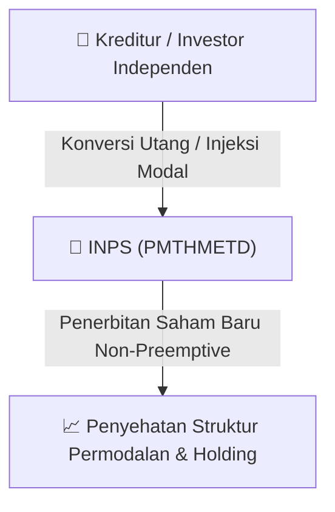

# ⚡ Laporan Intelijen Aksi Korporasi: [[INPS]] - Aksi Korporasi

⬅️ [[knowledge-base/daily-digests/Daily_Digest_20260916|Kembali ke Daily Digest]] | 📅 **2026-09-16** | 🎛️ [[Dashboard|Ke Dashboard Utama]]

> [!IMPORTANT]
> Laporan ini disusun secara otomatis oleh **Corporate Action Intelligence Agent** untuk memetakan implikasi strategis, rasio keuangan, alokasi dana, jadwal penting, dan panduan investor.

---

## 📌 1. Ringkasan Eksekutif & Katalis Strategis
- **Kode & Nama Emiten**: `[[INPS]]`
- **Kategori Aksi Korporasi**: `Aksi Korporasi`
- **Dokumen Resmi Bursa**: `Tanggapan atas Permintaan Penjelasan Bursa`
- **Ringkasan Inti Aksi**: PT Indah Prakasa Sentosa Tbk. (INPS) memberikan tanggapan atas permintaan penjelasan Bursa Efek Indonesia (BEI) terkait volatilitas transaksi saham. Perseroan menyatakan tidak mengetahui adanya fakta material yang belum diungkapkan, tidak mengetahui aktivitas pemegang saham tertentu yang wajib dilaporkan, dan menyatakan bahwa peningkatan harga saham merupakan mekanisme pasar. Perseroan mengungkapkan sedang mengkaji rencana pengakuisisian perusahaan lain dan berencana melakukan Penambahan Modal Tanpa Hak Memesan Efek Terlebih Dahulu (PMTHMETD/private placement) untuk perbaikan kondisi keuangan, namun keduanya masih dalam tahap kajian awal dan belum final.

---

## 📊 2. Matriks Parameter Material & Angka Kunci
| Parameter Utama | Nilai / Keterangan Resmi |
| :--- | :--- |
| **Nomor Surat** | `009/INPS-BEI/IX/2026` |
| **Nomor Surat Permintaan BEI** | `S-11909/BEI.PP1/09-2026` |
| **Periode Volatilitas Transaksi** | `2 s.d. 10 September 2026` |
| **Rencana Aksi Korporasi** | `Pengakuisisian perusahaan lain untuk dijadikan entitas anak (masih tahap kajian awal)` |
| **Rencana Aksi Korporasi Lainnya** | `Penambahan Modal Tanpa Hak Memesan Efek Terlebih Dahulu (PMTHMETD/private placement) sesuai POJK Nomor 14/POJK.04/2019` |
| **Status Rencana PMTHMETD** | `Masih dalam tahap kajian, termasuk penentuan harga pelaksanaan oleh KJPP, belum ada keputusan final Direksi maupun persetujuan RUPS` |
| **Keterangan Fakta Material** | `Perseroan tidak mengetahui adanya informasi atau fakta material yang belum diungkapkan kepada publik` |
| **Keterangan Aktivitas Pemegang Saham** | `Perseroan tidak mengetahui adanya aktivitas pemegang saham tertentu yang wajib dilaporkan berdasarkan POJK Nomor 4 Tahun 2024` |

---

## 🏢 3. Detail Rencana PMTHMETD / Private Placement [[INPS]]
- **Jenis Aksi Korporasi**: `Penambahan Modal Tanpa Hak Memesan Efek Terlebih Dahulu (PMTHMETD / Private Placement)`
- **Tujuan Utama**: `PT Indah Prakasa Sentosa Tbk. (INPS) memberikan tanggapan atas permintaan penjelasan Bursa Efek Indonesia (BEI) terkait volatilitas transaksi saham. Perseroan menyatakan tidak mengetahui adanya fakta material yang belum diungkapkan, tidak mengetahui aktivitas pemegang saham tertentu yang wajib dilaporkan, dan menyatakan bahwa peningkatan harga saham merupakan mekanisme pasar. Perseroan mengungkapkan sedang mengkaji rencana pengakuisisian perusahaan lain dan berencana melakukan Penambahan Modal Tanpa Hak Memesan Efek Terlebih Dahulu (PMTHMETD/private placement) untuk perbaikan kondisi keuangan, namun keduanya masih dalam tahap kajian awal dan belum final.`
- **Mekanisme**: Konversi Utang Menjadi Saham (*Debt-to-Equity Swap*) & Penerbitan Saham Baru kepada Investor Standby / Independen.

## 📈 4. Visualisasi Alur Private Placement (PMTHMETD)

## 💡 5. Panduan Strategi Investor & Analisis Dampak
- 🟢 **Penyehatan Struktur Permodalan**: Konversi utang menjadi saham mengurangi beban bunga (*interest expense*) dan memperbaiki ekuitas [[INPS]].
- ⚠️ **Dampak Dilusi Tanpa HMETD**: Karena dilakukan tanpa HMETD, pemegang saham publik tidak mendapatkan hak membeli saham baru, sehingga terjadi dilusi persentase kepemilikan.

---

## 🔗 Hubungan Note Terkait (Knowledge Graph)
- [[knowledge-base/daily-digests/Daily_Digest_20260916|📄 Daily Digest 2026-09-16]]
- [[knowledge-base/trading-signals/Trading_Signals_20260916|🎯 Sinyal Cuan 2026-09-16]]
- [[Dashboard|🎛️ Kembali ke Dashboard]]