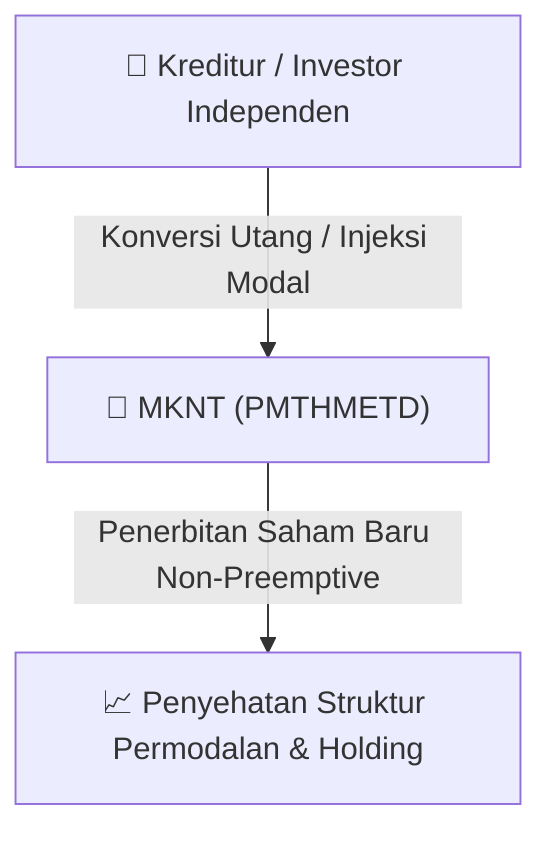

# ⚡ Laporan Intelijen Aksi Korporasi: [[MKNT]] - Aksi Korporasi

⬅️ [[knowledge-base/daily-digests/Daily_Digest_20260813|Kembali ke Daily Digest]] | 📅 **2026-08-13** | 🎛️ [[Dashboard|Ke Dashboard Utama]]

> [!IMPORTANT]
> Laporan ini disusun secara otomatis oleh **Corporate Action Intelligence Agent** untuk memetakan implikasi strategis, rasio keuangan, alokasi dana, jadwal penting, dan panduan investor.

---

## 📌 1. Ringkasan Eksekutif & Katalis Strategis
- **Kode & Nama Emiten**: `[[MKNT]]`
- **Kategori Aksi Korporasi**: `Aksi Korporasi`
- **Dokumen Resmi Bursa**: `Laporan Informasi dan Fakta Material lamp1`
- **Ringkasan Inti Aksi**: PT Mitra Komunikasi Nusantara Tbk (MKNT) mengumumkan pemanggilan Rapat Umum Pemegang Saham Luar Biasa (RUPSLB) yang akan diselenggarakan pada 24 Agustus 2026. Rapat akan membahas persetujuan Penambahan Modal Tanpa Hak Memesan Efek Terlebih Dahulu (PMTHMETD) melalui konversi utang dan penyetoran tunai, penetapan pengendali baru, perubahan nama menjadi PT Remitra Global International Tbk, perubahan anggaran dasar, dan perubahan susunan Direksi dan Dewan Komisaris.

---

## 📊 2. Matriks Parameter Material & Angka Kunci
| Parameter Utama | Nilai / Keterangan Resmi |
| :--- | :--- |
| **Jenis Rapat** | `Rapat Umum Pemegang Saham Luar Biasa (RUPSLB)` |
| **Tanggal Rapat** | `2026-08-24` |
| **Waktu Rapat** | `13.30 WIB – Selesai` |
| **Tempat Rapat** | `Hotel Manhattan Lt. 10, Jl. Prof. DR. Satrio Kav. 19-24, Kuningan, Karet Kuningan, Kecamatan Setiabudi, Jakarta Selatan` |
| **Mata Acara 1** | `Persetujuan PMTHMETD dalam rangka perbaikan posisi keuangan melalui konversi utang dan penyetoran tunai oleh investor independen` |
| **Mata Acara 2** | `Persetujuan penetapan pengendali baru Perseroan` |
| **Mata Acara 3** | `Persetujuan perubahan nama Perseroan menjadi PT Remitra Global International Tbk` |
| **Mata Acara 4** | `Persetujuan perubahan anggaran dasar, termasuk peningkatan modal dasar, penambahan Saham Seri B dengan nilai nominal Rp1 per saham, dan penyesuaian kegiatan usaha` |
| **Mata Acara 5** | `Persetujuan perubahan susunan Direksi dan/atau Dewan Komisaris` |
| **Tanggal Daftar Pemegang Saham (DPS)** | `2026-07-30` |
| **Biro Administrasi Efek** | `PT Ficomindo Buana Registrar` |
| **Dasar Hukum PMTHMETD** | `POJK No. 14/POJK.04/2019 tentang Perubahan atas POJK No. 32/POJK.04/2015` |

---

## 🏢 3. Detail Rencana PMTHMETD / Private Placement [[MKNT]]
- **Jenis Aksi Korporasi**: `Penambahan Modal Tanpa Hak Memesan Efek Terlebih Dahulu (PMTHMETD / Private Placement)`
- **Tujuan Utama**: `PT Mitra Komunikasi Nusantara Tbk (MKNT) mengumumkan pemanggilan Rapat Umum Pemegang Saham Luar Biasa (RUPSLB) yang akan diselenggarakan pada 24 Agustus 2026. Rapat akan membahas persetujuan Penambahan Modal Tanpa Hak Memesan Efek Terlebih Dahulu (PMTHMETD) melalui konversi utang dan penyetoran tunai, penetapan pengendali baru, perubahan nama menjadi PT Remitra Global International Tbk, perubahan anggaran dasar, dan perubahan susunan Direksi dan Dewan Komisaris.`
- **Mekanisme**: Konversi Utang Menjadi Saham (*Debt-to-Equity Swap*) & Penerbitan Saham Baru kepada Investor Standby / Independen.

## 📈 4. Visualisasi Alur Private Placement (PMTHMETD)

## 💡 5. Panduan Strategi Investor & Analisis Dampak
- 🟢 **Penyehatan Struktur Permodalan**: Konversi utang menjadi saham mengurangi beban bunga (*interest expense*) dan memperbaiki ekuitas [[MKNT]].
- ⚠️ **Dampak Dilusi Tanpa HMETD**: Karena dilakukan tanpa HMETD, pemegang saham publik tidak mendapatkan hak membeli saham baru, sehingga terjadi dilusi persentase kepemilikan.

---

## 🔗 Hubungan Note Terkait (Knowledge Graph)
- [[knowledge-base/daily-digests/Daily_Digest_20260813|📄 Daily Digest 2026-08-13]]
- [[knowledge-base/trading-signals/Trading_Signals_20260813|🎯 Sinyal Cuan 2026-08-13]]
- [[Dashboard|🎛️ Kembali ke Dashboard]]