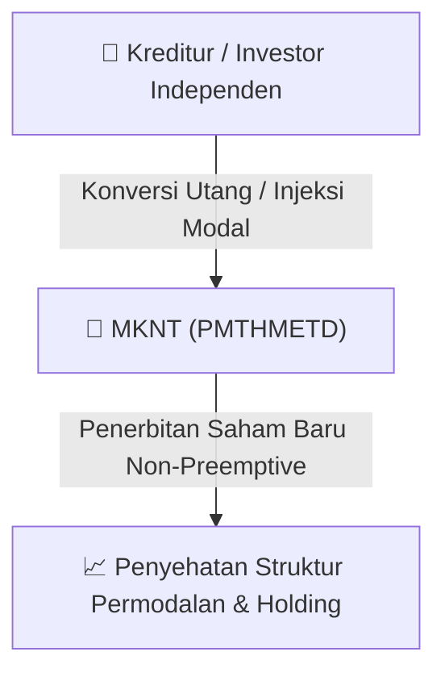

# ⚡ Laporan Intelijen Aksi Korporasi: [[MKNT]] - RUPS

⬅️ [[knowledge-base/daily-digests/Daily_Digest_20260909|Kembali ke Daily Digest]] | 📅 **2026-09-09** | 🎛️ [[Dashboard|Ke Dashboard Utama]]

> [!IMPORTANT]
> Laporan ini disusun secara otomatis oleh **Corporate Action Intelligence Agent** untuk memetakan implikasi strategis, rasio keuangan, alokasi dana, jadwal penting, dan panduan investor.

---

## 📌 1. Ringkasan Eksekutif & Katalis Strategis
- **Kode & Nama Emiten**: `[[MKNT]]`
- **Kategori Aksi Korporasi**: `RUPS`
- **Dokumen Resmi Bursa**: `Pemanggilan RUPS lamp6`
- **Ringkasan Inti Aksi**: PT Mitra Komunikasi Nusantara Tbk (MKNT) mengumumkan pengurangan mata acara RUPSLB yang akan diselenggarakan pada 14 September 2026. Mata acara mengenai Perubahan Kegiatan Usaha (PKU) tidak akan dibahas dalam RUPSLB tersebut karena masih menunggu tanggapan atas Surat OJK No. S-250/PM.211/2026. RUPSLB tetap akan membahas 6 mata acara lainnya, termasuk persetujuan PMTHMETD, penetapan pengendali baru, perubahan nama menjadi PT Remitra Global International Tbk, perubahan anggaran dasar, serta perubahan susunan Direksi dan Dewan Komisaris.

---

## 📊 2. Matriks Parameter Material & Angka Kunci
| Parameter Utama | Nilai / Keterangan Resmi |
| :--- | :--- |
| **Tanggal Surat** | `9 September 2026` |
| **Tanggal Pelaksanaan RUPSLB** | `14 September 2026` |
| **Nomor Surat OJK** | `S-250/PM.211/2026` |
| **Tanggal Surat OJK** | `1 September 2026` |
| **Batas Waktu Penerbitan Keterbukaan Informasi Final** | `10 September 2026` |
| **Mata Acara yang Dikurangi** | `Perubahan Kegiatan Usaha (PKU)` |
| **Jumlah Mata Acara yang Tetap Dibahas** | `6 mata acara` |
| **Mata Acara 1** | `Persetujuan PMTHMETD melalui konversi utang dan penyetoran tunai oleh investor independen` |
| **Mata Acara 2** | `Persetujuan penetapan pengendali baru Perseroan` |
| **Mata Acara 3** | `Persetujuan perubahan nama menjadi PT Remitra Global International Tbk` |
| **Mata Acara 4** | `Persetujuan perubahan anggaran dasar (termasuk peningkatan modal dasar, penambahan Saham Seri B dengan nilai nominal Rp1, penyesuaian KBLI 2025)` |
| **Mata Acara 5** | `Persetujuan perubahan susunan anggota Direksi` |
| **Mata Acara 6** | `Persetujuan perubahan susunan anggota Dewan Komisaris` |
| **Nilai Nominal Saham Seri B** | `Rp1 per saham` |
| **Dasar Hukum KBLI 2025** | `Peraturan Badan Pusat Statistik No. 7 Tahun 2025` |

---

## 🏢 3. Detail Rencana PMTHMETD / Private Placement [[MKNT]]
- **Jenis Aksi Korporasi**: `Penambahan Modal Tanpa Hak Memesan Efek Terlebih Dahulu (PMTHMETD / Private Placement)`
- **Tujuan Utama**: `PT Mitra Komunikasi Nusantara Tbk (MKNT) mengumumkan pengurangan mata acara RUPSLB yang akan diselenggarakan pada 14 September 2026. Mata acara mengenai Perubahan Kegiatan Usaha (PKU) tidak akan dibahas dalam RUPSLB tersebut karena masih menunggu tanggapan atas Surat OJK No. S-250/PM.211/2026. RUPSLB tetap akan membahas 6 mata acara lainnya, termasuk persetujuan PMTHMETD, penetapan pengendali baru, perubahan nama menjadi PT Remitra Global International Tbk, perubahan anggaran dasar, serta perubahan susunan Direksi dan Dewan Komisaris.`
- **Mekanisme**: Konversi Utang Menjadi Saham (*Debt-to-Equity Swap*) & Penerbitan Saham Baru kepada Investor Standby / Independen.

## 📈 4. Visualisasi Alur Private Placement (PMTHMETD)

## 💡 5. Panduan Strategi Investor & Analisis Dampak
- 🟢 **Penyehatan Struktur Permodalan**: Konversi utang menjadi saham mengurangi beban bunga (*interest expense*) dan memperbaiki ekuitas [[MKNT]].
- ⚠️ **Dampak Dilusi Tanpa HMETD**: Karena dilakukan tanpa HMETD, pemegang saham publik tidak mendapatkan hak membeli saham baru, sehingga terjadi dilusi persentase kepemilikan.

---

## 🔗 Hubungan Note Terkait (Knowledge Graph)
- [[knowledge-base/daily-digests/Daily_Digest_20260909|📄 Daily Digest 2026-09-09]]
- [[knowledge-base/trading-signals/Trading_Signals_20260909|🎯 Sinyal Cuan 2026-09-09]]
- [[Dashboard|🎛️ Kembali ke Dashboard]]