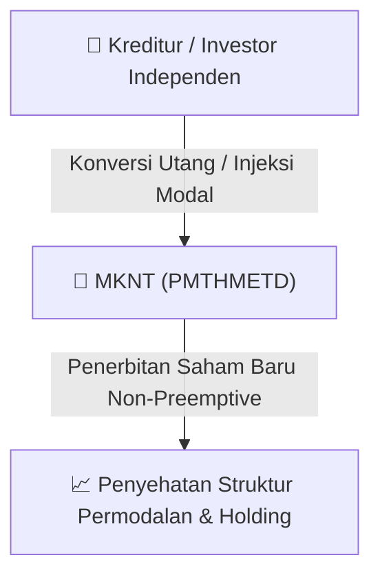

# ⚡ Laporan Intelijen Aksi Korporasi: [[MKNT]] - Aksi Korporasi

⬅️ [[knowledge-base/daily-digests/Daily_Digest_20260910|Kembali ke Daily Digest]] | 📅 **2026-09-10** | 🎛️ [[Dashboard|Ke Dashboard Utama]]

> [!IMPORTANT]
> Laporan ini disusun secara otomatis oleh **Corporate Action Intelligence Agent** untuk memetakan implikasi strategis, rasio keuangan, alokasi dana, jadwal penting, dan panduan investor.

---

## 📌 1. Ringkasan Eksekutif & Katalis Strategis
- **Kode & Nama Emiten**: `[[MKNT]]`
- **Kategori Aksi Korporasi**: `Aksi Korporasi`
- **Dokumen Resmi Bursa**: `Perubahan danatau Tambahan Keterbukaan Informasi terkait Aksi Korporasi lamp1`
- **Ringkasan Inti Aksi**: PT Mitra Komunikasi Nusantara Tbk (MKNT) menyampaikan surat pengantar perubahan informasi atas keterbukaan informasi kepada pemegang saham dalam rangka Penambahan Modal Tanpa Memberikan Hak Memesan Efek Terlebih Dahulu (PMTHMETD) kepada Otoritas Jasa Keuangan (OJK) dan Bursa Efek Indonesia (BEI).

---

## 📊 2. Matriks Parameter Material & Angka Kunci
| Parameter Utama | Nilai / Keterangan Resmi |
| :--- | :--- |
| **Nomor Surat** | `163/MKNT-OJK/IX/2026` |
| **Tanggal Surat** | `2026-09-10` |
| **Tujuan Surat** | `Otoritas Jasa Keuangan (OJK)` |
| **Perihal** | `Perubahan Informasi atas Keterbukaan Informasi Kepada Pemegang Saham PT Mitra Komunikasi Nusantara Tbk Dalam Rangka Penambahan Modal Tanpa Memberikan Hak Memesan Efek Terlebih Dahulu (PMTHMETD)` |
| **Tembusan** | `PT Bursa Efek Indonesia (BEI)` |

---

## 🏢 3. Detail Rencana PMTHMETD / Private Placement [[MKNT]]
- **Jenis Aksi Korporasi**: `Penambahan Modal Tanpa Hak Memesan Efek Terlebih Dahulu (PMTHMETD / Private Placement)`
- **Tujuan Utama**: `PT Mitra Komunikasi Nusantara Tbk (MKNT) menyampaikan surat pengantar perubahan informasi atas keterbukaan informasi kepada pemegang saham dalam rangka Penambahan Modal Tanpa Memberikan Hak Memesan Efek Terlebih Dahulu (PMTHMETD) kepada Otoritas Jasa Keuangan (OJK) dan Bursa Efek Indonesia (BEI).`
- **Mekanisme**: Konversi Utang Menjadi Saham (*Debt-to-Equity Swap*) & Penerbitan Saham Baru kepada Investor Standby / Independen.

## 📈 4. Visualisasi Alur Private Placement (PMTHMETD)

## 💡 5. Panduan Strategi Investor & Analisis Dampak
- 🟢 **Penyehatan Struktur Permodalan**: Konversi utang menjadi saham mengurangi beban bunga (*interest expense*) dan memperbaiki ekuitas [[MKNT]].
- ⚠️ **Dampak Dilusi Tanpa HMETD**: Karena dilakukan tanpa HMETD, pemegang saham publik tidak mendapatkan hak membeli saham baru, sehingga terjadi dilusi persentase kepemilikan.

---

## 🔗 Hubungan Note Terkait (Knowledge Graph)
- [[knowledge-base/daily-digests/Daily_Digest_20260910|📄 Daily Digest 2026-09-10]]
- [[knowledge-base/trading-signals/Trading_Signals_20260910|🎯 Sinyal Cuan 2026-09-10]]
- [[Dashboard|🎛️ Kembali ke Dashboard]]