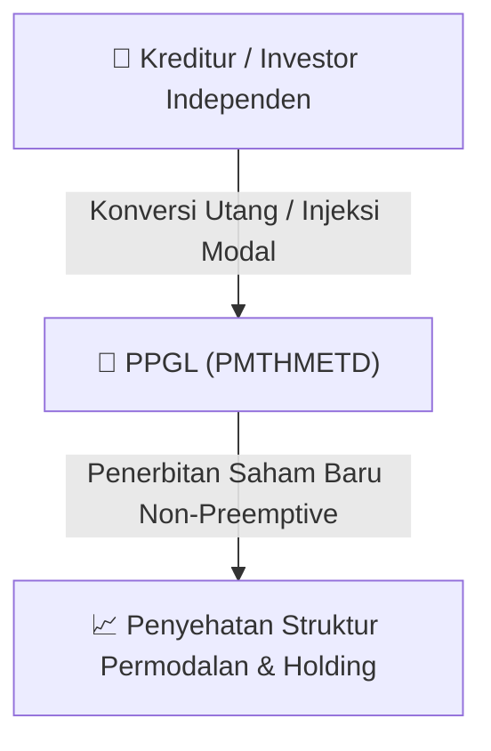

# ⚡ Laporan Intelijen Aksi Korporasi: [[PPGL]] - Aksi Korporasi

⬅️ [[knowledge-base/daily-digests/Daily_Digest_20260916|Kembali ke Daily Digest]] | 📅 **2026-09-16** | 🎛️ [[Dashboard|Ke Dashboard Utama]]

> [!IMPORTANT]
> Laporan ini disusun secara otomatis oleh **Corporate Action Intelligence Agent** untuk memetakan implikasi strategis, rasio keuangan, alokasi dana, jadwal penting, dan panduan investor.

---

## 📌 1. Ringkasan Eksekutif & Katalis Strategis
- **Kode & Nama Emiten**: `[[PPGL]]`
- **Kategori Aksi Korporasi**: `Aksi Korporasi`
- **Dokumen Resmi Bursa**: `Keterbukaan Informasi terkait Aksi Korporasi lamp1`
- **Ringkasan Inti Aksi**: PT Prima Globalindo Logistik Tbk. (PPGL) menerbitkan keterbukaan informasi terkait rencana Penambahan Modal Tanpa Hak Memesan Efek Terlebih Dahulu (PMTHMETD) sesuai dengan POJK 14/2019. Dokumen ini ditujukan kepada pemegang saham dan memuat definisi serta informasi penting terkait aksi korporasi tersebut.

---

## 📊 2. Matriks Parameter Material & Angka Kunci
| Parameter Utama | Nilai / Keterangan Resmi |
| :--- | :--- |
| **Jenis Aksi Korporasi** | `Penambahan Modal Tanpa Hak Memesan Efek Terlebih Dahulu (PMTHMETD)` |
| **Dasar Hukum** | `POJK 14/POJK.04/2019 tentang Perubahan atas POJK 32/POJK.04/2015` |
| **Tanggal Penerbitan Keterbukaan Informasi** | `16 September 2026` |
| **Biro Administrasi Efek (BAE)** | `PT Admitra Jasa Korpora` |
| **Kegiatan Usaha Utama** | `Jasa pengurusan transportasi (freight forwarding)` |
| **Alamat Perseroan** | `Green Sedayu Bizpark Cakung Blok GS7 No. 19` |

---

## 🏢 3. Detail Rencana PMTHMETD / Private Placement [[PPGL]]
- **Jenis Aksi Korporasi**: `Penambahan Modal Tanpa Hak Memesan Efek Terlebih Dahulu (PMTHMETD / Private Placement)`
- **Tujuan Utama**: `PT Prima Globalindo Logistik Tbk. (PPGL) menerbitkan keterbukaan informasi terkait rencana Penambahan Modal Tanpa Hak Memesan Efek Terlebih Dahulu (PMTHMETD) sesuai dengan POJK 14/2019. Dokumen ini ditujukan kepada pemegang saham dan memuat definisi serta informasi penting terkait aksi korporasi tersebut.`
- **Mekanisme**: Konversi Utang Menjadi Saham (*Debt-to-Equity Swap*) & Penerbitan Saham Baru kepada Investor Standby / Independen.

## 📈 4. Visualisasi Alur Private Placement (PMTHMETD)

## 💡 5. Panduan Strategi Investor & Analisis Dampak
- 🟢 **Penyehatan Struktur Permodalan**: Konversi utang menjadi saham mengurangi beban bunga (*interest expense*) dan memperbaiki ekuitas [[PPGL]].
- ⚠️ **Dampak Dilusi Tanpa HMETD**: Karena dilakukan tanpa HMETD, pemegang saham publik tidak mendapatkan hak membeli saham baru, sehingga terjadi dilusi persentase kepemilikan.

---

## 🔗 Hubungan Note Terkait (Knowledge Graph)
- [[knowledge-base/daily-digests/Daily_Digest_20260916|📄 Daily Digest 2026-09-16]]
- [[knowledge-base/trading-signals/Trading_Signals_20260916|🎯 Sinyal Cuan 2026-09-16]]
- [[Dashboard|🎛️ Kembali ke Dashboard]]