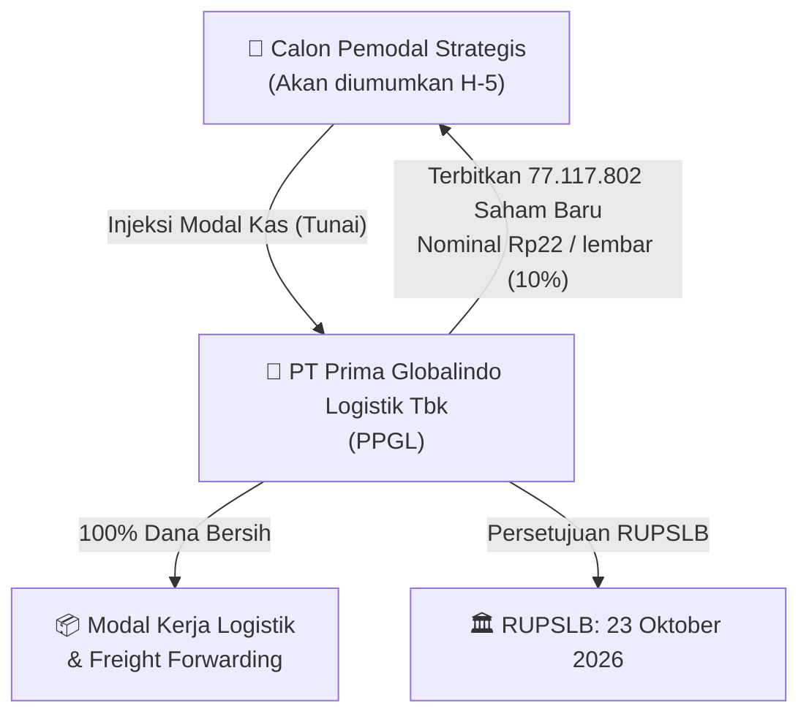

# ⚡ Laporan Intelijen Aksi Korporasi: [[PPGL]] — PMTHMETD (Private Placement)

⬅️ [[knowledge-base/daily-digests/Daily_Digest_20260921|Kembali ke Daily Digest]] | 📅 **2026-09-21** | 🎛️ [[Dashboard|Ke Dashboard Utama]]

> [!IMPORTANT]
> Laporan ini disusun berdasarkan Dokumen Resmi Keterbukaan Informasi PT Prima Globalindo Logistik Tbk tanggal 21 September 2026 perihal **Rencana Penambahan Modal Tanpa Hak Memesan Efek Terlebih Dahulu (PMTHMETD / Private Placement)** sesuai POJK No. 14/POJK.04/2019.

---

## 📌 1. Ringkasan Eksekutif & Katalis Strategis
- **Kode & Nama Emiten**: `[[PPGL]]` — PT Prima Globalindo Logistik Tbk
- **Kategori Aksi Korporasi**: `Penambahan Modal Tanpa HMETD (PMTHMETD / Private Placement)`
- **Bidang Usaha**: Jasa Pengurusan Transportasi (*Freight Forwarding*)
- **Dokumen Resmi Bursa**: `Keterbukaan Informasi Rencana PMTHMETD (Lampiran 1 No. 014/PGL/IX/2026)`
- **Ringkasan Inti Aksi**: Perseroan berencana menerbitkan sebanyak-banyaknya **77.117.802 lembar saham baru** (maksimal 10% dari modal ditempatkan dan disetor penuh) dengan nilai nominal **Rp 22,00 per saham**. Seluruh dana bersih hasil private placement akan dialokasikan penuh untuk **memperkuat modal kerja perseroan** guna mendukung pertumbuhan volume jasa pengurusan transportasi.

---

## 📊 2. Matriks Parameter Material & Angka Kunci

| Parameter Utama | Nilai / Keterangan Resmi |
| :--- | :--- |
| **Nama Perseroan** | `PT Prima Globalindo Logistik Tbk` |
| **Tanggal Keterbukaan Informasi** | `21 September 2026` |
| **Jenis Aksi Korporasi** | `Penambahan Modal Tanpa HMETD (PMTHMETD / Private Placement)` |
| **Landasan Regulasi** | `POJK No. 14/POJK.04/2019 & Peraturan BEI No. I-A` |
| **Jumlah Saham Baru Maksimal** | `77.117.802 lembar saham baru` |
| **Persentase Dilusi Saham Baru** | `Maksimal 10,00% dari modal disetor sebelum PMTHMETD (9,09% pasca pelaksanaan)` |
| **Nilai Nominal Saham** | `Rp 22,00 per lembar saham` |
| **Harga Pelaksanaan** | `Paling sedikit 90% dari rata-rata harga penutupan 25 hari bursa sebelum tanggal permohonan pencatatan (Peraturan I-A)` |
| **Struktur Permodalan Sebelum Aksi** | `771.178.020 lembar (Rp 16.965.816.430)` |
| **Struktur Permodalan Setelah Aksi** | `848.295.822 lembar (Rp 18.662.508.084)` |
| **Tanggal Pelaksanaan RUPSLB** | `23 Oktober 2026` |

---

## 👥 3. Komposisi Pengendali & Calon Pemodal (Investors)
- **Pemegang Saham Saat Ini**:
  - Darmawan Suryadi SM: `409.637.667 saham (53,12%)` — *Pengendali*
  - Jap Astrid Patricia: `175.818.833 saham (22,80%)`
  - Masyarakat (di bawah 5%): `185.721.520 saham (24,08%)`
- **Calon Pemodal**: Belum ditentukan pada tanggal keterbukaan informasi. Akan diumumkan paling lambat 5 hari kerja sebelum pelaksanaan transaksi sesuai Pasal 43A POJK 14/2019.
- **Perubahan Pengendalian**: Tidak terjadi perubahan pengendali utama (*Change of Control*).

---

## 🎯 4. Rencana Penggunaan Dana Hasil Private Placement & Tujuan Strategis
- 📌 **Tujuan Inti**: Memperkuat struktur permodalan dan rasio keuangan guna mendukung kegiatan usaha utama *freight forwarding*.
- 💵 **Alokasi Penggunaan Dana**:
  - **100% untuk Modal Kerja Perseroan**: Pembiayaan operasional pengurusan kargo, sewa gudang, dan pemenuhan kas operasional logistik setelah dikurangi biaya emisi.
- 📈 **Dampak Finansial**: Peningkatan modal kerja, peningkatan rasio lancar (*Current Ratio* dari 40,60% menjadi 41,34%), dan penurunan rasio utang terhadap modal.

---

## 📈 5. Visualisasi Alur Private Placement

---

## 💡 6. Panduan Strategi Investor & Implikasi Dilusi
- ⚠️ **Efek Dilusi Kepemilikan**: Pemegang saham eksisting publik akan mengalami dilusi kepemilikan proporsional sebesar maksimum **9,09%** (bukan 41,67%).
- 🛡️ **Ketiadaan Hak Memesan Efek**: Karena bersifat *Non-Preemptive* (PMTHMETD), pemegang saham publik tidak memiliki hak memesan efek tambahan, namun mendapat katalis positif berupa tambahan kas masuk tanpa beban bunga perbankan.
- 🎯 **Katalis Pergerakan Harga**: Perhatikan pengumuman penetapan harga pelaksanaan resmi dan identitas pemodal strategis yang masuk menjelang RUPSLB 23 Oktober 2026.

---

## 🔗 Hubungan Note Terkait (Knowledge Graph)
- [[knowledge-base/daily-digests/Daily_Digest_20260921|📄 Daily Digest 2026-09-21]]
- [[knowledge-base/corporate-actions/private-placement/PPGL_Private_Placement_20260916|📄 Dokumen Pengumuman Awal PPGL]]
- [[Dashboard|🎛️ Kembali ke Dashboard]]