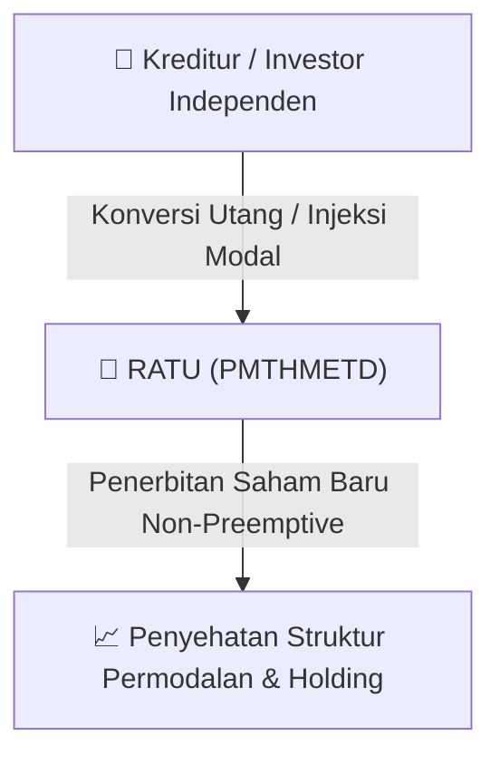

# ⚡ Laporan Intelijen Aksi Korporasi: [[RATU]] - Aksi Korporasi

⬅️ [[knowledge-base/daily-digests/Daily_Digest_20260828|Kembali ke Daily Digest]] | 📅 **2026-08-28** | 🎛️ [[Dashboard|Ke Dashboard Utama]]

> [!IMPORTANT]
> Laporan ini disusun secara otomatis oleh **Corporate Action Intelligence Agent** untuk memetakan implikasi strategis, rasio keuangan, alokasi dana, jadwal penting, dan panduan investor.

---

## 📌 1. Ringkasan Eksekutif & Katalis Strategis
- **Kode & Nama Emiten**: `[[RATU]]`
- **Kategori Aksi Korporasi**: `Aksi Korporasi`
- **Dokumen Resmi Bursa**: `Tanggapan atas Permintaan Penjelasan Bursa lamp1`
- **Ringkasan Inti Aksi**: PT Raharja Energi Cepu Tbk menyampaikan tanggapan atas permintaan penjelasan Bursa terkait rencana Penambahan Modal Tanpa Memberikan Hak Memesan Efek Terlebih Dahulu (PMTHMETD). Seluruh dana hasil PMTHMETD akan digunakan untuk modal kerja serta pengembangan kegiatan usaha Perseroan dan grup Perseroan, namun nilai, persentase, dan timeline penggunaan dana belum dapat ditentukan.

---

## 📊 2. Matriks Parameter Material & Angka Kunci
| Parameter Utama | Nilai / Keterangan Resmi |
| :--- | :--- |
| **Nama Perseroan** | `PT Raharja Energi Cepu Tbk` |
| **Jenis Aksi Korporasi** | `Penambahan Modal Tanpa Memberikan Hak Memesan Efek Terlebih Dahulu (PMTHMETD)` |
| **Tanggal Surat Tanggapan** | `28 Agustus 2026` |
| **Tanggal Surat Permintaan Penjelasan Bursa** | `27 Agustus 2026` |
| **Tanggal Keterbukaan Informasi Awal** | `30 Juli 2026` |
| **Tanggal Tambahan Keterbukaan Informasi** | `7 Agustus 2026` |
| **Rencana Penggunaan Dana** | `Modal kerja serta pengembangan kegiatan usaha Perseroan dan grup Perseroan` |
| **Bentuk Penggunaan Dana untuk Pengembangan Usaha** | `Pembelian aset, pembelian saham, pemberian pinjaman, dan/atau bentuk transaksi lain yang dianggap sesuai` |
| **Nilai Penggunaan Dana** | `Belum dapat ditentukan` |
| **Persentase Penggunaan Dana** | `Belum dapat ditentukan` |
| **Timeline Penggunaan Dana** | `Dalam jangka waktu 2 tahun sejak RUPSLB, mengikuti realisasi PMTHMETD` |
| **Jangka Waktu Pelaksanaan PMTHMETD** | `2 tahun sejak RUPSLB sesuai Pasal 8C ayat (1) huruf a POJK No. 14/2019` |
| **Penentuan Harga Pelaksanaan** | `Rata-rata harga penutupan saham selama 25 Hari Bursa berturut-turut di pasar reguler sebelum tanggal permohonan pencatatan Saham Baru` |
| **Pembiayaan Jasa Profesional dari Dana PMTHMETD** | `Tidak terdapat jasa profesional yang akan dibiayai dari dana hasil PMTHMETD` |
| **Bidang Usaha Perseroan** | `Perusahaan induk di sektor minyak dan gas bumi` |
| **Tembusan Surat** | `Otoritas Jasa Keuangan (OJK)` |
| **Kewajiban Pengungkapan Realisasi Penggunaan Dana** | `Akan diungkapkan kepada pemegang saham, OJK, dan Bursa sesuai Pasal 43B POJK No. 14/2019` |

---

## 🏢 3. Detail Rencana PMTHMETD / Private Placement [[RATU]]
- **Jenis Aksi Korporasi**: `Penambahan Modal Tanpa Hak Memesan Efek Terlebih Dahulu (PMTHMETD / Private Placement)`
- **Tujuan Utama**: `PT Raharja Energi Cepu Tbk menyampaikan tanggapan atas permintaan penjelasan Bursa terkait rencana Penambahan Modal Tanpa Memberikan Hak Memesan Efek Terlebih Dahulu (PMTHMETD). Seluruh dana hasil PMTHMETD akan digunakan untuk modal kerja serta pengembangan kegiatan usaha Perseroan dan grup Perseroan, namun nilai, persentase, dan timeline penggunaan dana belum dapat ditentukan.`
- **Mekanisme**: Konversi Utang Menjadi Saham (*Debt-to-Equity Swap*) & Penerbitan Saham Baru kepada Investor Standby / Independen.

## 📈 4. Visualisasi Alur Private Placement (PMTHMETD)

## 💡 5. Panduan Strategi Investor & Analisis Dampak
- 🟢 **Penyehatan Struktur Permodalan**: Konversi utang menjadi saham mengurangi beban bunga (*interest expense*) dan memperbaiki ekuitas [[RATU]].
- ⚠️ **Dampak Dilusi Tanpa HMETD**: Karena dilakukan tanpa HMETD, pemegang saham publik tidak mendapatkan hak membeli saham baru, sehingga terjadi dilusi persentase kepemilikan.

---

## 🔗 Hubungan Note Terkait (Knowledge Graph)
- [[knowledge-base/daily-digests/Daily_Digest_20260828|📄 Daily Digest 2026-08-28]]
- [[knowledge-base/trading-signals/Trading_Signals_20260828|🎯 Sinyal Cuan 2026-08-28]]
- [[Dashboard|🎛️ Kembali ke Dashboard]]