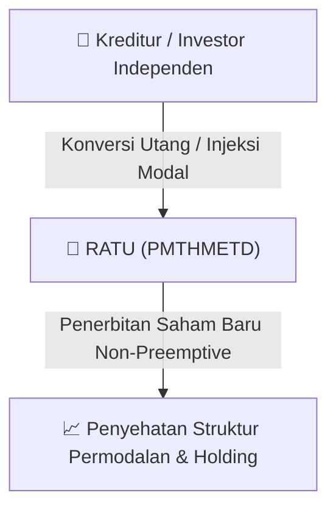

# ⚡ Laporan Intelijen Aksi Korporasi: [[RATU]] - RUPS

⬅️ [[knowledge-base/daily-digests/Daily_Digest_20260910|Kembali ke Daily Digest]] | 📅 **2026-09-10** | 🎛️ [[Dashboard|Ke Dashboard Utama]]

> [!IMPORTANT]
> Laporan ini disusun secara otomatis oleh **Corporate Action Intelligence Agent** untuk memetakan implikasi strategis, rasio keuangan, alokasi dana, jadwal penting, dan panduan investor.

---

## 📌 1. Ringkasan Eksekutif & Katalis Strategis
- **Kode & Nama Emiten**: `[[RATU]]`
- **Kategori Aksi Korporasi**: `RUPS`
- **Dokumen Resmi Bursa**: `Ringkasan RisalahRisalah RUPS`
- **Ringkasan Inti Aksi**: Rapat Umum Pemegang Saham Independen PT Raharja Energi Cepu Tbk (RATU) yang diselenggarakan pada 8 September 2026 menyetujui rencana Penambahan Modal Tanpa Hak Memesan Efek Terlebih Dahulu (PMTHMETD) dengan penerbitan saham baru sebanyak-banyaknya 271.505.380 lembar atau maksimal 10% dari modal ditempatkan dan disetor penuh. Rapat dihadiri kuorum 51% dari total saham, dengan hasil suara setuju 51,866%, tidak setuju 0,004%, dan abstain 0,076%.

---

## 📊 2. Matriks Parameter Material & Angka Kunci
| Parameter Utama | Nilai / Keterangan Resmi |
| :--- | :--- |
| **Jenis Rapat** | `RUPS Independen` |
| **Tanggal Rapat** | `2026-09-08` |
| **Kuorum Kehadiran** | `51%` |
| **Jumlah Saham Hadir** | `346.874.858 saham` |
| **Persentase Suara Setuju** | `51,866%` |
| **Jumlah Suara Tidak Setuju** | `24.500 saham (0,004%)` |
| **Jumlah Suara Abstain** | `510.400 saham (0,076%)` |
| **Agenda RUPS** | `Persetujuan atas rencana Penambahan Modal Tanpa Hak Memesan Efek Terlebih Dahulu (PMTHMETD) sesuai POJK No. 14/2019` |
| **Jumlah Saham Baru Diterbitkan (Maksimal)** | `271.505.380 saham` |
| **Persentase Saham Baru dari Modal Ditempatkan** | `10%` |
| **Hasil Keputusan** | `Setuju` |
| **Penerima Kuasa Pelaksanaan PMTHMETD** | `Dewan Komisaris dan Direksi Perseroan dengan hak substitusi` |

---

## 🏢 3. Detail Rencana PMTHMETD / Private Placement [[RATU]]
- **Jenis Aksi Korporasi**: `Penambahan Modal Tanpa Hak Memesan Efek Terlebih Dahulu (PMTHMETD / Private Placement)`
- **Tujuan Utama**: `Rapat Umum Pemegang Saham Independen PT Raharja Energi Cepu Tbk (RATU) yang diselenggarakan pada 8 September 2026 menyetujui rencana Penambahan Modal Tanpa Hak Memesan Efek Terlebih Dahulu (PMTHMETD) dengan penerbitan saham baru sebanyak-banyaknya 271.505.380 lembar atau maksimal 10% dari modal ditempatkan dan disetor penuh. Rapat dihadiri kuorum 51% dari total saham, dengan hasil suara setuju 51,866%, tidak setuju 0,004%, dan abstain 0,076%.`
- **Mekanisme**: Konversi Utang Menjadi Saham (*Debt-to-Equity Swap*) & Penerbitan Saham Baru kepada Investor Standby / Independen.

## 📈 4. Visualisasi Alur Private Placement (PMTHMETD)

## 💡 5. Panduan Strategi Investor & Analisis Dampak
- 🟢 **Penyehatan Struktur Permodalan**: Konversi utang menjadi saham mengurangi beban bunga (*interest expense*) dan memperbaiki ekuitas [[RATU]].
- ⚠️ **Dampak Dilusi Tanpa HMETD**: Karena dilakukan tanpa HMETD, pemegang saham publik tidak mendapatkan hak membeli saham baru, sehingga terjadi dilusi persentase kepemilikan.

---

## 🔗 Hubungan Note Terkait (Knowledge Graph)
- [[knowledge-base/daily-digests/Daily_Digest_20260910|📄 Daily Digest 2026-09-10]]
- [[knowledge-base/trading-signals/Trading_Signals_20260910|🎯 Sinyal Cuan 2026-09-10]]
- [[Dashboard|🎛️ Kembali ke Dashboard]]