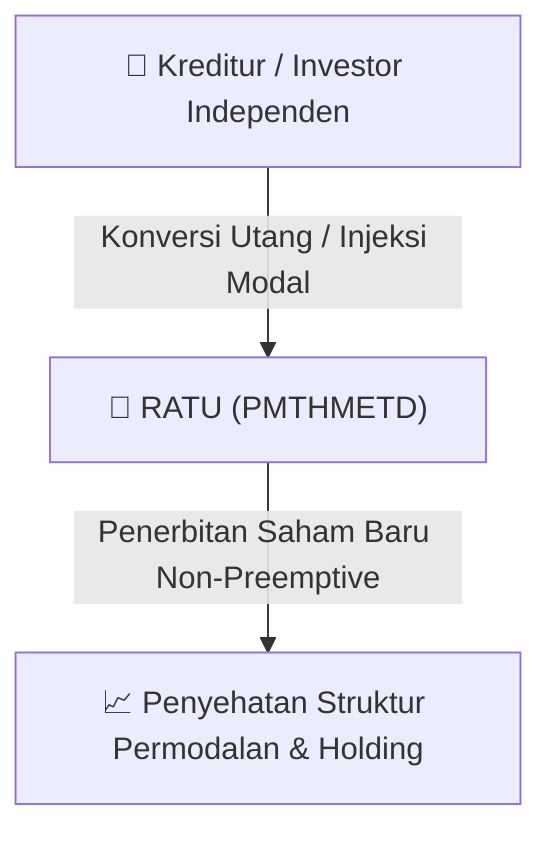

# ⚡ Laporan Intelijen Aksi Korporasi: [[RATU]] - Public Expose

⬅️ [[knowledge-base/daily-digests/Daily_Digest_20260915|Kembali ke Daily Digest]] | 📅 **2026-09-15** | 🎛️ [[Dashboard|Ke Dashboard Utama]]

> [!IMPORTANT]
> Laporan ini disusun secara otomatis oleh **Corporate Action Intelligence Agent** untuk memetakan implikasi strategis, rasio keuangan, alokasi dana, jadwal penting, dan panduan investor.

---

## 📌 1. Ringkasan Eksekutif & Katalis Strategis
- **Kode & Nama Emiten**: `[[RATU]]`
- **Kategori Aksi Korporasi**: `Public Expose`
- **Dokumen Resmi Bursa**: `Public Expose lamp1`
- **Ringkasan Inti Aksi**: Laporan Paparan Publik PT Raharja Energi Cepu Tbk (RATU) yang diselenggarakan secara virtual pada 10 September 2026. Manajemen memaparkan kinerja Semester I 2026, strategi pertumbuhan melalui akuisisi aset produktif, dan rencana penggunaan dana private placement hingga 10% saham untuk modal kerja dan ekspansi. Manajemen menyatakan komitmen untuk terus membagikan dividen, namun besaran rasio dividen akan ditentukan pada akhir tahun buku. Terkait akuisisi, manajemen menargetkan realisasi closing pada tahun 2027 secara konservatif.

---

## 📊 2. Matriks Parameter Material & Angka Kunci
| Parameter Utama | Nilai / Keterangan Resmi |
| :--- | :--- |
| **Waktu Penyelenggaraan** | `Kamis, 10 September 2026, Pukul 14.00-14.51 WIB` |
| **Jumlah Pendaftar Peserta** | `111 peserta` |
| **Rencana Private Placement** | `Hingga 10% saham` |
| **Penggunaan Dana Private Placement** | `Modal kerja (working capital) dan akuisisi aset produktif` |
| **Target Akuisisi** | `Aset yang sudah berproduksi (producing) dalam 2-3 tahun ke depan` |
| **Target Closing Akuisisi** | `Tahun 2027 (secara konservatif)` |
| **Kebijakan Dividen** | `Komitmen membayar dividen, rasio ditentukan akhir tahun buku` |
| **Direktur Utama** | `Sumantri Suwarno` |
| **Direktur** | `Alexandra Sinta Wahjudewanti dan Adrian Hartadi` |

---

## 🏢 3. Detail Rencana PMTHMETD / Private Placement [[RATU]]
- **Jenis Aksi Korporasi**: `Penambahan Modal Tanpa Hak Memesan Efek Terlebih Dahulu (PMTHMETD / Private Placement)`
- **Tujuan Utama**: `Laporan Paparan Publik PT Raharja Energi Cepu Tbk (RATU) yang diselenggarakan secara virtual pada 10 September 2026. Manajemen memaparkan kinerja Semester I 2026, strategi pertumbuhan melalui akuisisi aset produktif, dan rencana penggunaan dana private placement hingga 10% saham untuk modal kerja dan ekspansi. Manajemen menyatakan komitmen untuk terus membagikan dividen, namun besaran rasio dividen akan ditentukan pada akhir tahun buku. Terkait akuisisi, manajemen menargetkan realisasi closing pada tahun 2027 secara konservatif.`
- **Mekanisme**: Konversi Utang Menjadi Saham (*Debt-to-Equity Swap*) & Penerbitan Saham Baru kepada Investor Standby / Independen.

## 📈 4. Visualisasi Alur Private Placement (PMTHMETD)

## 💡 5. Panduan Strategi Investor & Analisis Dampak
- 🟢 **Penyehatan Struktur Permodalan**: Konversi utang menjadi saham mengurangi beban bunga (*interest expense*) dan memperbaiki ekuitas [[RATU]].
- ⚠️ **Dampak Dilusi Tanpa HMETD**: Karena dilakukan tanpa HMETD, pemegang saham publik tidak mendapatkan hak membeli saham baru, sehingga terjadi dilusi persentase kepemilikan.

---

## 🔗 Hubungan Note Terkait (Knowledge Graph)
- [[knowledge-base/daily-digests/Daily_Digest_20260915|📄 Daily Digest 2026-09-15]]
- [[knowledge-base/trading-signals/Trading_Signals_20260915|🎯 Sinyal Cuan 2026-09-15]]
- [[Dashboard|🎛️ Kembali ke Dashboard]]