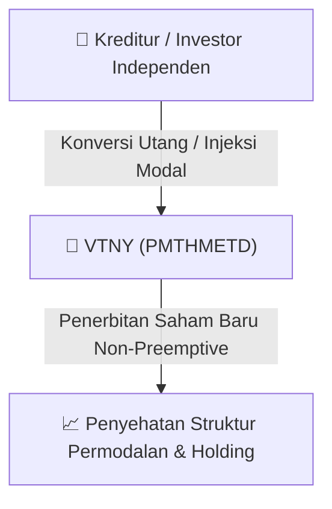

# ⚡ Laporan Intelijen Aksi Korporasi: [[VTNY]] - Public Expose

⬅️ [[knowledge-base/daily-digests/Daily_Digest_20260916|Kembali ke Daily Digest]] | 📅 **2026-09-16** | 🎛️ [[Dashboard|Ke Dashboard Utama]]

> [!IMPORTANT]
> Laporan ini disusun secara otomatis oleh **Corporate Action Intelligence Agent** untuk memetakan implikasi strategis, rasio keuangan, alokasi dana, jadwal penting, dan panduan investor.

---

## 📌 1. Ringkasan Eksekutif & Katalis Strategis
- **Kode & Nama Emiten**: `[[VTNY]]`
- **Kategori Aksi Korporasi**: `Public Expose`
- **Dokumen Resmi Bursa**: `Public Expose lamp2`
- **Ringkasan Inti Aksi**: Laporan hasil Public Expose PT Venteny Fortuna International Tbk (VTNY) yang membahas strategi pertumbuhan perusahaan, kinerja keuangan semester I 2026, target pertumbuhan kuartal III 2026, serta rencana aksi korporasi dan dividen. Perusahaan menargetkan pertumbuhan laba 5-8% untuk kuartal III 2026, mencatatkan pendapatan bersih Rp105,8 miliar di semester I 2026 (tumbuh 1,77% YoY), dan belum memiliki rencana aksi korporasi ekuitas maupun pembagian dividen dalam waktu dekat.

---

## 📊 2. Matriks Parameter Material & Angka Kunci
| Parameter Utama | Nilai / Keterangan Resmi |
| :--- | :--- |
| **Jumlah Peserta Public Expose** | `42 peserta` |
| **Jumlah Peserta Press Conference** | `58 peserta` |
| **Target Pertumbuhan Laba Kuartal III 2026** | `5-8%` |
| **Pendapatan Bersih Semester I 2026** | `Rp105,8 miliar` |
| **Pendapatan Bersih Semester I 2025 (Periode Sebelumnya)** | `Rp104,0 miliar` |
| **Pertumbuhan Pendapatan YoY Semester I 2026** | `1,77%` |
| **Pendapatan B2B Financial Services Semester I 2026** | `Rp60,9 miliar` |
| **Pertumbuhan Pendapatan B2B Financial Services YoY** | `8,12%` |
| **Rencana Aksi Korporasi Ekuitas (Rights Issue, Private Placement, Buyback)** | `Belum ada rencana` |
| **Rencana Pembagian Dividen** | `Belum ada rencana dalam waktu dekat` |
| **Produk Baru yang Diluncurkan** | `Payroll Advance Service` |
| **Strategi Pengembangan Bisnis** | `Payroll service, ekspansi B2B, penguatan partnership strategis, adopsi AI` |

---

## 🏢 3. Detail Rencana PMTHMETD / Private Placement [[VTNY]]
- **Jenis Aksi Korporasi**: `Penambahan Modal Tanpa Hak Memesan Efek Terlebih Dahulu (PMTHMETD / Private Placement)`
- **Tujuan Utama**: `Laporan hasil Public Expose PT Venteny Fortuna International Tbk (VTNY) yang membahas strategi pertumbuhan perusahaan, kinerja keuangan semester I 2026, target pertumbuhan kuartal III 2026, serta rencana aksi korporasi dan dividen. Perusahaan menargetkan pertumbuhan laba 5-8% untuk kuartal III 2026, mencatatkan pendapatan bersih Rp105,8 miliar di semester I 2026 (tumbuh 1,77% YoY), dan belum memiliki rencana aksi korporasi ekuitas maupun pembagian dividen dalam waktu dekat.`
- **Mekanisme**: Konversi Utang Menjadi Saham (*Debt-to-Equity Swap*) & Penerbitan Saham Baru kepada Investor Standby / Independen.

## 📈 4. Visualisasi Alur Private Placement (PMTHMETD)

## 💡 5. Panduan Strategi Investor & Analisis Dampak
- 🟢 **Penyehatan Struktur Permodalan**: Konversi utang menjadi saham mengurangi beban bunga (*interest expense*) dan memperbaiki ekuitas [[VTNY]].
- ⚠️ **Dampak Dilusi Tanpa HMETD**: Karena dilakukan tanpa HMETD, pemegang saham publik tidak mendapatkan hak membeli saham baru, sehingga terjadi dilusi persentase kepemilikan.

---

## 🔗 Hubungan Note Terkait (Knowledge Graph)
- [[knowledge-base/daily-digests/Daily_Digest_20260916|📄 Daily Digest 2026-09-16]]
- [[knowledge-base/trading-signals/Trading_Signals_20260916|🎯 Sinyal Cuan 2026-09-16]]
- [[Dashboard|🎛️ Kembali ke Dashboard]]