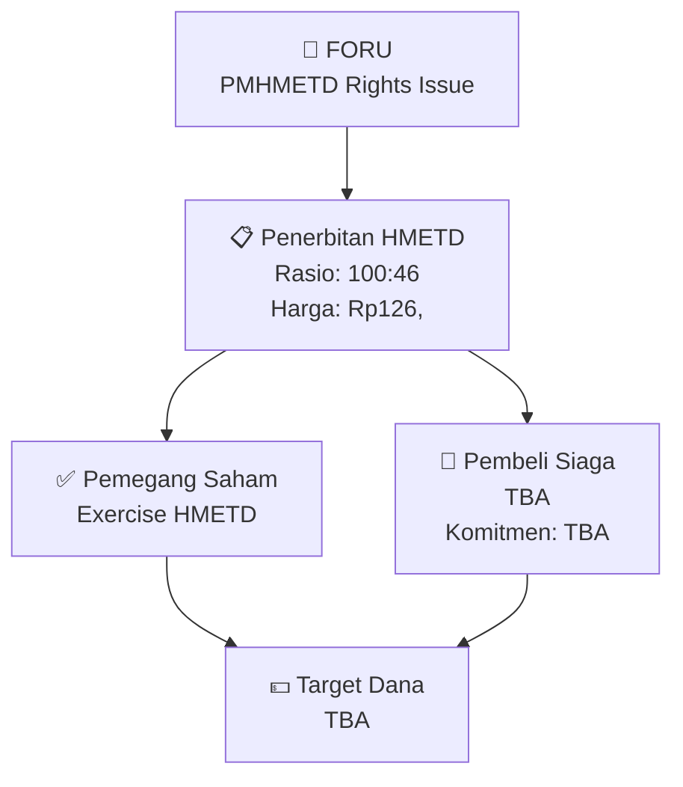

# 📋 Rencana Rights Issue / PMHMETD — [[FORU]]

⬅️ [[knowledge-base/daily-digests/Daily_Digest_20260923|Kembali ke Daily Digest]] | 📅 **2026-09-23** | 🎛️ [[Dashboard|Ke Dashboard Utama]]

> [!IMPORTANT]
> Laporan ini disusun secara otomatis oleh **Corporate Action Intelligence Agent** pada **2026-09-23**.
> Sumber dokumen: `20260921_FORU_Peng-Harga Teoretis FORU 260921-No. Peng-00174BEI.POP09-2026.pdf`

---

## 📌 1. Ringkasan Eksekutif & Tujuan Strategis

- **Kode & Nama Emiten**: `[[FORU]]`
- **Kategori Aksi Korporasi**: `Rights_Issue`
- **Dokumen Sumber**: `20260921_FORU_Peng-Harga Teoretis FORU 260921-No. Peng-00174BEI.POP09-2026.pdf`
- **Tanggal Laporan**: `2026-09-23`

[Analisis LLM tidak tersedia — isi manual]

---

## 📊 2. Fakta Material & Parameter Keuangan

| Parameter Utama | Nilai / Keterangan |
| :--- | :--- |
| **Jenis Aksi** | `PMHMETD / Rights Issue` |
| **Jumlah Saham Baru** | `46.235` |
| **Rasio HMETD** | `100:46` |
| **Harga Pelaksanaan** | `Rp126,` |
| **Target Dana** | `TBA` |
| **Pembeli Siaga** | `TBA` |
| **Komitmen Pembeli Siaga** | `TBA` |
| **Dilusi Maksimum** | `TBA` |
| **Pengendali Utama** | `TBA` |

---

## 👥 3. Struktur Kepemilikan, Pengendali & Pembeli Siaga

- **Pemegang Saham Pengendali**: `TBA`
- **Pembeli Siaga (Standby Buyer)**: `TBA`
- **Komitmen Pembeli Siaga**: `TBA`
- **Dilusi Maksimum** (jika tidak exercise HMETD): `TBA`

---

## 🎯 4. Alokasi & Rencana Penggunaan Dana

- Informasi alokasi dana belum tersedia — lihat prospektus / dokumen resmi.

---

## 📅 5. Timeline & Jadwal Pelaksanaan

| Tahapan / Event | Tanggal |
| :--- | :---: |
| **Harga Pelaksanaan HMETD** | `Rp126,` |
| **Periode Pelaksanaan HMETD** | `Terjadwal — lihat prospektus` |

---

## 📈 6. Diagram Visual Flowchart (Mermaid)

---

## 💡 7. Rekomendasi Investor & Strategi Trading

[Analisis LLM tidak tersedia — isi manual]

---

## 🔗 8. Hubungan Note Terkait (Knowledge Graph)

- [[knowledge-base/daily-digests/Daily_Digest_20260923|📄 Daily Digest 2026-09-23]]
- [[knowledge-base/trading-signals/Trading_Signals_20260923|🎯 Sinyal Cuan 2026-09-23]]
- [[FORU|🏬 Halaman Emiten FORU]]
- [[Dashboard|🎛️ Kembali ke Dashboard Utama]]

---

*Laporan dibuat otomatis oleh Corporate Action Intelligence Agent · 2026-09-23*