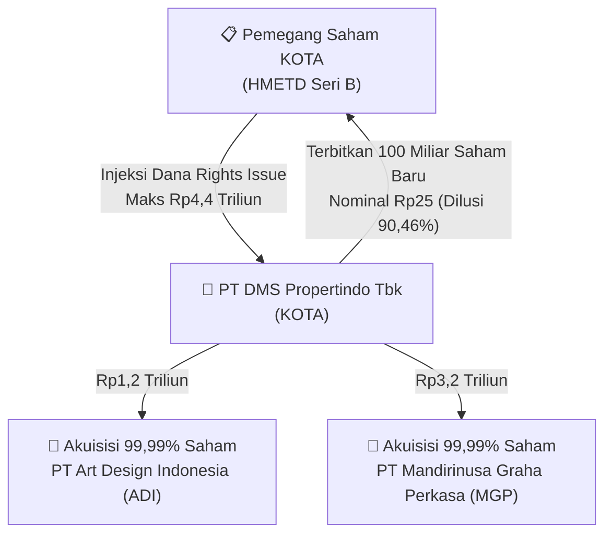

# ⚡ Laporan Intelijen Aksi Korporasi: [[KOTA]] — PMHMETD I & Akuisisi Material

⬅️ [[knowledge-base/daily-digests/Daily_Digest_20260828|Kembali ke Daily Digest]] | 📅 **2026-08-28** | 🎛️ [[Dashboard|Ke Dashboard Utama]]

> [!IMPORTANT]
> Laporan ini memetakan implikasi strategis, rasio keuangan, alokasi dana, dan jadwal penting rencana **Penambahan Modal dengan Memberikan HMETD I (PMHMETD I / Rights Issue)** serta **Transaksi Material Pengambilalihan Saham** PT DMS Propertindo Tbk.

---

## 📌 1. Ringkasan Eksekutif & Katalis Strategis
- **Kode & Nama Emiten**: `[[KOTA]]` — PT DMS Propertindo Tbk
- **Kategori Aksi Korporasi**: `PMHMETD I, Transaksi Material Akuisisi, dan Perubahan Penggunaan Dana IPO`
- **Dokumen Resmi Bursa**: `Laporan Informasi dan Fakta Material (Lampiran 1 No. Peng-32133484)`
- **Ringkasan Inti Aksi**: PT DMS Propertindo Tbk berencana melakukan PMHMETD I sebanyak-banyaknya **100.000.000.000 (100 miliar) saham baru seri B** atau **90,46%** dari modal ditempatkan dan disetor penuh setelah PMHMETD I, dengan nilai nominal **Rp 25 per saham**. Dana hasil PMHMETD I sebesar **Rp 4,4 Triliun** akan digunakan untuk mengakuisisi 99,99% saham **PT Art Design Indonesia (ADI)** senilai **Rp 1,2 Triliun** dan **PT Mandirinusa Graha Perkasa (MGP)** senilai **Rp 3,2 Triliun** dari PT Michel Energi, serta sisa dana untuk kebutuhan operasional Perseroan.

---

## 📊 2. Matriks Parameter Material & Angka Kunci

| Parameter Utama | Nilai / Keterangan Resmi |
| :--- | :--- |
| **Nama Perseroan** | `PT DMS Propertindo Tbk` |
| **Tanggal Keterbukaan Informasi** | `28 Agustus 2026` |
| **Jenis Aksi Korporasi** | `PMHMETD I, Transaksi Material Akuisisi, & Perubahan Penggunaan Dana IPO` |
| **Jumlah Saham Baru Maksimal PMHMETD I** | `100.000.000.000 lembar saham seri B` |
| **Persentase Dilusi Saham Baru** | `90,46% dari modal ditempatkan dan disetor penuh pasca aksi` |
| **Nilai Nominal Saham Baru** | `Rp 25 per lembar saham` |
| **Perubahan Pengendali** | `Tidak terjadi perubahan pengendali` |
| **Batas Waktu Pelaksanaan PMHMETD I** | `Paling lambat 12 bulan sejak tanggal RUPSLB yang menyetujui rencana PMHMETD I` |
| **Total Target Dana PMHMETD I** | `Rp 4.400.000.000.000 (Rp 4,4 Triliun)` |
| **Target Akuisisi 1** | `PT Art Design Indonesia (ADI)` |
| **Penjual Saham ADI** | `PT Michel Energi` |
| **Jumlah Saham ADI yang Dibeli** | `1.206.272 lembar saham atau 99,99%` |
| **Nilai Transaksi ADI** | `Rp 1.200.000.000.000 (Rp 1,2 Triliun)` |
| **Target Akuisisi 2** | `PT Mandirinusa Graha Perkasa (MGP)` |
| **Penjual Saham MGP** | `PT Michel Energi` |
| **Jumlah Saham MGP yang Dibeli** | `6.413.296 lembar saham atau 99,99%` |
| **Nilai Transaksi MGP** | `Rp 3.200.000.000.000 (Rp 3,2 Triliun)` |

---

## 👥 3. Komposisi Pengendali & Pembeli Siaga (Standby Buyers)
- **Pengendali Utama**: Tidak mengalami perubahan pengendalian.
- **Komitmen Pembeli Siaga (Standby Buyers)**: Dalam proses finalisasi prospektus resmi.
- **Nilai Nominal / Batas Harga Pelaksanaan**: Nilai nominal Rp 25 per saham seri B (harga pelaksanaan final akan ditentukan dalam prospektus HMETD).
- **Rasio HMETD**: Akan diumumkan setelah penetapan rasio definitif pada pernyataan pendaftaran efektif OJK.

---

## 🎯 4. Rencana Penggunaan Dana Hasil Rights Issue & Tujuan Strategis
- 📌 **Tujuan Inti**: Melakukan ekspansi portofolio properti melalui akuisisi strategis dua entitas pengembang properti komersial & residensial.
- 💵 **Rincian Alokasi Dana Hasil Rights Issue (Rp 4,4 Triliun)**:
  - 1️⃣ **Rp 1,20 Triliun (27,27%)**: Pembelian 99,99% saham PT Art Design Indonesia (ADI) dari PT Michel Energi.
  - 2️⃣ **Rp 3,20 Triliun (72,73%)**: Pembelian 99,99% saham PT Mandirinusa Graha Perkasa (MGP) dari PT Michel Energi.
  - 3️⃣ **Sisa Dana Bersih**: Modal kerja dan operasional perseroan.
- 📅 **Batas Waktu Pelaksanaan**: Paling lambat 12 bulan sejak persetujuan RUPSLB.

---

## 📈 5. Visualisasi Alur Rights Issue & Akuisisi

---

## 💡 6. Panduan Strategi Investor & Analisis Dilusi
- ⚠️ **Risiko Dilusi Signifikan (90,46%)**: Penerbitan 100 miliar saham baru seri B terhadap modal lama akan menimbulkan efek dilusi masif hingga **90,46%** bagi pemegang saham yang tidak mengeksekusi haknya.
- 🔍 **Kualitas Aset Akuisisi**: Nilai valuasi gabungan ADI dan MGP (Rp 4,4T) akan melipatgandakan total aset KOTA secara drastis, mentransformasikan skala bisnis KOTA menjadi entitas properti beraset besar.
- 🎯 **Rekomendasi**: Investor wajib memantau harga pelaksanaan definitif dan appraisal independen atas aset tanah/properti ADI & MGP sebelum memutuskan menebus HMETD.

---

## 🔗 Hubungan Note Terkait (Knowledge Graph)
- [[knowledge-base/daily-digests/Daily_Digest_20260828|📄 Daily Digest 2026-08-28]]
- [[knowledge-base/trading-signals/Trading_Signals_20260828|🎯 Sinyal Cuan 2026-08-28]]
- [[Dashboard|🎛️ Kembali ke Dashboard]]