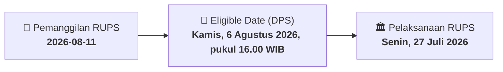

# ⚡ Laporan Intelijen Aksi Korporasi: [[ASMI]] - RUPS

⬅️ [[knowledge-base/daily-digests/Daily_Digest_20260811|Kembali ke Daily Digest]] | 📅 **2026-08-11** | 🎛️ [[Dashboard|Ke Dashboard Utama]]

> [!IMPORTANT]
> Laporan ini disusun secara otomatis oleh **Corporate Action Intelligence Agent** untuk memetakan implikasi strategis, rasio keuangan, alokasi dana, jadwal penting, dan panduan investor.

---

## 📌 1. Ringkasan Eksekutif & Katalis Strategis
- **Kode & Nama Emiten**: `[[ASMI]]`
- **Kategori Aksi Korporasi**: `RUPS`
- **Dokumen Resmi Bursa**: `Pemanggilan RUPS lamp1`
- **Ringkasan Inti Aksi**: Pemanggilan Rapat Umum Pemegang Saham Luar Biasa (RUPSLB) Kedua oleh PT Asuransi Maximus Graha Persada Tbk (ASMI) yang akan diselenggarakan secara elektronik (e-RUPS) pada Jumat, 14 Agustus 2026. Rapat ini merupakan kelanjutan dari RUPSLB Pertama yang gagal mencapai kuorum pada 27 Juli 2026. Agenda utama rapat adalah persetujuan atas rencana Pembelian Kembali Saham (buyback) sesuai dengan Peraturan OJK No. 29 Tahun 2023.

---

## 📊 2. Matriks Parameter Material & Angka Kunci
| Parameter Utama | Nilai / Keterangan Resmi |
| :--- | :--- |
| **Jenis Rapat** | `Rapat Umum Pemegang Saham Luar Biasa (RUPSLB) Kedua` |
| **Tanggal Pelaksanaan Rapat** | `Jumat, 14 Agustus 2026` |
| **Waktu Pelaksanaan** | `14.00 WIB - selesai` |
| **Tempat Pelaksanaan** | `18 Parc Place (secara elektronik / e-RUPS)` |
| **Mata Acara Rapat** | `Persetujuan atas Rencana Pembelian Kembali Saham Perseroan sesuai dengan Peraturan OJK No. 29 Tahun 2023` |
| **Dasar Hukum Pemanggilan** | `Peraturan OJK No. 15/POJK.04/2020` |
| **Tanggal RUPSLB Pertama (Tidak Mencapai Kuorum)** | `Senin, 27 Juli 2026` |
| **Recording Date (Daftar Pemegang Saham yang Berhak Hadir)** | `Kamis, 6 Agustus 2026, pukul 16.00 WIB` |
| **Biro Administrasi Efek** | `PT Adimitra Jasa Korpora` |

---

## 📌 3. Detail Pelaksanaan RUPS / RUPSLB
- **Hari, Tanggal Pelaksanaan**: `Senin, 27 Juli 2026`
- **Waktu Pelaksanaan**: `14.00 WIB - selesai`
- **Lokasi / Tempat Pelaksanaan**: `18 Parc Place (secara elektronik / e-RUPS)`
- **Batas Hak Suara (Eligible Date / Recording Date)**: `Kamis, 6 Agustus 2026, pukul 16.00 WIB`

## 📝 4. Matriks Agenda & Mata Acara Rapat
| No | Agenda / Mata Acara | Penjelasan & Sub-Acara |
| :-: | :--- | :--- |
| 1 | **Mata Acara Rapat** | Persetujuan atas Rencana Pembelian Kembali Saham Perseroan sesuai dengan Peraturan OJK No. 29 Tahun 2023 |

## 🗓️ 5. Timeline Investor & Ketentuan Kehadiran

## 💡 6. Panduan Investor & E-Voting
- 👥 **Hak Suara**: Pemegang saham yang berhak hadir/memberikan suara adalah yang terdaftar dalam DPS pada **Eligible Date (Kamis, 6 Agustus 2026, pukul 16.00 WIB)**.
- 🗳️ **E-Voting eASY.KSEI**: Pemegang saham dapat memberikan kuasa/suara secara elektronik melalui sistem eASY.KSEI.

---

## 🔗 Hubungan Note Terkait (Knowledge Graph)
- [[knowledge-base/daily-digests/Daily_Digest_20260811|📄 Daily Digest 2026-08-11]]
- [[knowledge-base/trading-signals/Trading_Signals_20260811|🎯 Sinyal Cuan 2026-08-11]]
- [[Dashboard|🎛️ Kembali ke Dashboard]]